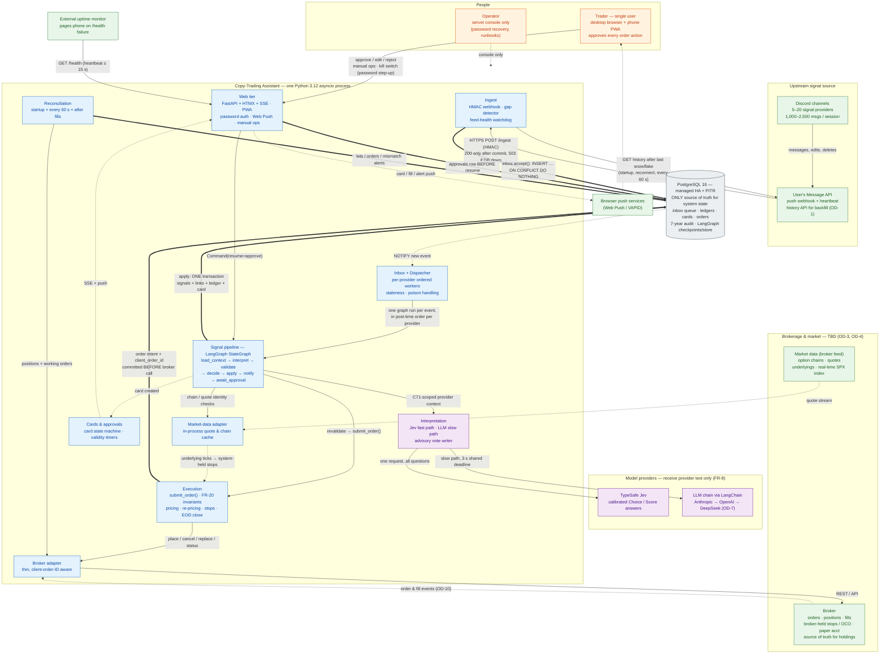
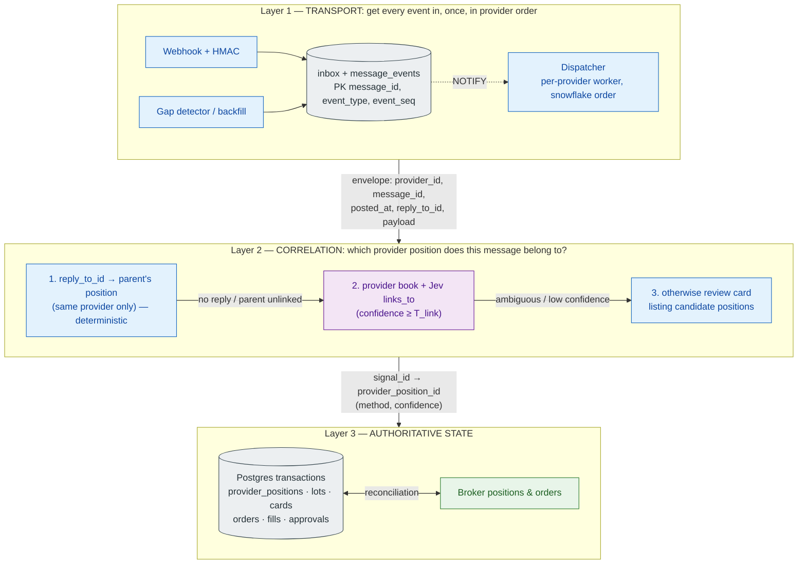

# 1. High-Level System Architecture

[← Index](README.md) · Next: [Component architecture →](02-component-architecture.md)

## 1.1 System context and containers

### What the diagram represents

The whole system at container level: one Python asyncio service, one managed PostgreSQL cluster, and the external systems it depends on. The service is a **deterministic pipeline with narrow model roles** (PRD §4), not an autonomous agent.

### Component responsibilities

| Component                              | Responsibility                                                                                                                                                                                                      | Why it exists                                                                                 |
| -------------------------------------- | ------------------------------------------------------------------------------------------------------------------------------------------------------------------------------------------------------------------- | --------------------------------------------------------------------------------------------- |
| **Message API** (external, user-owned) | Only source of Discord content (C11). Pushes events; must redeliver or offer backfill (C91).                                                                                                                        | The system never talks to Discord directly (PRD §2 non-goals).                                |
| **Ingest**                             | Verifies HMAC, durably stores each event exactly once, detects gaps and backfills, watches feed health (FR-1, FR-1d, FR-4).                                                                                         | A signal must never be lost (G5).                                                             |
| **Inbox + Dispatcher**                 | Postgres-backed queue; one worker per provider processes that provider's events one at a time in post-time order; providers run in parallel (FR-1a).                                                                | Follow-ups must be processed against a provider book that already contains the entry (AC-18). |
| **Signal pipeline**                    | LangGraph graph, one thread per message event. Builds provider-scoped context, interprets, validates, decides, and commits results in one transaction; pauses for human approval without holding the provider slot. | Orchestration + durable human-in-the-loop pause (TRD §5.1).                                   |
| **Interpretation**                     | Jev answers semantic questions over code-found candidates; an LLM handles hard cases and writes the advisory note. Never decides trade/size/price.                                                                  | Informal, typo-ridden messages need language understanding (PRD §1).                          |
| **Cards & approvals**                  | Card state machine, validity rules (C22), expiry timers, supersession, notifications.                                                                                                                               | Every order action needs approval (C6/C14).                                                   |
| **Execution**                          | The single `submit_order()` gate: FR-20 invariants, order intent, broker call, re-pricing, system-held stops, stop restore, end-of-day close.                                                                       | "Every order goes through one function" (TRD §1.5).                                           |
| **Reconciliation**                     | Compares system lots/orders with the broker; any mismatch blocks new entries.                                                                                                                                       | Broker is the source of truth for holdings (PRD §11).                                         |
| **Web tier**                           | Dashboard, SSE, Web Push, password auth, manual operations, labeling screen.                                                                                                                                        | Approvals within seconds on desktop and phone (G3).                                           |
| **PostgreSQL**                         | Only source of truth for system state, the message queue, audit trail and LangGraph checkpoints. No Kafka, no Redis (C94).                                                                                          | Single transactional boundary; RPO ≈ 0 for trading data (C93).                                |

### Consistency and reliability considerations

- **Two sources of truth, clearly partitioned:** Postgres is authoritative for everything the system decided (messages, signals, ledgers, cards, approvals, order intents). The **broker** is authoritative for what is actually held and working. Reconciliation is the bridge.
- **Durable-before-acknowledge:** the webhook returns `200` only after commit; the order intent is committed before the broker call; the approval row is written before the graph resumes.
- **Models never touch the broker, the ledgers, or user holdings.** They receive provider text and the provider's own book only (FR-8, C71).

### Potential failure points

Message API silence or non-redelivery (OD-1) · Postgres unavailability (trading halts by design) · all LLM vendors down (raw review card) · broker timeouts (query by client order ID) · market-data loss (system-held stops blind, OD-12) · the single app VM (RTO ≤ 5 min target; system-held stops do not fire while it is down). See [09](09-failure-recovery.md).

---

## 1.2 Layered view: transport, correlation, state

TRD §1.7 separates three concerns that are often conflated. This view makes it explicit that **no queue or cache resolves signal context**.

**Why this matters:** `signal_id` and `provider_position_id` are _outputs_ of interpretation (TRD §8.1). Transport can only partition by `provider_id`, which is known on arrival. That is why a Kafka topic keyed by signal or a Redis context cache cannot replace Layer 2, and why TRD §15 rejects both at this scale.
