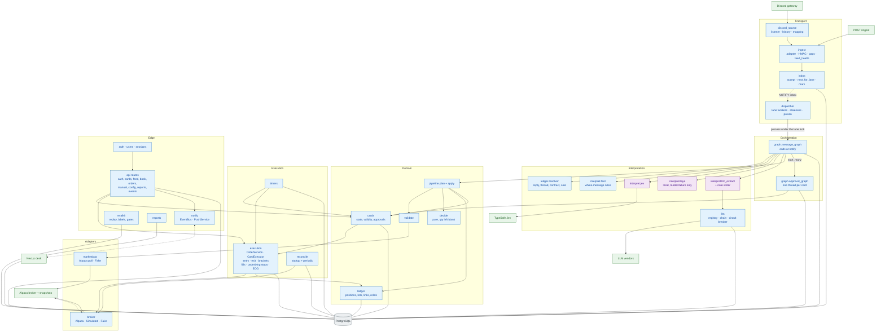
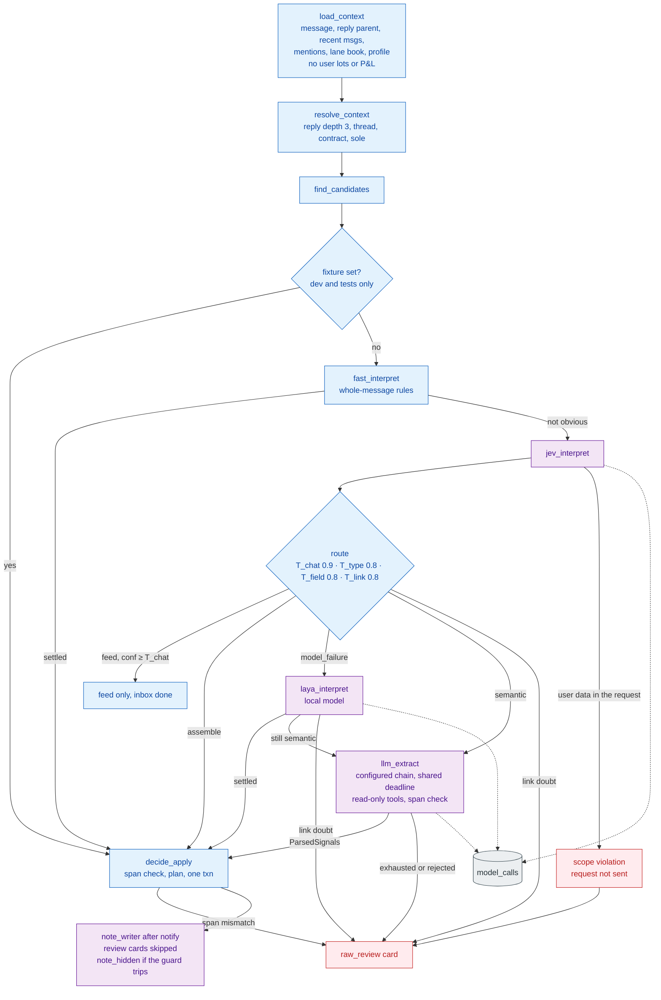
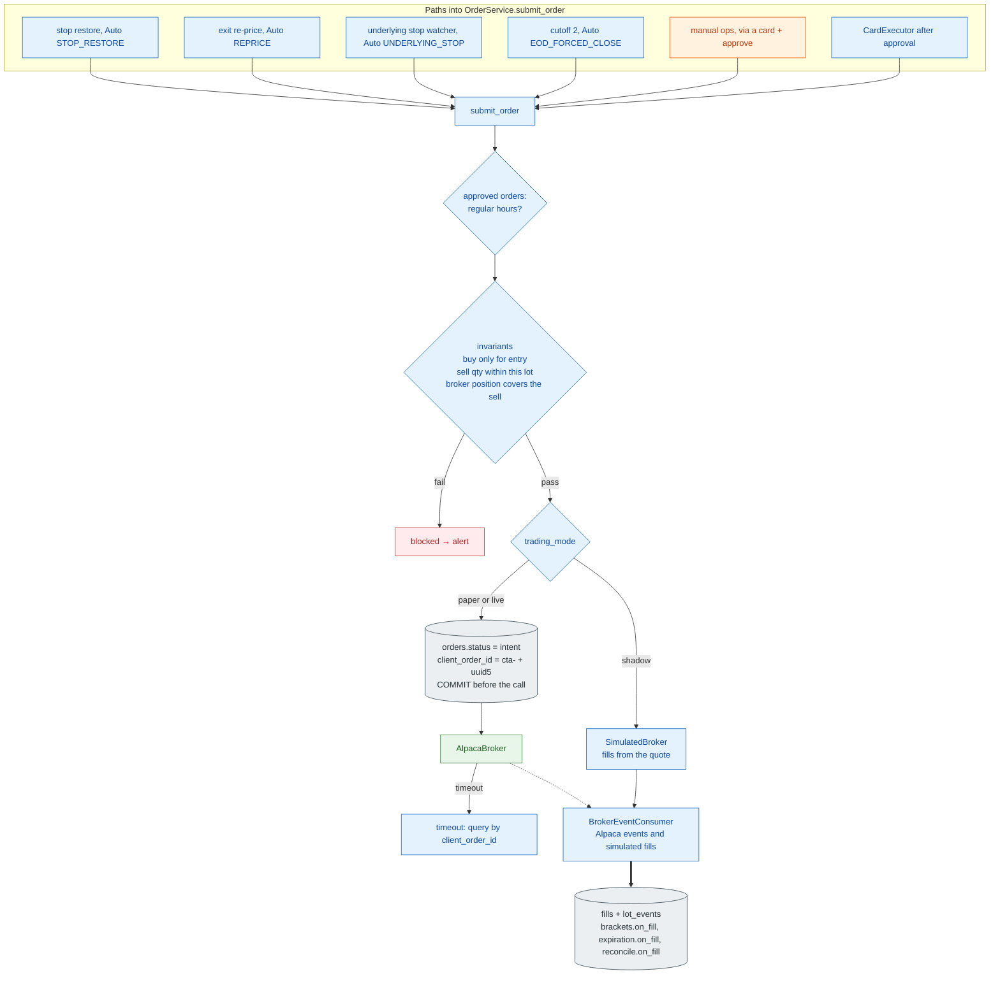

# 2. Detailed Component Architecture

[← High-level](01-high-level-architecture.md) · [Index](README.md) · Next: [End-to-end data flow →](03-end-to-end-data-flow.md)

The backend is one Python asyncio process. Module boundaries are packages, not network boundaries. The desk is a separate Next.js process.

## 2.1 Module map

### Call rules

| Module | Called by | Rule |
|---|---|---|
| `discord_source` | lifespan | Watched channels only (`RuntimeConfig.channels`). Bot authors are dropped. |
| `ingest` | listener, `POST /ingest`, gap loop | Writes only through `inbox.accept()`. |
| `inbox` | ingest, dispatcher | Lane key is `(channel_id, provider_id)`. `NOTIFY` payload is `channel_id:provider_id`. |
| `dispatcher` | `NOTIFY inbox` | Holds the lane `asyncio.Lock` for the whole `GraphProcessor.process()`, then releases it. Approval waits live on other threads. |
| `graph.message_graph` | dispatcher, relink recheck, evalkit replay | Side effects are `decide_apply`, `raw_review`, and `notify`. Recheck and replay stop after interpretation. |
| `graph.approval_graph` | `ApprovalService.start` / `resume` | `await_approval` interrupts. Approve continues to `revalidate` then `execute`. |
| `interpret.fast` | message graph | Edits and deletes skip it. A follow-up rule requires exactly one resolved position. |
| `ledger.resolver` | `resolve_context`, before any model | A unique code result is final. A model may rank ambiguous candidates and cannot resolve them. |
| `interpret.laya` | message graph | Only after a Jev model failure (off, timeout, API error, invalid answer). |
| `interpret.llm_extract` | message graph | Semantic doubts, and Laya misses when the chain is configured. Scope guard, schema check, literal-span check. |
| `pipeline.plan` | `decide_apply` | I/O lives here: quotes, validation, `decide()`. |
| `pipeline.apply` | `decide_apply` | One transaction: lock the lane book, signals, links, ledger, cards, timers, inbox status. |
| `decide` | planner | Pure. Never sets `qty` except a full close, which sells the lot. |
| `execution` | `CardExecutor`, timers, manual, underlying-stop watcher | The only module that places orders. |
| `timers` | lifespan loop | `card_expiry`, `entry_cancel`, `cutoff_1`, `cutoff_2`, `offhours_release`. |
| `reconcile` | startup, periodic loop, post-fill | Paper and live only. A dirty report sets `entries_blocked`. |
| `api` + Next.js | browser | Manual orders become cards and go through the same approval and `submit_order` path. |

### Resume and races

The message graph finishes. The approval graph accepts one resume. The card state machine allows one transition out of `pending` into a terminal or `approved` state, so a late approve after expiry is rejected. `notify` starts a thread for each new pending card and resumes threads for cards just invalidated.

---

## 2.2 Data ownership

```mermaid
flowchart LR
    classDef code fill:#e3f2fd,stroke:#1565c0,color:#0d47a1
    classDef audit fill:#fffde7,stroke:#f9a825,color:#5d4037
    classDef state fill:#eceff1,stroke:#37474f,color:#263238
    classDef lg fill:#f3e5f5,stroke:#6a1b9a,color:#4a148c

    subgraph MODS["Writers"]
        inbox["inbox"]:::code
        dispatcher["dispatcher"]:::code
        interp["jev / laya / llm"]:::code
        apply["pipeline.apply"]:::code
        cards["cards"]:::code
        api["api + auth + manual"]:::code
        execm["execution"]:::code
        timers["timers"]:::code
        reconcile["reconcile"]:::code
        ingest["ingest + discord"]:::code
        flags["system.flags"]:::code
        evalkit["evalkit"]:::code
        graphm["langgraph runtime"]:::code
    end

    subgraph AUDIT["Append-only"]
        me[("message_events")]:::audit
        stg[("stage_timings")]:::audit
        mc[("model_calls")]:::audit
        sig[("signals")]:::audit
        ml[("message_links")]:::audit
        ppe[("provider_position_events")]:::audit
        lote[("lot_events")]:::audit
        ste[("stop_events")]:::audit
        ce[("card_events")]:::audit
        ap[("approvals")]:::audit
        oe[("order_events")]:::audit
        fi[("fills")]:::audit
        al[("alerts")]:::audit
        ack[("alert_acks")]:::audit
        cc[("config_changes")]:::audit
        mcor[("manual_corrections")]:::audit
        aud[("audit_log")]:::audit
        sfe[("system_flag_events")]:::audit
        ev[("eval_labels / eval_runs")]:::audit
    end

    subgraph STATE["Current state"]
        ib[("inbox")]:::state
        pp[("provider_positions")]:::state
        lots[("lots")]:::state
        cardt[("cards")]:::state
        ord[("orders")]:::state
        st[("stops")]:::state
        tm[("timers")]:::state
        cfg[("config")]:::state
        hb[("dispatcher_heartbeat")]:::state
        fl[("system_flags")]:::state
        users[("users / auth_sessions")]:::state
        push[("push_subscriptions")]:::state
    end

    subgraph LGT["schema langgraph"]
        ckpt[("checkpoints")]:::lg
        store[("store: provider profiles")]:::lg
    end

    inbox ==> me
    inbox ==> ib
    dispatcher ==> ib
    dispatcher ==> hb
    apply ==> sig
    apply ==> ml
    apply ==> pp
    apply ==> ppe
    apply ==> cardt
    apply ==> ce
    apply ==> tm
    apply ==> stg
    interp ==> mc
    cards ==> cardt
    cards ==> ce
    cards ==> ap
    api ==> aud
    api ==> users
    api ==> cc
    api ==> mcor
    api ==> ack
    api ==> push
    api ==> store
    execm ==> ord
    execm ==> oe
    execm ==> fi
    execm ==> lots
    execm ==> lote
    execm ==> st
    execm ==> ste
    timers ==> tm
    reconcile ==> ord
    reconcile ==> lots
    reconcile ==> al
    ingest ==> al
    flags ==> fl
    flags ==> sfe
    evalkit ==> ev
    graphm ==> ckpt
```

Ownership rules:

- **Append-only tables** gain new rows. A re-link is a new `message_links` row (`supersedes_link_id` points at the previous one). The current link is the latest row for that signal.
- **Provider book writers:** `apply` (from messages) and manual corrections. Both take `lock_open_book` for the lane. `apply` aborts with `BookChanged` if the book moved during planning.
- **Lot writers:** fill application and reconcile. Fills lock the lot row and do not take the lane slot.
- **Provider profiles** in the LangGraph store (`lexicon`, `habits`, `aliases`) are written only by manual corrections. Models only read them.
- **`audit_log`** is granted `INSERT` to the runtime role. It replaced the old `logins` table.

---

## 2.3 Interpretation internals

Routing after an interpreter answers (`interpret.route`):

| Why it was not settled | Next step |
|---|---|
| `model_failure` — Jev off, timeout, API error, invalid answer | Laya, then the LLM if Laya does not settle it, then a raw review card |
| `semantic` — low type confidence, several signals, a missing field, a worded condition, feed-guard | LLM only. Laya is not used |
| `link` — which earlier position, including re-entry among several | Raw review card. No model resolves it |

`feed_guard` blocks a feed-only verdict when the lane holds a position and the text could act on it. That becomes a semantic doubt.

Literal-span verification runs on every interpreter, including the fast path, inside `decide_apply`. A missing span is `validation_failure`, not another vendor.

One run stores one `interpret_outcome` on the inbox row: `fast_success`, `jev_success`, `fallback_success`, `review`, `validation_failure`, `scope_violation`, or `fixture`. `interpret_reasons` keeps the per-interpreter trace.

---

## 2.4 Execution internals

Every order row has an `approval_id` or an `auto_reason`. `client_order_id` is `cta-` plus a uuid5:

- Approved: `{card_id}:{action_seq}`, plus `:{parent_order_id}` on a replacement.
- Automatic: `{parent or lot or card}:{reason}:{seq}`.

| Action | Policy in code |
|---|---|
| Entry / add | Limit at the signal price plus `entry_chase_pct`, floored to the tick. Unfilled remainder cancelled by the `entry_cancel` timer. Quantity is what the user typed. |
| Exit / trim | `ExitPolicy` works the order and re-prices with `Auto(REPRICE)` until filled or the floor. At the floor it alerts and restores stops. |
| Full close | Quantity is the lot quantity. No typed size. |
| Premium stop | Broker-held, placed by `BracketService` after approval. |
| Underlying stop | System-held. `UnderlyingStopWatcher` polls snapshots and calls `ExitPolicy` with `Auto(UNDERLYING_STOP)`. |
| Take-profits | Broker limits, sized with `tp_legs` once the user quantity is known. |
| End of day | Cutoff 1 creates a close card. Cutoff 2 submits `Auto(EOD_FORCED_CLOSE)`. |
| Off hours | `apply` writes the ledger and schedules `offhours_release`. Cards are planned again at the open. |

`entries_blocked` and `kill_switch` stop new entries inside `submit_order`. Exits still run.

---

## 2.5 What is not in the process

Kafka and Redis are not dependencies. The extension points that exist today:

| Boundary | What it is now |
|---|---|
| Inbox | `accept`, `next_for_lane`, `mark`. A second consumer would have to speak those three. |
| Hot reads | In-process. Market data is the Alpaca client plus its poll loop. Lane exclusion is an `asyncio.Lock`, plus one Postgres advisory lock for the whole process. |
| Second process | `hold_instance_lock` refuses it. Multi-process lane locks are not implemented. |
