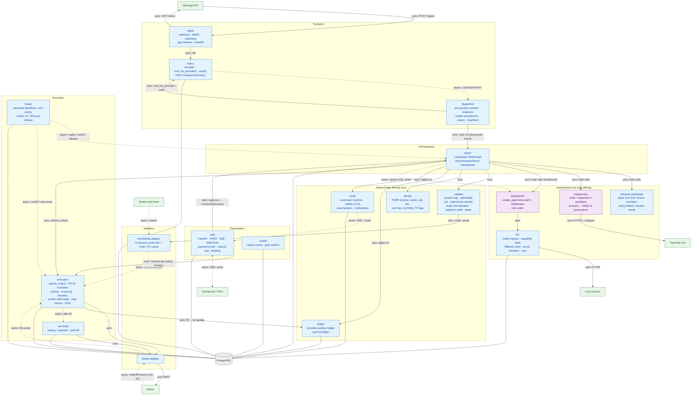
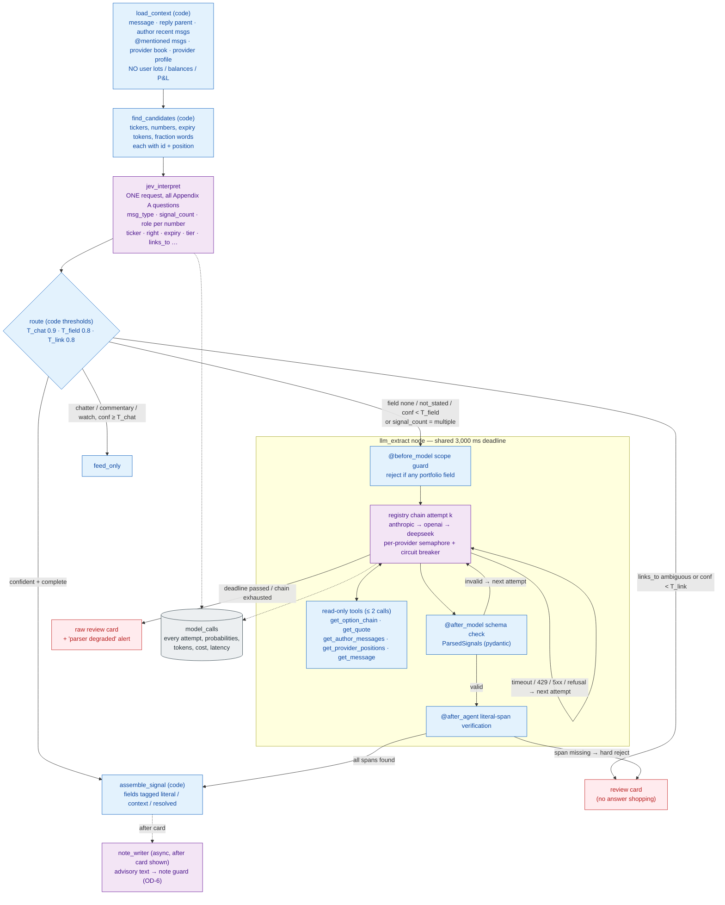
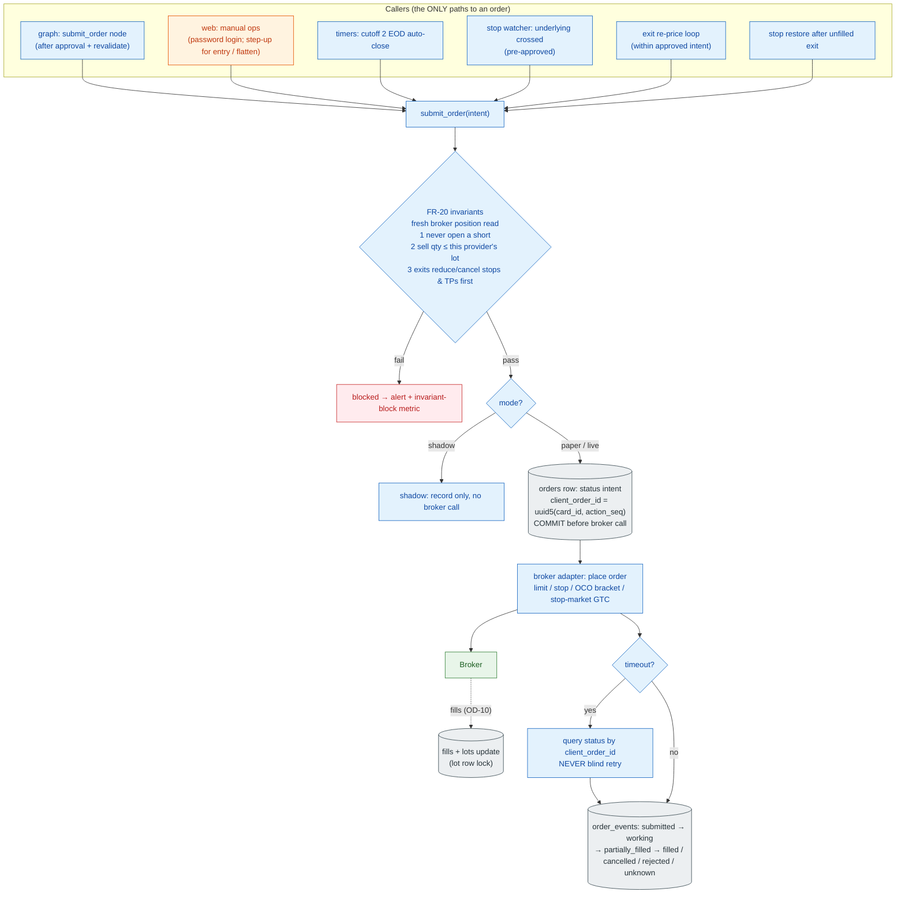
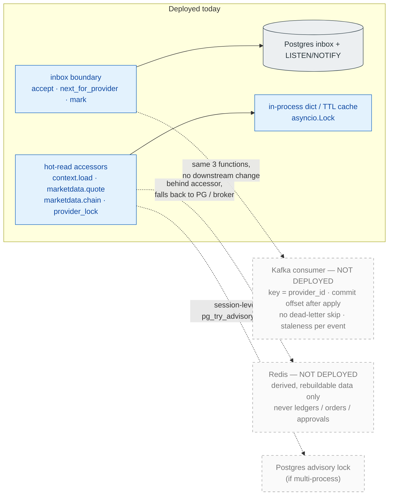

# 2. Detailed Component Architecture

[← High-level](01-high-level-architecture.md) · [Index](README.md) · Next: [End-to-end data flow →](03-end-to-end-data-flow.md)

The service is a single Python asyncio process split into the modules of TRD §2.2. Module boundaries are code boundaries (packages), not network boundaries.

## 2.1 Module map with communication types

### What the diagram represents
Every module, the direction of calls between them, and whether each call is synchronous (solid) or asynchronous (dashed). All modules share one Postgres connection pool; plain lines to `PostgreSQL` mean "reads/writes its own tables" (ownership in §2.2).

### Component responsibilities and interaction rationale

| Module | Owns | Called by | Key rule |
|---|---|---|---|
| `ingest` | webhook, feed-health watchdog, gap detector | Message API (push), its own 60 s loop | Writes only through `inbox.accept()`. |
| `inbox` | `inbox`, `message_events` insert | `ingest`, `dispatcher` | The only transport boundary. A future Kafka consumer would implement the same 3 functions (§2.5). |
| `dispatcher` | worker per provider, staleness check, catch-up mode, model semaphores, poison handling, heartbeat | NOTIFY | Holds the **provider slot** from `load_context` to `notify`; never across `interrupt()`. |
| `graph` | the per-message StateGraph + checkpointer | dispatcher, web (resume), timers (resume) | Orchestration state only; domain truth lives in domain tables (TRD §1.4). |
| `interpret.candidates` | regex finders | graph | Over-find; no whitelist (C86). |
| `interpret.jev` | Jev state builder, question catalog | graph | Jev *chooses among candidates*; it cannot invent digits (C78). |
| `interpret.llm` | `create_agent` slow path, note writer, middleware guardrails, read-only tools | graph | Output passes literal-span verification; no write tools. |
| `llm` | registry, capability table, fallback chain, circuit breakers, cost normalisation | interpret.llm | No provider-specific code outside this module (TRD §4.8). |
| `validate` | identity & normalisation checks | graph | Failures downgrade to review cards; never auto-correct (C78). |
| `decide` | pure decision functions | graph | No I/O; every PRD scenario is a unit test. |
| `ledger` | provider positions, user lots | graph (`apply`), execution (fills), reconcile, web (corrections) | Rows locked `SELECT … FOR UPDATE` inside `apply`. |
| `cards` | card state machine, validity, notifications | graph, timers, web | Card unique on `(signal_id, action)`. |
| `execution` | `submit_order()`, pricing loops, stop watcher, stop restore, EOD | graph, timers, web (manual) | The only module that calls the broker for orders. |
| `timers` | persisted deadlines | own loop | Survive restarts (reloaded at startup step 8). |
| `reconcile` | broker ↔ lot comparison | startup, 60 s loop, post-fill | Mismatch blocks entry cards. |
| `web` | dashboard, auth, manual ops, labeling | browser | Manual orders hit the same `submit_order()` checks (C42). |
| `evalkit` | replay + gates | offline | Replays from `message_events`; never re-triggers live side effects. |

### Consistency considerations
- **Synchronous inside a message run, asynchronous across runs.** A single message's context → apply path is synchronous and serialised per provider. Cross-cutting events (NOTIFY, SSE, timers, broker streams) are asynchronous and always re-read state from Postgres before acting.
- **Resume sources are multiple** (web, timers, supersession, crash recovery) but the graph thread's `await_approval` node accepts exactly one resume; the `cards` state machine rejects transitions out of terminal states, so a late approve after expiry is a no-op.

### Failure points
Blocked event loop (caught by the dispatcher heartbeat, `/health` fails after 15 s) · model semaphores saturated by 429s (counted as queue wait) · note writer failure (off critical path; card shows without note).

---

## 2.2 Data ownership: which module writes which table

```mermaid
flowchart LR
    classDef code fill:#e3f2fd,stroke:#1565c0,color:#0d47a1
    classDef audit fill:#fffde7,stroke:#f9a825,color:#5d4037
    classDef state fill:#eceff1,stroke:#37474f,color:#263238
    classDef lg fill:#f3e5f5,stroke:#6a1b9a,color:#4a148c

    subgraph MODS["Writer modules"]
        inbox["inbox"]:::code
        dispatcher["dispatcher"]:::code
        interp["interpret.jev / interpret.llm"]:::code
        apply["graph: apply node<br/>(ledger + cards, ONE txn)"]:::code
        cards["cards"]:::code
        web["web"]:::code
        execm["execution"]:::code
        timers["timers"]:::code
        reconcile["reconcile"]:::code
        ingest["ingest"]:::code
        evalkit["evalkit"]:::code
        graphm["graph runtime"]:::code
    end

    subgraph AUDIT["Append-only audit (INSERT, SELECT only)"]
        me[("message_events")]:::audit
        mc[("model_calls")]:::audit
        sig[("signals")]:::audit
        ml[("message_links")]:::audit
        ce[("card_events")]:::audit
        ap[("approvals")]:::audit
        oe[("order_events")]:::audit
        fi[("fills")]:::audit
        al[("alerts")]:::audit
        cc[("config_changes")]:::audit
        mcor[("manual_corrections")]:::audit
        lo[("logins")]:::audit
        ev[("eval_labels / eval_runs")]:::audit
    end

    subgraph STATE["Current state (mutable)"]
        ib[("inbox")]:::state
        pp[("provider_positions")]:::state
        lots[("lots")]:::state
        cardt[("cards")]:::state
        ord[("orders")]:::state
        st[("stops")]:::state
        tm[("timers")]:::state
        cfg[("config")]:::state
        hb[("dispatcher_heartbeat")]:::state
    end

    subgraph LGT["LangGraph-managed (not audit)"]
        ckpt[("checkpoint tables")]:::lg
        store[("PostgresStore: provider profiles")]:::lg
    end

    inbox ==> me
    inbox ==> ib
    dispatcher ==>|"status, attempts, flags"| ib
    dispatcher ==> hb
    dispatcher ==>|"poison, catch-up"| al
    interp ==> mc
    apply ==> sig
    apply ==> ml
    apply ==> pp
    apply ==> cardt
    apply ==> ce
    apply ==>|"status = done"| ib
    cards ==>|"state transitions"| cardt
    cards ==> ce
    cards ==> tm
    web ==> ap
    web ==> mcor
    web ==> lo
    web ==> cc
    web ==> ev
    web ==>|"provider-position corrections"| pp
    web ==>|"audited profile writes only"| store
    web ==>|"config edits"| cfg
    execm ==> ord
    execm ==> oe
    execm ==> fi
    execm ==> lots
    execm ==> st
    execm ==> al
    timers ==> tm
    reconcile ==>|"adopt orders"| ord
    reconcile ==>|"foreign lots, mismatch flags"| lots
    reconcile ==> al
    ingest ==>|"feed silence"| al
    evalkit ==> ev
    graphm ==> ckpt
```

### Ownership rules
- **Append-only tables** are granted `INSERT, SELECT` only to the app DB role (TRD §8). No module can rewrite history; corrections are new rows (e.g. a re-link is a new `message_links` row).
- **Provider ledger writers:** `apply` (from messages) and `web` (user corrections, C73). Both lock the provider's rows `FOR UPDATE`.
- **Lot writers:** `execution` (fills) and `reconcile` (foreign lots / mismatch flags). Fills update lots under the **lot's own row lock**, independent of the provider slot (TRD §5.1).
- **Long-term store (provider profiles):** written only by audited code paths from user-approved sources. **Models never write to it** (TRD §5.3) — this prevents memory poisoning by provider messages.
- History of `provider_positions`, `lots`, `stops` is required by PRD §14 but no history table is specified in the TRD → **OD-13** (see [07](07-data-model.md)).

---

## 2.3 Interpretation subsystem internals

### Key points
- **Jev chooses, code finds.** Every number in a literal field is a span copied from the text, so a model cannot transpose a digit (C78, FR-7).
- **Confidence only downgrades** (TRD §1.3): a low `links_to` goes to a review card and *no model can upgrade it*.
- **Fallback vs no-fallback:** infrastructure failures (timeout, 429/5xx, schema-invalid, refusal) fall to the next vendor within the same deadline. **Content failures** (span not in text, chain/quote mismatch) go to review — re-asking other models until one "passes" would reward a matching hallucination (TRD §4.8 rule 3).
- **One message = one model's output.** Outputs are never merged across providers (rule 4).
- **Jev outage:** 429/529 retried once, then the message takes the slow path (latency rises, nothing is lost). If Jev fails the week-0 bench, the graph runs without `jev_interpret` (OD-8).

---

## 2.4 Execution subsystem internals

**Pricing policies** executed inside this subsystem (all code, PRD §9):

| Action | Policy | Source |
|---|---|---|
| Entry / add | Limit at signal price (top of range) + X%; cancel unfilled remainder after M s; keep partial fills. | C22, FR-21 |
| Exit / trim | Limit at mid; re-price toward bid every few seconds until filled or floor reached; at floor stop + notify + restore stops. | C25 |
| Premium stop | Broker-held stop order; fires with no further approval. | C28 |
| Underlying stop | System-held; stop watcher triggers the C25 exit when the underlying crosses. Candle-close shown as info only. | C49 |
| Stock stop | Stop-market GTC at broker. | C61 |
| Take-profits | Broker limit orders, OCO-linked with stop; legs = min(levels, qty) from TP1. | C50, C56, C83 |
| EOD | Cutoff 1 → urgent close card; cutoff 2 → automatic C25 exit, stops/TPs cancelled first. | C19 |

---

## 2.5 Extension boundaries (Kafka / Redis — **not deployed**)

PRD C94 and TRD §15 rule out Kafka and Redis now but require boundaries so either can be added **only on a measured trigger**.

| Adopt Kafka only if measured | Adopt Redis only if measured |
|---|---|
| Sustained ingest > ~100 events/s, or inbox insert p99 > 50 ms after tuning | ≥ 2 app processes need shared live quotes and broker connection limits bite |
| ≥ 2 independently deployed consumers need separate replay positions | `context.load` p95 > 50 ms after indexing |
| Multi-user fan-out > ~1,000 users (PRD non-goal) | Vendor rate limits must be shared across processes |
| Multi-region ingest | `LISTEN/NOTIFY` fan-out to a scaled web tier measured insufficient |
| Must accept while PG is down **and** Message API cannot redeliver (try local spool / SQS first) | — |
