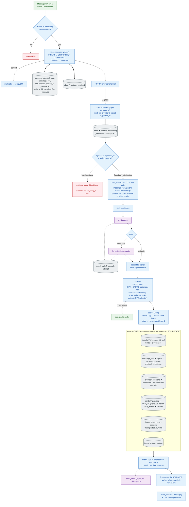
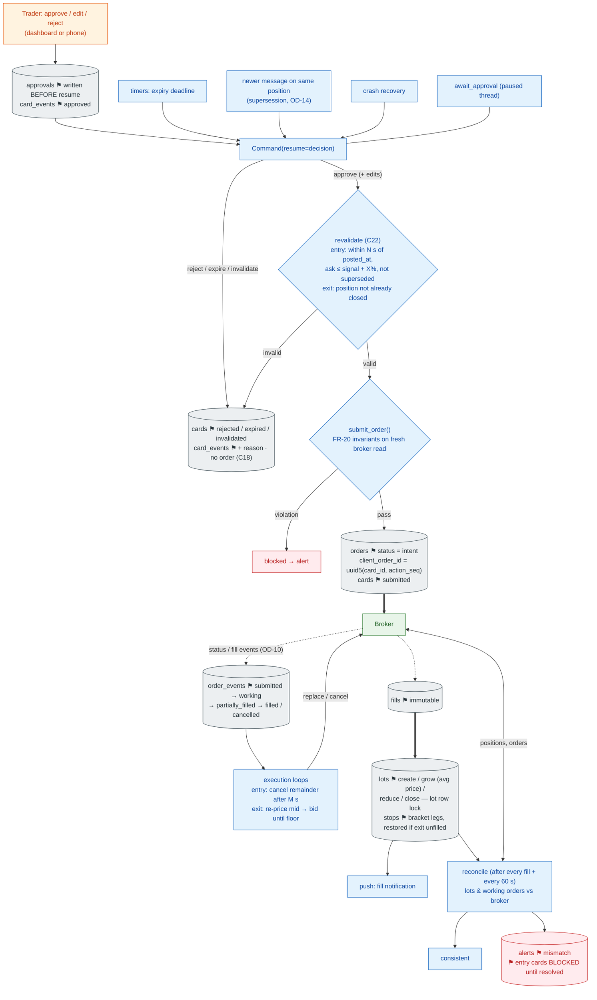

# 3. End-to-End Data Flow

[← Components](02-component-architecture.md) · [Index](README.md) · Next: [Context & correlation →](04-context-correlation.md)

The journey of one message: **ingestion → persistence → context resolution → interpretation → validation → signal/ledger update → decision → approval → order execution → broker → fills → reconciliation.** It is split at the approval pause, because that is where the provider slot is released and the time scale changes from milliseconds to minutes.

Legend for this section: cylinders = persisted rows; **⚑** = a state change; thick arrows = durable writes.

## 3.1 Part A — message to approval card (provider slot held)

## 3.2 Part B — approval to reconciled lot (provider slot NOT held)

## 3.3 Persistence and state-change ledger

| # | Step | Persisted in | Transaction boundary | State change | Idempotency key |
|---|---|---|---|---|---|
| 1 | Webhook / backfill accept | `message_events`, `inbox` | own txn, commit before `200` | inbox `received` | `(message_id, event_type, event_seq)` |
| 2 | Dequeue | `inbox` | own txn | `processing`, attempts+1 | event_id |
| 3 | Interpretation | `model_calls` | per call | none (audit only) | — (repeatable, no side effects) |
| 4 | Graph progress | LangGraph checkpoints | per node | orchestration only | `thread_id = msg:<message_id>:<event_seq>` |
| 5 | **apply** | `signals`, `message_links`, `provider_positions`, `cards`, `card_events`, `timers`, `inbox` | **one txn** | provider ledger + card `pending` + inbox `done` | card UNIQUE `(signal_id, action)` |
| 6 | Approval | `approvals`, `card_events` | own txn, **before** resume | card `approved` | approval_id |
| 7 | Order intent | `orders`, `cards` | own txn, **before** broker call | order `intent`, card `submitted` | `client_order_id` UNIQUE |
| 8 | Broker status | `order_events` | per event | order state machine | client_order_id + broker id |
| 9 | Fill | `fills`, `lots`, `stops` | one txn per fill, lot row lock | lot created / grown / reduced / closed | broker fill id (**OD-10** defines source) |
| 10 | Reconciliation | `lots`, `orders`, `alerts` | own txn | adopt orders; foreign lots; entry gate | client_order_id prefix |

### Explanation
- **Why the split at `apply`:** everything that depends on per-provider order (context, linking, ledger, card) is committed atomically before the run pauses. After resume, nothing touches the provider ledger, so the next message from the same provider never waits on a human (FR-1a, C88).
- **Why the approval row precedes resume:** AC-2 ("no order without an approval record") is checked against domain tables, not against checkpoint internals (TRD §5.1).
- **Why the order intent precedes the broker call:** if the process dies between the two, restart finds the intent and queries the broker by `client_order_id` instead of resubmitting (AC-7).
- **Validity clocks start at `posted_at`**, not at card creation (C90); a backlog therefore cannot create a fresh-looking card for an old price.

### Failure points on this path
Postgres down at step 1 (→ `503`, redelivery, OD-1) · poison at steps 2–5 (3 attempts → raw review card) · LLM chain exhausted at step 3 (raw review card) · market data missing at validate (review card, OD-12) · crash between 7 and broker call (resolved by status query) · missing fill event (periodic reconciliation catches it).
