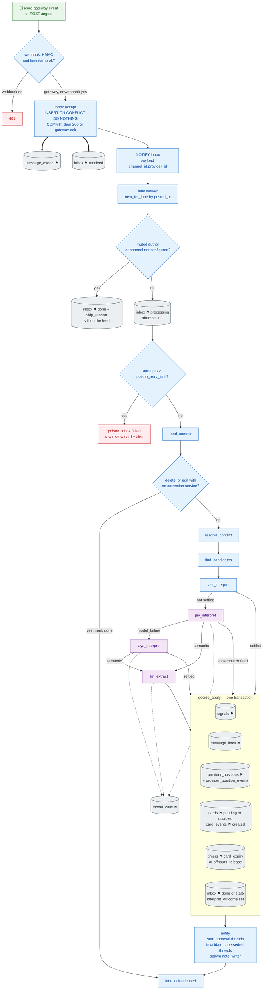
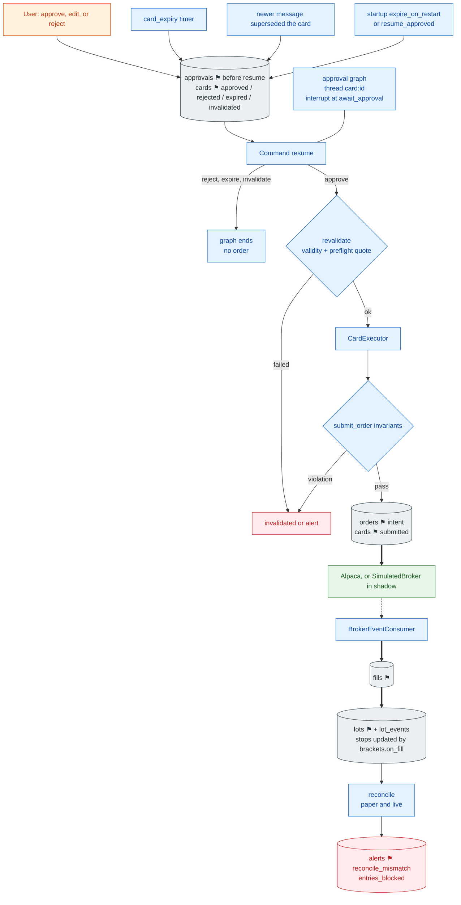

# 3. End-to-End Data Flow

[← Components](02-component-architecture.md) · [Index](README.md) · Next: [Context & correlation →](04-context-correlation.md)

One message, split where the lane slot is released. The message graph ends at `notify`. The human wait is a second graph, one thread per card.

Legend: cylinders are rows; **⚑** is a state change; thick arrows are durable writes.

## 3.1 Part A — message to pending cards (lane slot held)

Off-hours does not skip interpretation. `decide_apply` still updates the provider book, then schedules `offhours_release` and inserts no cards. At the open, `ReleaseService` re-plans with fresh quotes.

A stale entry or add (`age > stale_entry_s`, default 30 s) is marked inbox `stale`: the book may update, and there is no approvable entry card. Exits, stops, and corrections still card, with `late` when a newer lane event was already applied.

## 3.2 Part B — approval to a reconciled lot (lane slot free)

The decision API writes the approval and the card transition in one transaction, then resumes the graph. Restart recovery calls `resume_approved`. Entry resumes wait while `entries_blocked` is set.

## 3.3 Persistence ledger

| # | Step | Persisted in | Boundary | Idempotency |
|---|---|---|---|---|
| 1 | Gateway or webhook accept | `message_events`, `inbox` | commit before ack | PK `(message_id, event_type, event_seq)` |
| 2 | Dequeue | `inbox` | own update | attempts, `claimed_at` |
| 3 | Stage marks | `stage_timings` | per stage | PK includes `attempt` and `stage` |
| 4 | Model calls | `model_calls` | per attempt | append-only |
| 5 | Message-graph checkpoint | `langgraph.checkpoints` | once, at exit | thread `msg:{message_id}:{event_type}:{event_seq}:{attempt}` |
| 6 | **apply** | `signals`, `message_links`, `provider_positions`, `provider_position_events`, `cards`, `card_events`, `timers`, `inbox` | **one transaction** | `signals` unique on the event key + `idx`; `cards.dedupe_key`; card unique `(signal_id, action)` |
| 7 | Approval | `approvals`, `card_events` | before resume | one `approvals` row per card |
| 8 | Approval checkpoint | `langgraph.checkpoints` | interrupt and resume | thread `card:{card_id}` |
| 9 | Order intent | `orders`, `cards` | before the broker call | `client_order_id` unique |
| 10 | Broker status | `order_events`, `orders` | per event, forward-only | `client_order_id` |
| 11 | Fill | `fills`, `lots`, `lot_events`, `stops` | one transaction | `broker_fill_id` unique |
| 12 | Reconciliation | `lots`, `orders`, `alerts`, `system_flags` | own transaction | mismatch dedupe |

`signal_id` is a UUID. It is not the pair `(message_id, idx)`. That pair is a unique key on `signals` together with `event_type` and `event_seq`.

### Why the split is at notify

Everything that depends on lane order (context, the link, the provider book, the card) commits before the message graph ends. The next event on that lane does not wait for a person. Fills lock the lot and do not take the lane lock.

### Failure points on this path

Postgres down at accept (webhook `503`; the gateway retries on reconnect plus the gap detector) · poison after `poison_retry_limit` (default 3) · model chain exhausted (raw review card) · quote missing at validate (review card) · crash after the intent row (status query by `client_order_id`) · missed fill (the consumer plus periodic reconcile).
