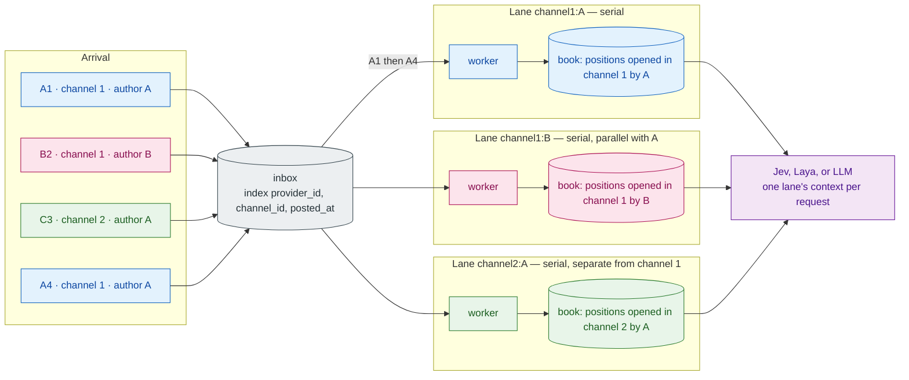
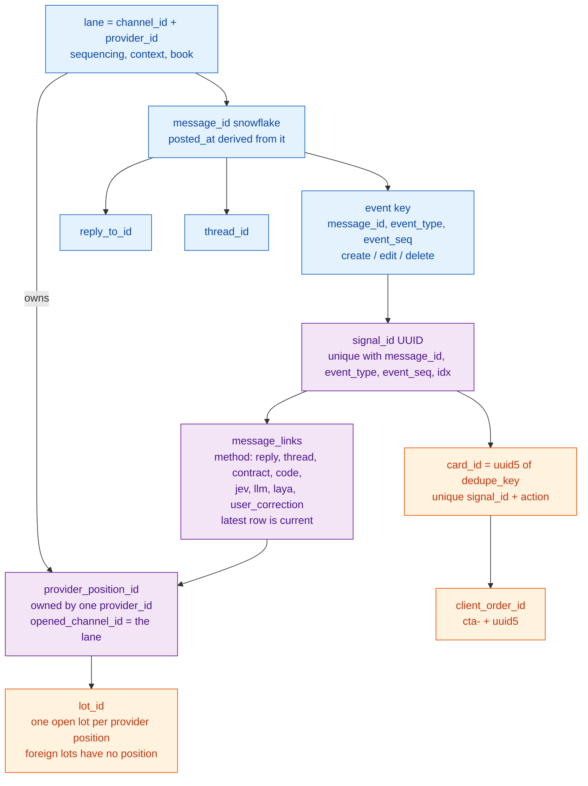
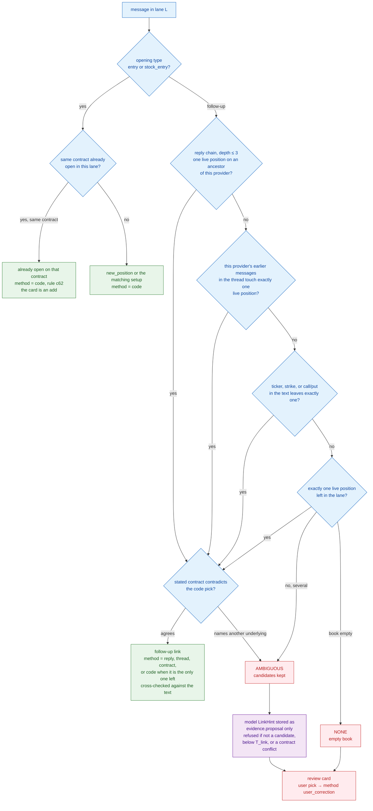

# 4. Message Context and Signal Correlation

[← Data flow](03-end-to-end-data-flow.md) · [Index](README.md) · Next: [Signal processing flowchart →](05-signal-processing-flowchart.md)

A provider position belongs to one lane: `(provider_id, opened_channel_id)`. Links never cross lanes. A model sees that lane's messages and that lane's book, narrowed to the resolver's candidates. It does not see user lots, balances, or P&L.

## 4.1 Lane isolation

The same author in two channels is two lanes and two books. Two authors in one channel are two lanes. Workers run in parallel across lanes, so one lane's model call does not block the others.

Inside a lane the worker is serial from `load_context` through `notify`. A follow-up cannot read the book from before its own entry has been applied.

A row in `provider_positions` with no `opened_channel_id` is in no lane's book.

## 4.2 Identifier model

Transport keys, known on arrival: `channel_id`, `provider_id`, `message_id`, `event_type`, `event_seq`, `reply_to_id`, `thread_id`.

Interpretation outputs: `signal_id`, `provider_position_id`, the link row. Two lanes on the same contract are two positions and, if both are traded, two lots. The sell check is per lot.

## 4.3 How a message is linked

Code runs first, in `ledger.resolver`. A model hint never overrides a unique result.

`resolve_link` is the function that combines the resolver result with the message type:

- An opening signal creates a position (`method = code`) unless the lane already has that contract, or the text is a re-entry (`back in`, `re-entry`, `reloaded`) onto a position closed today.
- A follow-up takes the resolver's unique pick when the text does not contradict it.
- Otherwise the outcome is `ambiguous` or `none`, and `decide` emits a review card. The model's `links_to` is stored on the link row as a proposal so the card can show it. Confidence does not turn that into a link.
- `watch` and `conditional` update the book (`status` `watch` or `conditional`, optional `condition_text`) and produce no card. A later entry on that setup is an entry, not an add.
- A follow-up with no user lot updates the provider book and creates no card.

## 4.4 Late events and re-links

If a newer event on the lane is already `done` or `stale`, the late event is still applied and flagged `late`. After commit, `RelinkService.recheck_after_late` re-interprets affected follow-ups (`GraphProcessor.recheck` writes nothing) and opens review cards. It does not rewrite those positions by itself.

A user correction, an edit, or a delete goes through `cards.corrections` / `manual.corrections`: pending cards on the old reading are invalidated, a new `message_links` or `manual_corrections` row records the change, and the profile store is touched only on that audited path.

## 4.5 What a model is allowed to see

`load_context` builds the lane packet: the message, the reply parent, recent messages, mentions, the lane book, and the provider profile (`lexicon`, `habits`, `aliases`).

`_model_context` then replaces the book with `link_candidates`, the positions the resolver already narrowed. The model does not see the rest of the lane, and it never sees lots or P&L. A scope-guard hit on the LLM request sends nothing, stores `scope_violation`, and raises an urgent alert.
