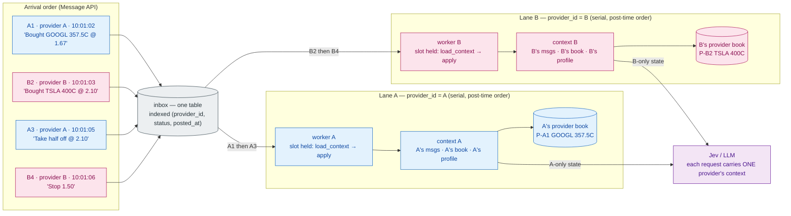
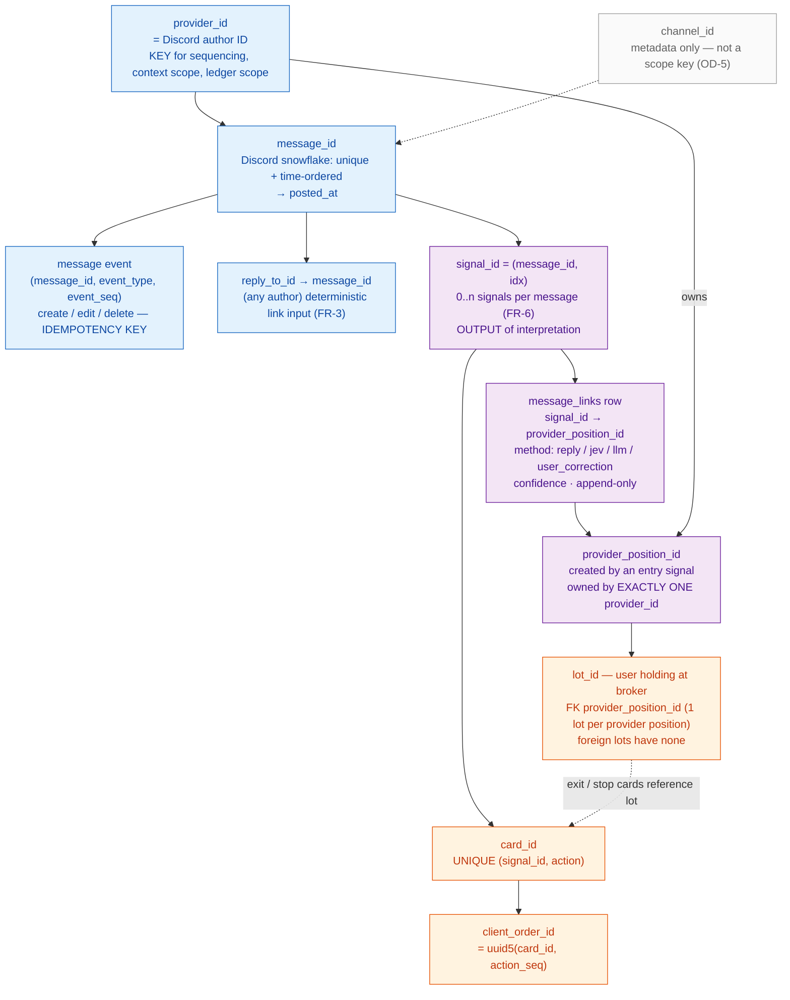
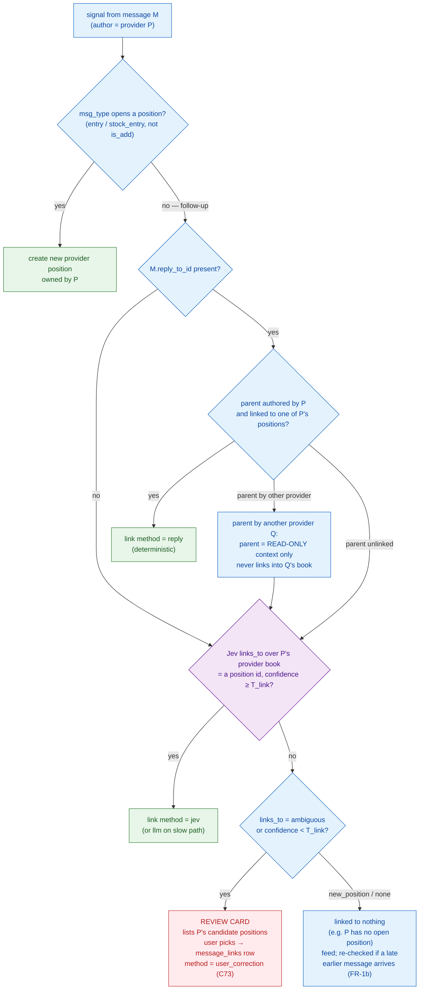
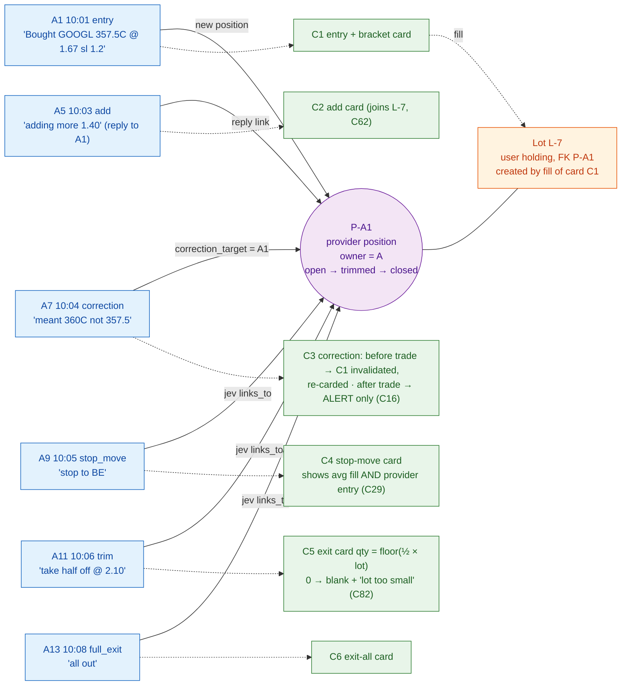
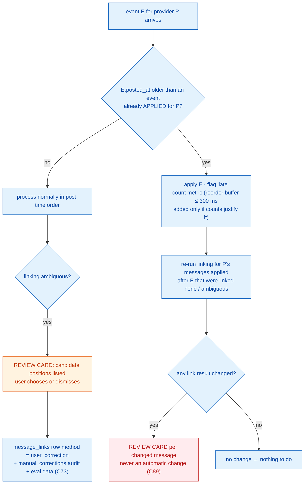
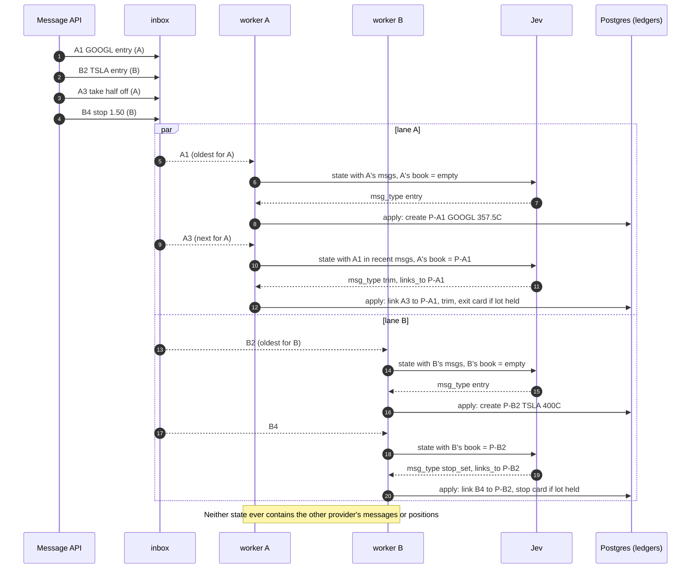

# 4. Message Context & Signal Correlation

[← Data flow](03-end-to-end-data-flow.md) · [Index](README.md) · Next: [Signal processing flowchart →](05-signal-processing-flowchart.md)

**Invariant for this whole section: provider context is never mixed.** A provider position is owned by exactly one provider; links never cross providers; the context sent to any model contains one provider's messages and one provider's book (PRD §6, C71, AC-18). Position scope is **per author** by default (OD-5).

## 4.1 Provider isolation lanes

**Outcome (AC-18):** A3 links to P-A1 (GOOGL); B4 links to P-B2 (TSLA). A3 is never processed before A1 is in A's book, because lane A is serial. Lanes A and B run in parallel, so B never waits on A's slow path.

**Why serial per provider:** if A1 and A3 ran concurrently, A3 could read an empty book, be linked `none`, and go feed-only — a silently lost exit (TRD §2.4 race). **Why parallel across providers:** Kafka-style shared partitions would make one provider's 3 s slow-path call block other providers (head-of-line blocking, TRD §15.1).

---

## 4.2 Identifier model

- **Transport keys** (blue) are known on arrival and may be used to route: `provider_id`, `message_id`, `event_seq`, `reply_to_id`.
- **Interpretation outputs** (purple) — `signal_id`, `provider_position_id`, links — cannot be used to partition or route before interpretation (PRD §6; TRD §8.1).
- **Two providers on the same contract → two provider positions → two lots** (C24). The sell invariant (FR-20.2) is per provider lot.

---

## 4.3 Correlation decision ladder

**Why this order:** the reply reference is exact and cheap, so it wins (FR-3). The model is only asked to choose among *this provider's* open positions; it cannot link across providers because the other providers' positions are never in its options. Low confidence downgrades to human review; it never upgrades (C31).

**Cross-provider replies:** "B replies 'same' to A1" → B gets its own provider position; A's ledger is unchanged (TRD §12 scenario).

---

## 4.4 Many messages → one provider position → one lot

Each message is its own signal (or signals) with its own `message_links` row; the position accumulates history; the user's lot is touched only through approved cards and fills. A newer message on the same position **invalidates a still-pending entry card** (C22) — e.g. if C1 is still pending when A5 arrives, C1 expires and the user sees the newer state.

---

## 4.5 Ambiguity and out-of-order handling

---

## 4.6 AC-18 as a sequence

### Consistency and failure considerations
- **Ordering source:** snowflake post time, not arrival order (C88). Late arrivals are applied and flagged, never dropped.
- **Slot mechanics:** single process → `asyncio` per-provider worker; multi-process (future) → session-level `pg_try_advisory_lock(hash(provider_id))` on a dedicated connection (never a Redis lock). Inside `apply`, provider rows are additionally locked `FOR UPDATE`.
- **Failure points:** a provider-ledger error propagates to later follow-ups (PRD §21) — mitigated by user correction + review cards; a poison message in lane P does **not** stop lane P (FR-1e).
- **OD-5:** if position scope becomes (author, channel), the lane key stays `provider_id` but the book and `links_to` options are filtered by channel.
