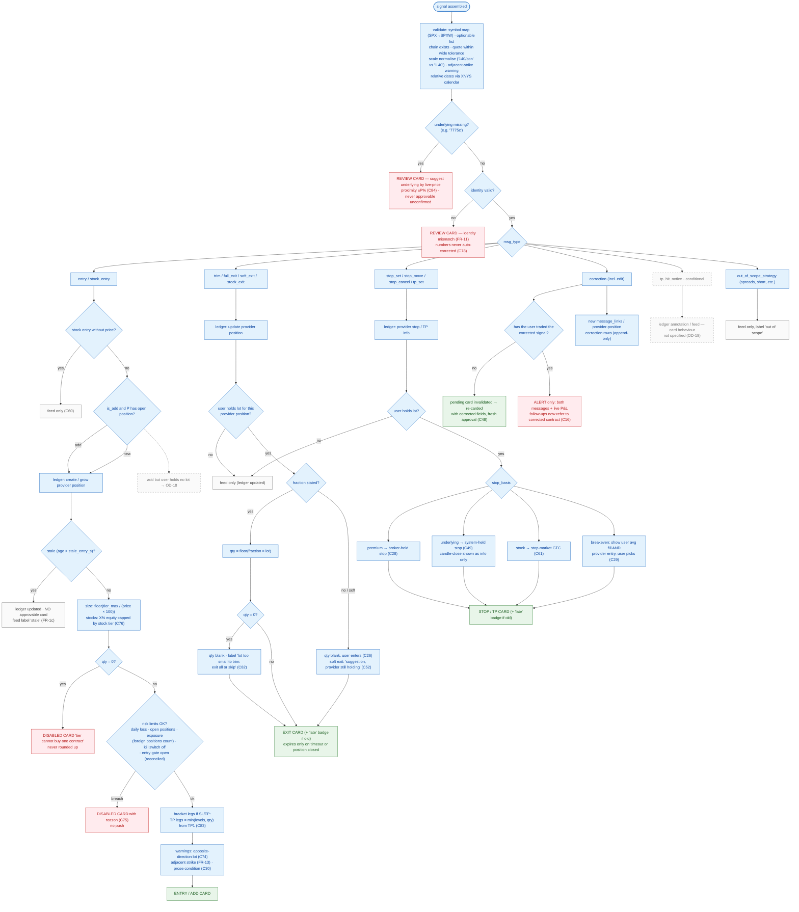
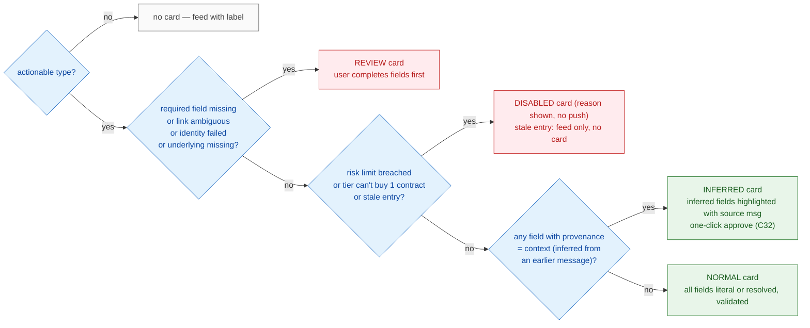

# 5. Signal Processing Flowchart

[← Context & correlation](04-context-correlation.md) · [Index](README.md) · Next: [Sequence diagrams →](06-sequence-diagrams.md)

Split into three focused charts: **(5.1)** intake → interpretation hand-off, **(5.2)** deterministic handling per message type, **(5.3)** card tier assignment. Purple = model; blue = code; orange = human; red = error / blocked.

The **model / code boundary** is always the same: models stop after `assemble_signal` (plus the async advisory note). Everything from `validate` onward is deterministic code.

## 5.1 Intake, sequencing and interpretation routing

```mermaid
flowchart TB
    classDef code fill:#e3f2fd,stroke:#1565c0,color:#0d47a1
    classDef model fill:#f3e5f5,stroke:#6a1b9a,color:#4a148c
    classDef fail fill:#ffebee,stroke:#c62828,color:#b71c1c
    classDef feed fill:#fafafa,stroke:#757575,color:#424242

    START(["event dequeued for provider P<br/>(post-time order)"]):::code
    MUT{"author muted? (C57)"}:::code
    FEEDM["feed only, label 'muted'"]:::feed
    EVT{"event_type"}:::code
    DEL["delete: find pending cards from this message<br/>→ invalidate + alert (C48)"]:::fail
    EDIT["edit: treated as a correction of the original<br/>(C48) — continues as msg with is_correction"]:::code
    ATT{"attempts ≥ 3 ?"}:::code
    POISON["status failed · RAW REVIEW CARD + alert<br/>P's queue continues (FR-1e)"]:::fail
    STALE{"age > stale_entry_s ?"}:::code
    FLAG["mark message 'stale-eligible' / 'late'<br/>(effect decided per type in 5.2)"]:::code
    HOURS{"within regular hours?"}:::code
    HOLD["action held: timer until 09:30 ET<br/>card built then with fresh validation (C59)"]:::code

    CTX["load_context (C71 scope)"]:::code
    CAND["find_candidates (regex over-find)"]:::code
    JEVOK{"Jev reachable?<br/>(1 retry on 429/529)"}:::code
    JEV["jev_interpret — all questions, one request"]:::model
    R1{"chatter / commentary_pnl / watch<br/>conf ≥ T_chat ?"}:::code
    FEED["NON-ACTIONABLE: feed with label<br/>(FR-10: uncertain defaults here)"]:::feed
    R2{"links_to ambiguous<br/>or conf < T_link ?"}:::code
    REVIEW["REVIEW CARD — candidate positions"]:::fail
    R3{"required field none / not_stated,<br/>conf < T_field, two numbers claim<br/>one role, or signal_count = multiple?"}:::code
    SLOW["llm_extract — provider chain,<br/>3 s shared deadline, ≤ 2 read-only tools"]:::model
    SOK{"result?"}:::code
    DEG["RAW REVIEW CARD + 'parser degraded' alert (FR-9)"]:::fail
    SPAN["literal-span verification (code)"]:::code
    SPOK{"every literal span in text?"}:::code
    HARD["HARD REJECT → review card<br/>no fallback to other vendor"]:::fail
    ASM["assemble_signal<br/>literal / context / resolved per field"]:::code
    NEXT(["→ 5.2 deterministic handling"]):::code
    ERR["unhandled exception<br/>inbox failed attempt, retry later"]:::fail

    START --> MUT
    MUT -->|"yes"| FEEDM
    MUT -->|"no"| EVT
    EVT -->|"delete"| DEL
    EVT -->|"edit"| EDIT --> ATT
    EVT -->|"create"| ATT
    ATT -->|"yes"| POISON
    ATT -->|"no"| STALE
    STALE -->|"yes"| FLAG --> HOURS
    STALE -->|"no"| HOURS
    HOURS -->|"no"| HOLD
    HOURS -->|"yes"| CTX
    HOLD -.->|"at open"| CTX
    CTX --> CAND --> JEVOK
    JEVOK -->|"yes"| JEV --> R1
    JEVOK -->|"no — all to slow path"| SLOW
    R1 -->|"yes"| FEED
    R1 -->|"no"| R2
    R2 -->|"yes"| REVIEW
    R2 -->|"no"| R3
    R3 -->|"yes"| SLOW
    R3 -->|"no"| ASM
    SLOW --> SOK
    SOK -->|"deadline / chain exhausted"| DEG
    SOK -->|"ParsedSignals"| SPAN --> SPOK
    SPOK -->|"no"| HARD
    SPOK -->|"yes"| ASM
    ASM --> NEXT
    CTX -.->|"exception"| ERR
    ERR -.->|"attempts + 1"| ATT
```

**Notes**
- **Off-hours hold (C59):** PRD says actions *are held until 09:30 ET* and then built with fresh validation. Whether interpretation runs immediately and only the card is deferred, or the whole event is deferred, is not stated; the chart shows the conservative reading (card built at open with fresh validation) — both satisfy C59.
- **Edit events:** without edit delivery from the Message API, this branch never fires and edit-corrections are lost (OD-2, PRD §21).
- **Where the LLM stops:** after `ParsedSignals` passes schema + literal-span checks. It never sees the user's lots and never chooses an action, quantity or price.

---

## 5.2 Deterministic handling per message type

**Notes**
- **Risk-limit check** applies to *approvable entry cards* (FR-18). Exits are never blocked by risk limits — missing an exit is worse than acting late (TRD §2.4).
- **Supersession:** after this message's `apply` commits, any still-pending **entry** card on the same provider position is invalidated (C22). Firing mechanism: OD-14.
- **Exit card side effects** are deferred to execution: on approval, working stops/TPs are reduced/cancelled first and restored if the exit ends unfilled (FR-20.3).
- **Dashed grey branches** are not specified by PRD/TRD (OD-18) and must be decided before phase 3.

---

## 5.3 Card tier assignment (code; confidence can only downgrade)

Every card shows the **author prominently** (C57), the source messages, inferred-field highlights, computed quantity, bracket legs and warnings, plus the async **advisory note** labelled "advisory" (C80) — hidden by the note guard if it mentions any ticker/strike/expiry/price not present in validated fields or sources (OD-6).
