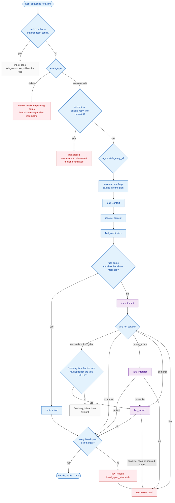
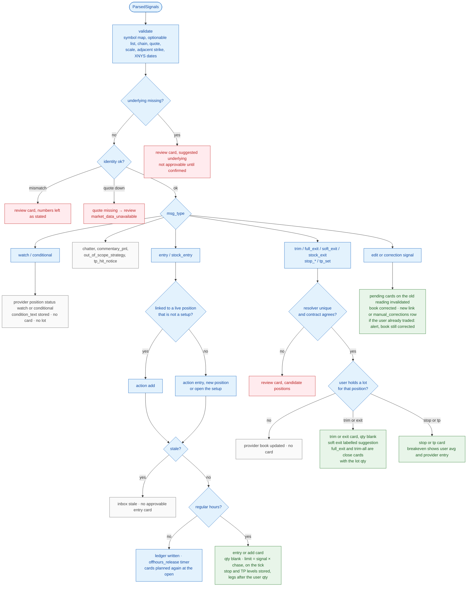
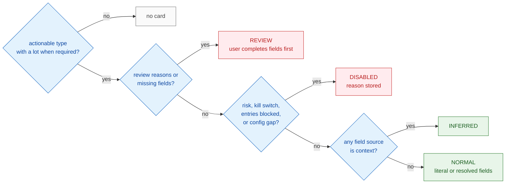

# 5. Signal Processing Flowchart

[← Context & correlation](04-context-correlation.md) · [Index](README.md) · Next: [Sequence diagrams →](06-sequence-diagrams.md)

Three charts: intake and routing, what each message type does, and how the card tier is chosen. Purple is a model. Blue is code. Orange would be a person (none of these three charts wait on one). Red is a blocked path.

Models stop when they return `ParsedSignals` (or a feed-only type). `decide_apply` checks literal spans, then `Planner` validates and `decide()` builds cards. The note writer runs after `notify` and cannot change fields.

## 5.1 Intake, sequencing, and interpretation

Edits continue as messages. `CorrectionService` treats an edit, or a `correction` signal, as a correction of the original position. Deletes do not enter interpretation when that service is wired (it is, in the lifespan).

`T_chat` defaults to 0.9. `T_type`, `T_field`, and `T_link` default to 0.8. Laya has its own higher gates (`t_chat` 0.95, the others 0.9) inside `LayaConfig`.

An exception during the run increments `attempts` and leaves the row for another try until the poison limit. Database connection errors retry and do not count as poison.

## 5.2 What each message type does

`Planner.plan` validates, links, and calls `decide()`. `apply_event` writes the ledger update and the cards in one transaction. `decide()` returns no cards for the feed-only types; the ledger update can still be written.

Risk limits, the kill switch, and `entries_blocked` apply to entry and add cards. A breach becomes a disabled card with a reason. Exits are not blocked by those gates.

After the transaction commits, a pending entry or add on that same position is `invalidated` / `superseded`, and `notify` ends its approval thread.

A disabled card is inserted in state `disabled` (the type and the state match). It is not pushed as something to approve.

## 5.3 Card tier

Low field confidence (under `T_field`) is a review reason. It does not pick a different number. Stale entries produce no card rather than a disabled one.

The card stores the proposal: action, limit, signal price, stop, TP levels, warnings, candidate positions, and `valid_until` measured from `posted_at`. The advisory note is written afterward onto `cards.note`. If the note guard finds a ticker, strike, expiry, or price that is not in the validated fields, `note_hidden` is set and a `note_hidden` alert is raised.
