# 6. Sequence Diagrams

[← Signal processing](05-signal-processing-flowchart.md) · [Index](README.md) · Next: [Data model →](07-data-model.md)

Participants keep these names:

| Alias | Participant |
|---|---|
| `DC` | Discord gateway (`DiscordListener`) |
| `IN` | `inbox.accept` |
| `WP` | dispatcher worker for one lane |
| `G` | message graph, thread `msg:{message_id}:{event_type}:{event_seq}:{attempt}` |
| `J` / `Laya` / `LLM` | Jev, local Laya, LLM chain |
| `PL` | `Planner` (validate + link + `decide`) |
| `DB` | PostgreSQL |
| `AG` | approval graph, thread `card:{card_id}` |
| `W` | FastAPI + Next.js desk |
| `U` | signed-in user |
| `X` | `OrderService` / `CardExecutor` |
| `B` | Alpaca, or `SimulatedBroker` when `trading_mode` is `shadow` |
| `T` | `TimerService` |
| `R` | `Reconciler` |

`POST /ingest` replaces `DC` when the event arrives on the webhook. The steps after `accept` are the same.

---

## 6.1 New entry

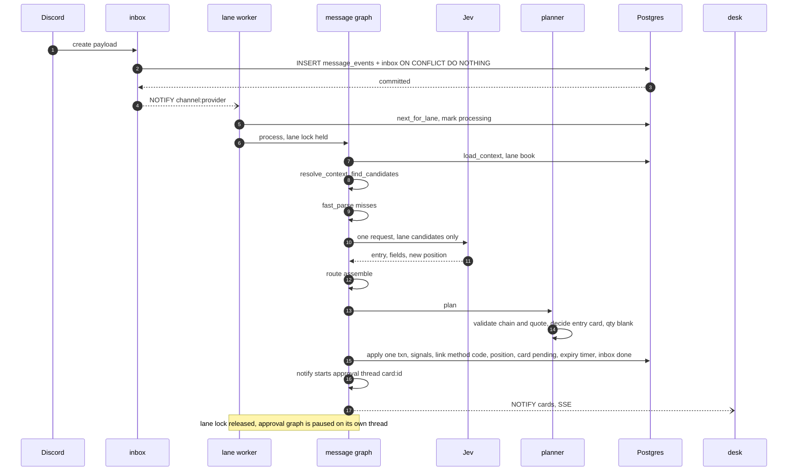

A fast-path match skips Jev. Off-hours still runs this graph, writes the position, and schedules `offhours_release` instead of inserting the card.

---

## 6.2 Follow-up trim

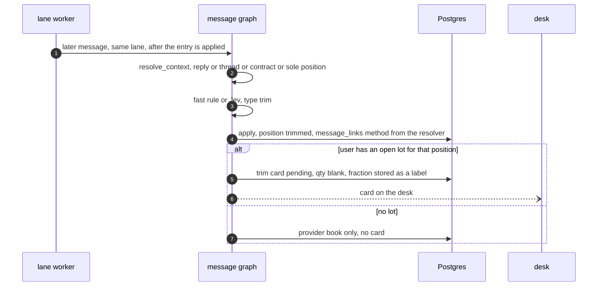

A full exit or a trim of `all` is a close card whose quantity is the lot quantity. A soft exit is an exit card labelled `suggestion`.

---

## 6.3 Stops

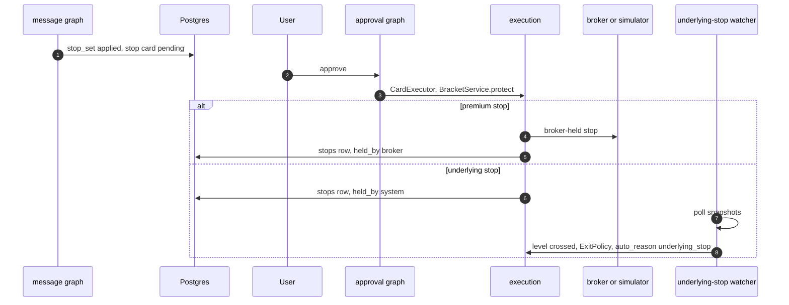

Breakeven stores both the user's average and the provider's entry on the card. The user picks. Candle-close is a label, not a trigger. A stock stop is a stop-market order at the broker.

---

## 6.4 Edit, correction, delete

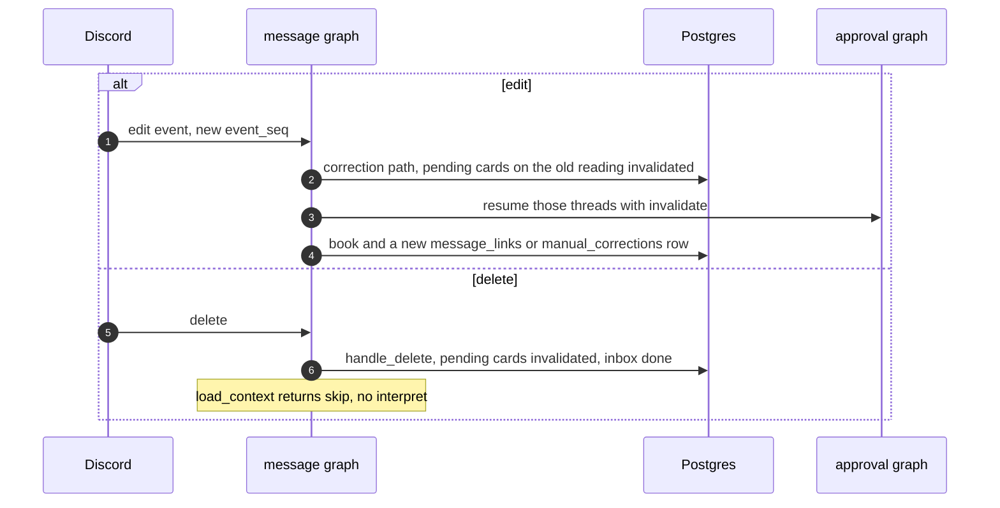

If the user has already traded the corrected signal, the book still changes and an alert is raised. The fill and the lot are not rewritten.

---

## 6.5 Ambiguous link

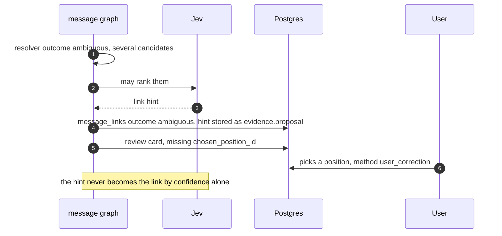

A link doubt (`route` kind `link`, including re-entry among several closed positions) skips Laya and the LLM and opens the review card directly.

---

## 6.6 Approve to an order

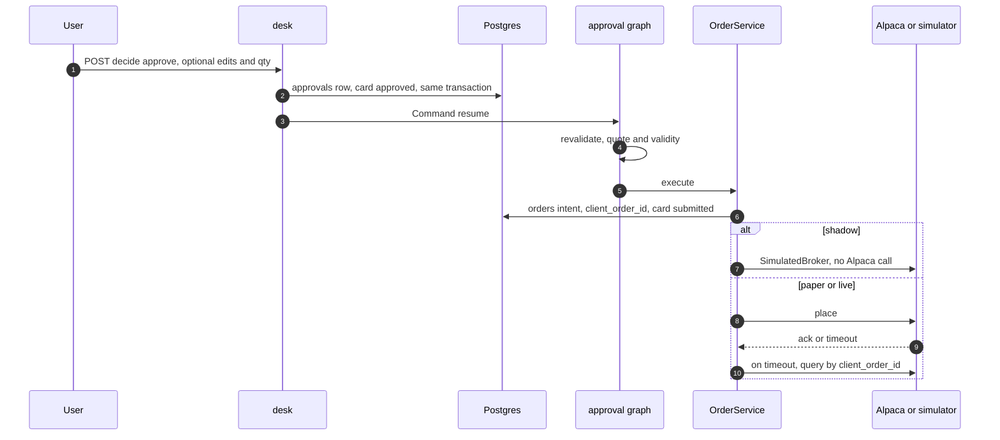

Reject, expiry, and invalidate are written on the card before resume. The approval graph sees a non-approve decision and ends. A failed revalidation moves `approved` to `invalidated` with `revalidate_failed`. If every placed order is `rejected`, the reason is `order_rejected`.

---

## 6.7 Fill to the lot

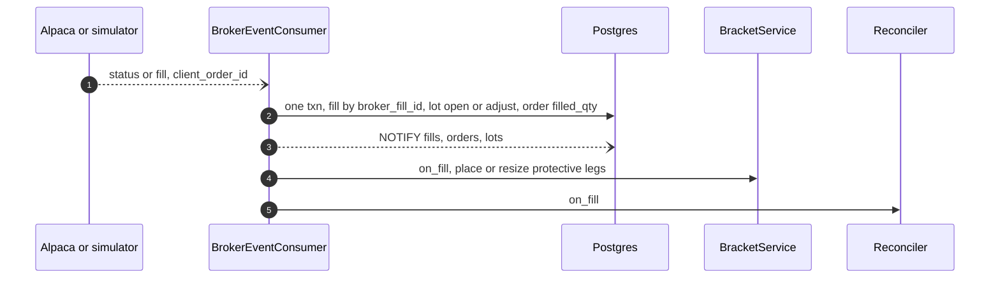

An unknown `client_order_id` is ignored. Status only moves forward. Reconciliation can synthesize the same events with source `reconcile` when the stream missed one.

---

## 6.8 Process start

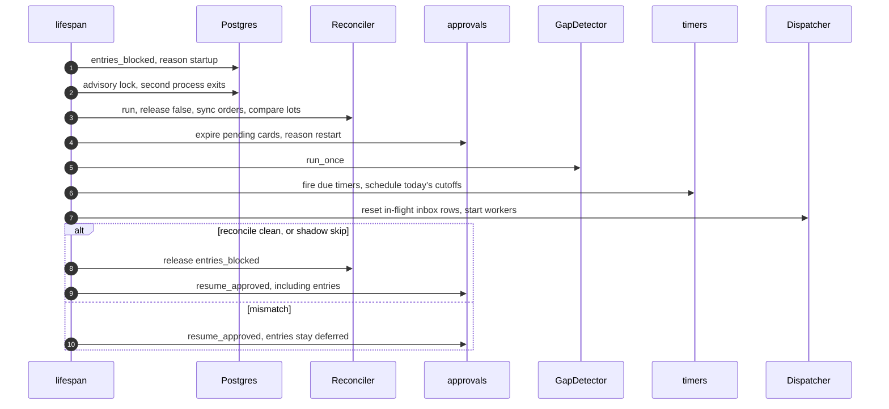

Failover recovery (`recover_after_failover`) is the shorter list: it does not expire cards and does not reset the dispatcher. It runs when the listener reconnects the worker after the lock was lost.

---

## 6.9 Reconciliation

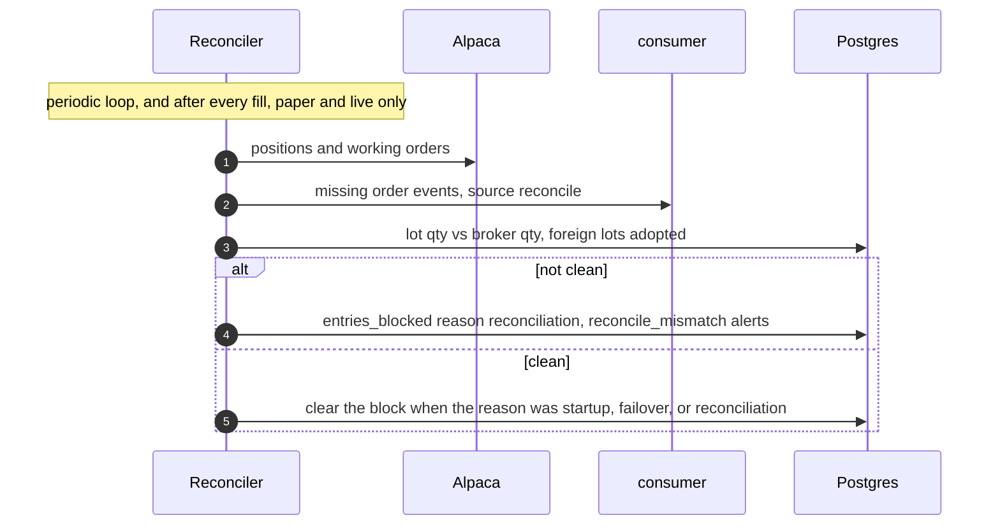

Shadow mode returns clean immediately (`skipped=shadow`) because there is no broker account to compare.

---

## 6.10 End of day

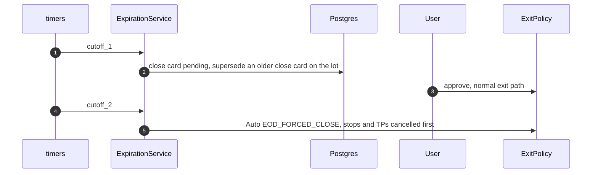

`schedule_today` arms both timers from the runtime config at startup. A fill that closes the lot cancels them via `expiration.on_fill`.

---

## 6.11 Model failure and the slow path

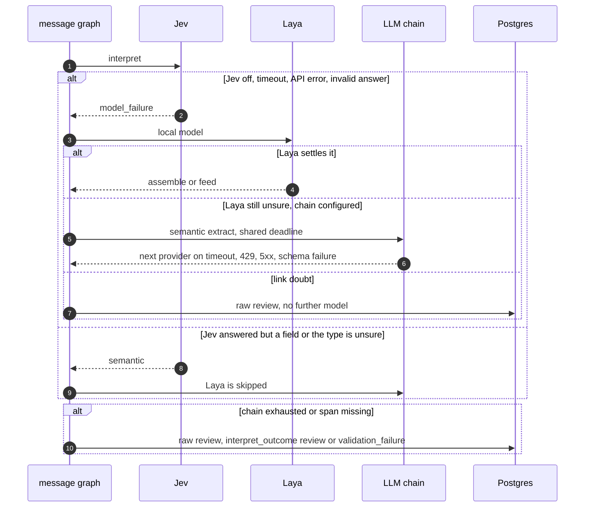

Content rejection (a span that is not in the text) does not try the next vendor. Infrastructure failure does, inside the same deadline. One message keeps one interpreter's output.

---

## 6.12 Poison message

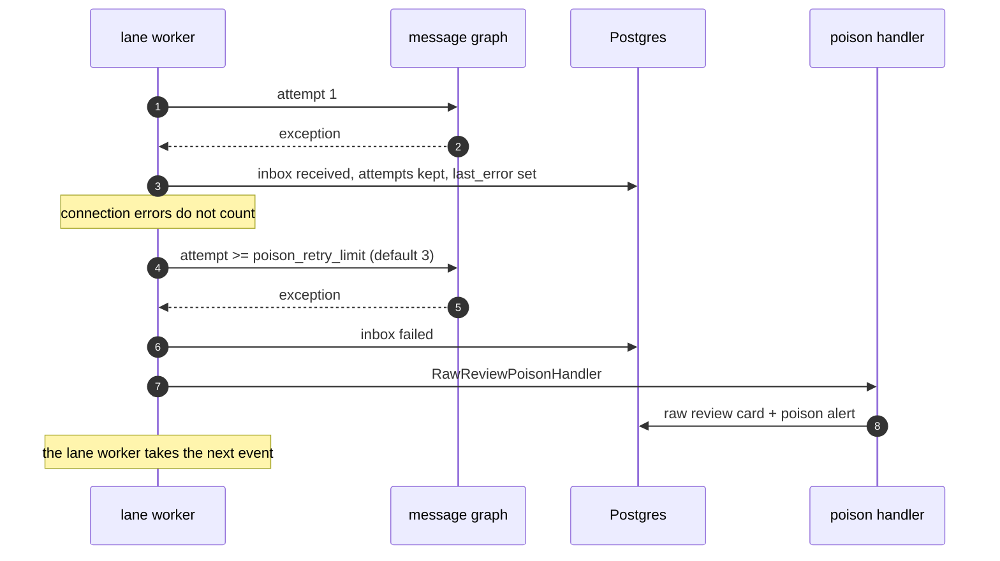
