# 6. Sequence Diagrams

[← Signal processing](05-signal-processing-flowchart.md) · [Index](README.md) · Next: [Data model →](07-data-model.md)

Participants use the same names throughout:

| Alias | Participant |
|---|---|
| `API` | User's Message API (external) |
| `ING` | `ingest` (webhook, gap detector) |
| `IN` | `inbox` (Postgres table + NOTIFY) |
| `WP` | dispatcher worker for provider P |
| `G` | LangGraph run (thread `msg:<message_id>:<event_seq>`) |
| `J` / `LLM` | Jev / LLM provider chain |
| `VD` | `validate` + `decide` (pure code) |
| `MD` | market-data adapter |
| `DB` | PostgreSQL |
| `CD` | `cards` module |
| `W` | web tier (dashboard, SSE, push) |
| `U` | Trader |
| `X` | `execution` (`submit_order()`) |
| `B` | Broker |
| `T` | `timers` |
| `R` | `reconcile` |

---

## 6.1 New trade signal (entry with SL/TP → bracket card)

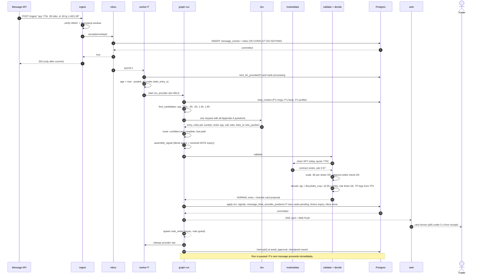

**Why:** receipt is acknowledged only once durable; interpretation, validation and decision all complete under the provider slot; the approval wait does not. **Failure points:** Jev unreachable (→ slow path), quote outside tolerance (→ review card), risk limit (→ disabled card), stale (→ no approvable card).

---

## 6.2 Follow-up trim / exit

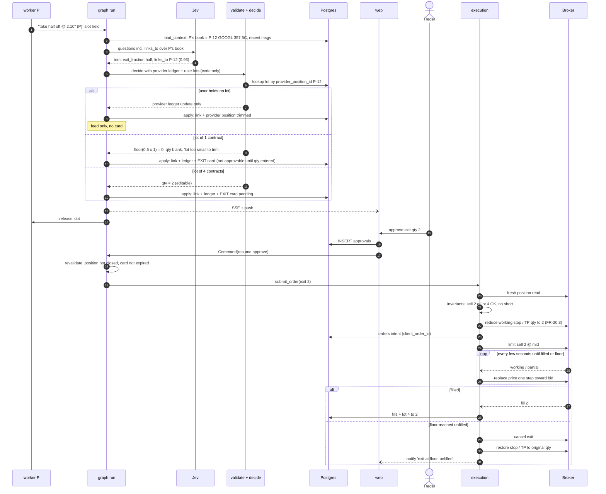

---

## 6.3 Stop-loss update (premium vs underlying) and trigger

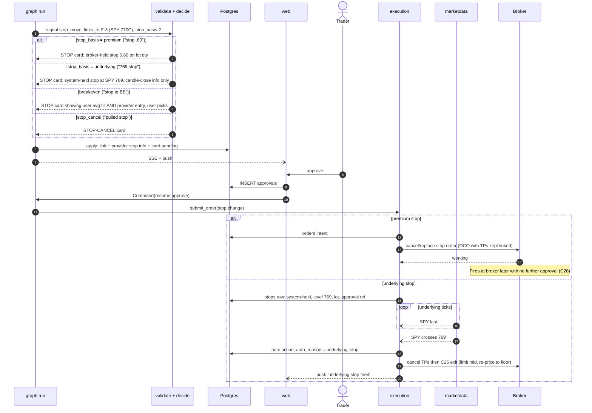

**Reliability note:** the broker-held stop survives an app outage; the system-held underlying stop **does not** (PRD §21) — uptime monitor pages the phone.

---

## 6.4 Correction message (before and after the trade) · edit · delete

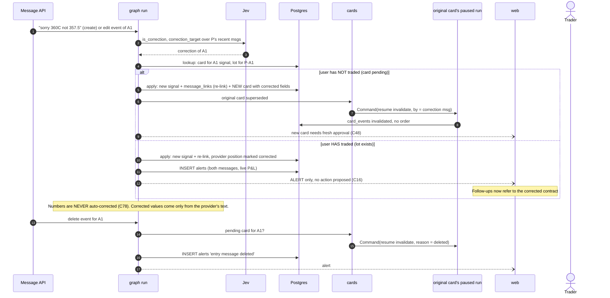

---

## 6.5 Ambiguous signal (review card)

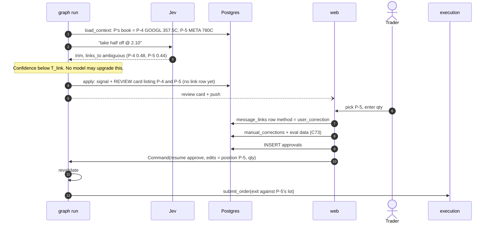

Variants that also produce review cards: missing underlying ("7775c" → suggestion by live-price proximity, never approvable unconfirmed), identity/quote mismatch, literal-span failure, two numbers claiming one role that the slow path cannot resolve.

---

## 6.6 Human approval → broker order (entry with bracket)

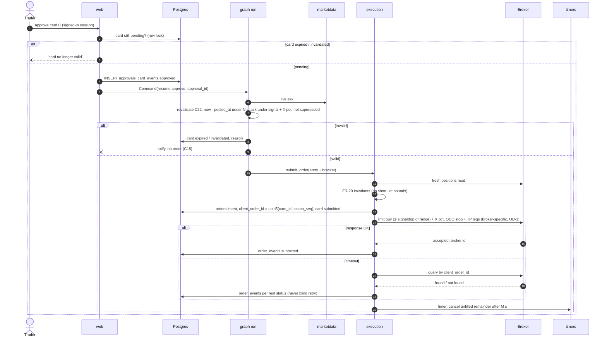

**AC-2:** every `orders` row joins to an `approvals` row, or carries an `auto_reason` from the PRD §9 list (broker stop/TP firing, underlying stop firing, exit re-pricing, EOD cutoff 2, stop restore).

---

## 6.7 Order fill → lot / position update

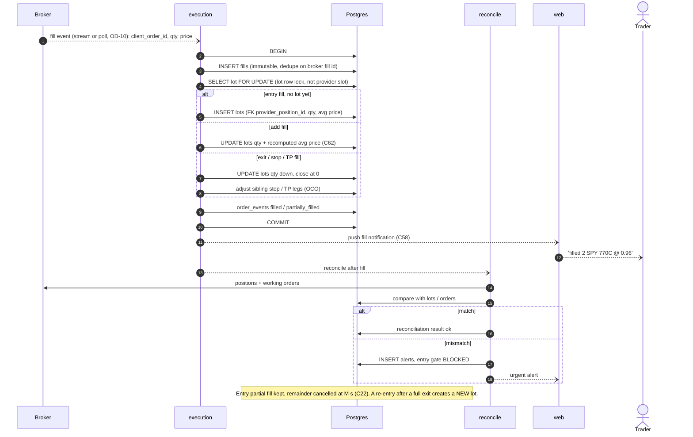

---

## 6.8 Service restart / recovery (TRD §9 startup sequence)

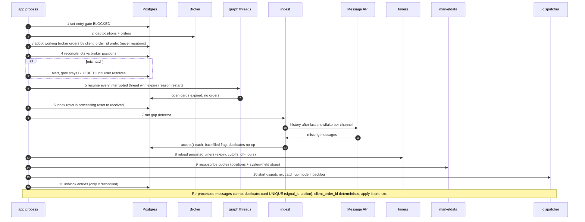

---

## 6.9 Reconciliation (periodic, every 60 s in market hours + after every fill)

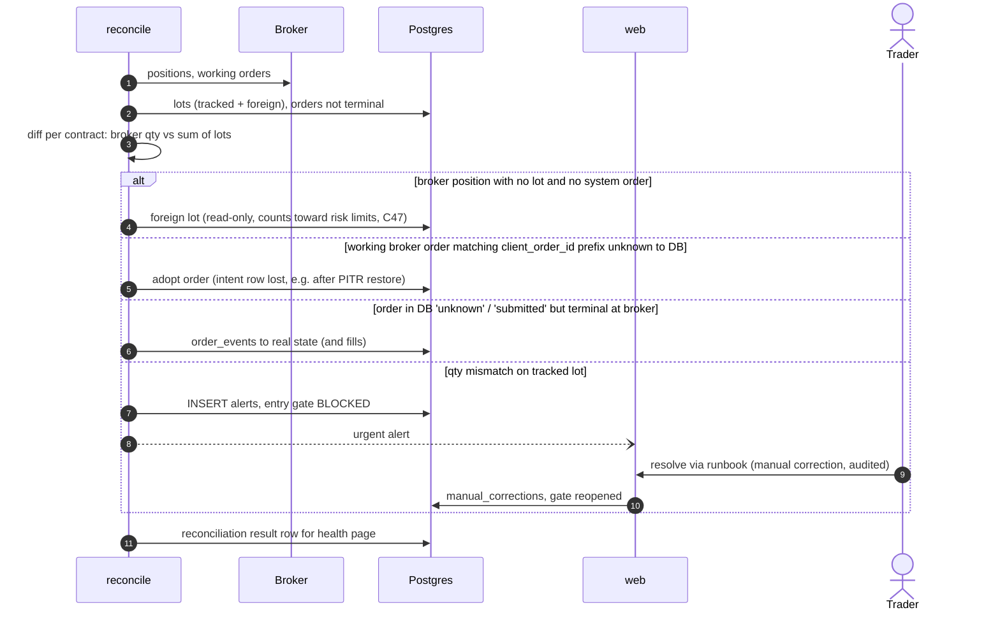

---

## 6.10 End-of-day expiration management (0DTE, C19)

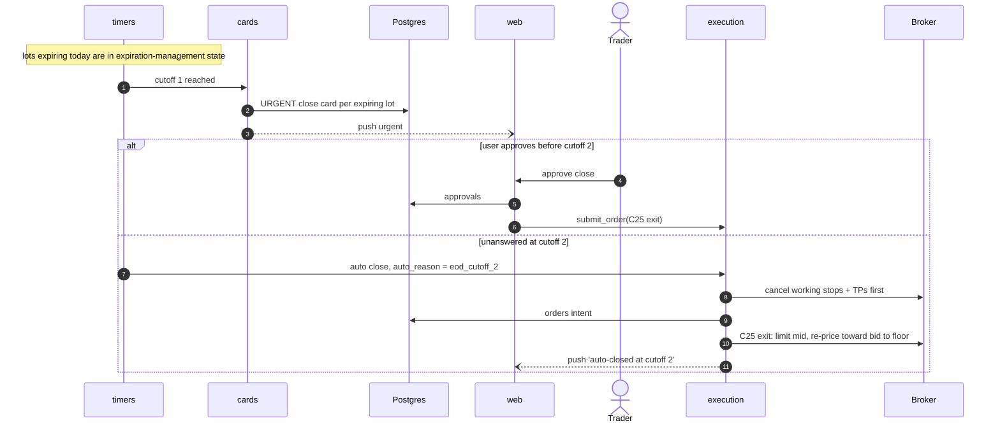

---

## 6.11 Failure: LLM slow path fails over, then degrades

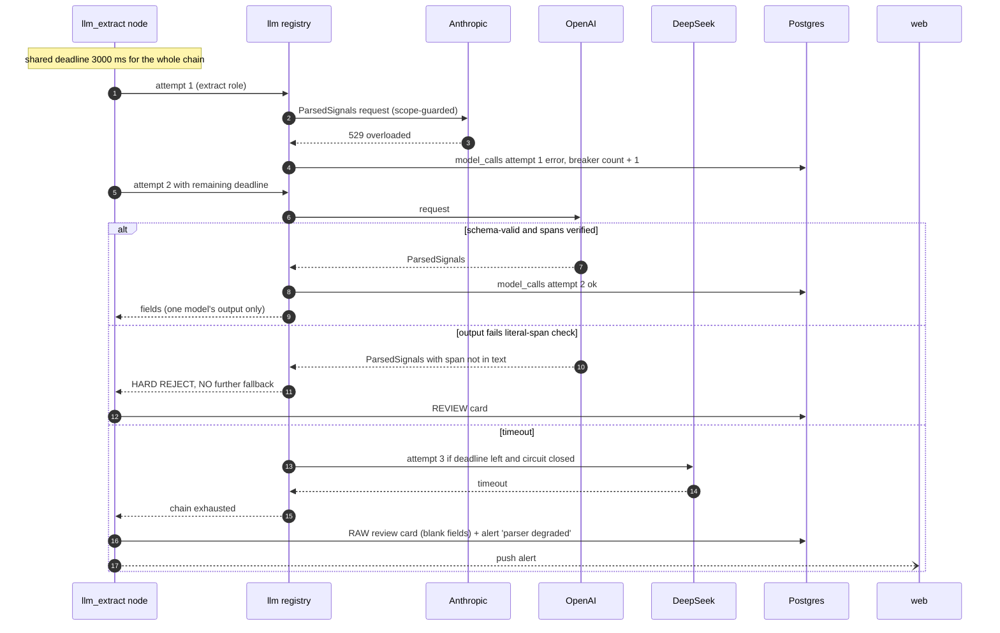

---

## 6.12 Failure: poison message

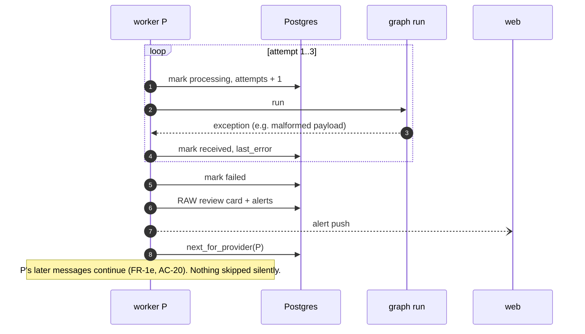

Broker submit timeout and crash-during-order sequences are in [09 §9.8](09-failure-recovery.md).
