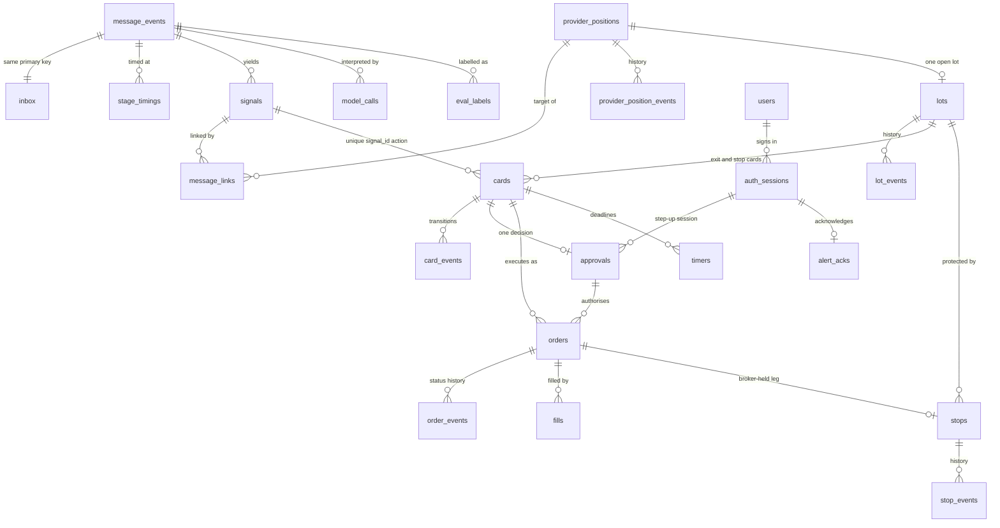
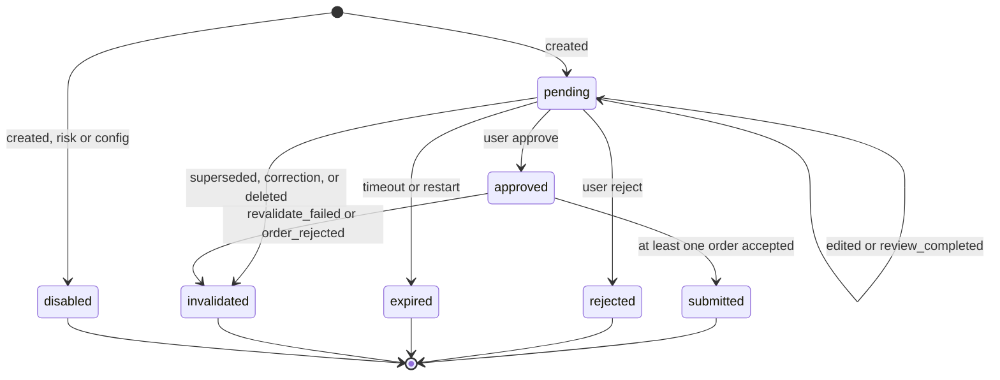
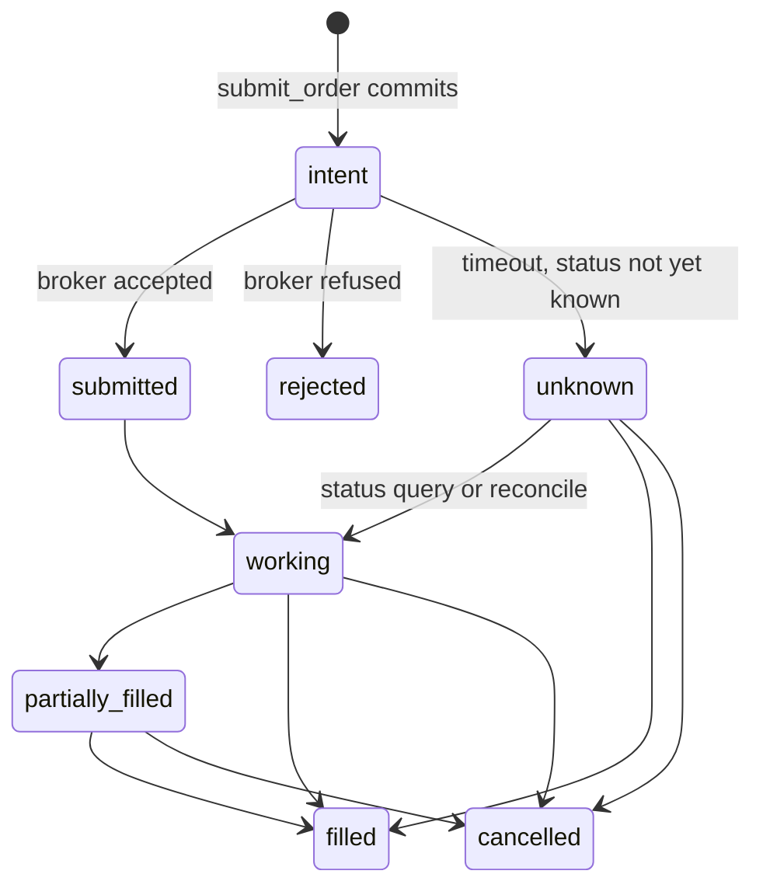

# 7. Data Model

[← Sequences](06-sequence-diagrams.md) · [Index](README.md) · Next: [Deployment →](08-deployment.md)

PostgreSQL 17 holds domain state in `public` and LangGraph state in schema `langgraph`. The table classes live under `backend/app/**/models.py`.

| Class | Rule | Tables |
|---|---|---|
| Append-only audit | New rows only. A correction is a new row. | `message_events`, `stage_timings`, `model_calls`, `signals`, `message_links`, `provider_position_events`, `lot_events`, `stop_events`, `card_events`, `approvals`, `order_events`, `fills`, `alerts`, `alert_acks`, `config_changes`, `manual_corrections`, `audit_log`, `system_flag_events`, `eval_labels`, `eval_runs` |
| Current state | Updated in place. History of the ledgers is the `*_events` tables. | `inbox`, `provider_positions`, `lots`, `cards`, `orders`, `stops`, `timers`, `config`, `dispatcher_heartbeat`, `system_flags`, `users`, `auth_sessions`, `push_subscriptions` |
| LangGraph | Orchestration. Checkpoints are pruned on a daily task. | `langgraph.checkpoints`, `checkpoint_blobs`, `checkpoint_writes`, `checkpoint_migrations`, `store` |

There is no `providers` table and no `logins` table. Authors are Discord ids. Sign-ins are rows in `audit_log`.

## 7.1 Relationships

`PROVIDER` is not a table. `provider_id` and `channel_id` are columns. A position with a null `opened_channel_id` is in no lane book. Foreign lots have a null provider position.

## 7.2 Ingestion and interpretation

```mermaid
erDiagram
    message_events {
        bigint message_id PK
        text event_type PK "create edit delete"
        bigint event_seq PK
        bigint provider_id
        bigint channel_id
        bigint thread_id
        bigint guild_id
        bigint reply_to_id
        timestamptz posted_at
        text body
        jsonb payload
        bool backfilled
        timestamptz received_at
    }
    inbox {
        bigint message_id PK
        text event_type PK
        bigint event_seq PK
        bigint provider_id
        bigint channel_id "lane with provider_id"
        text status "received processing done failed stale"
        int attempts
        text skip_reason "muted_author channel_not_configured"
        text interpret_outcome
        jsonb interpret_reasons
        bool late
        bool backfilled
    }
    stage_timings {
        bigint message_id PK
        text event_type PK
        bigint event_seq PK
        int attempt PK
        text stage PK "received dequeued context fast jev laya llm validated card pushed"
        timestamptz at
    }
    signals {
        uuid signal_id PK
        bigint message_id
        text event_type
        bigint event_seq
        int idx "unique with the event key"
        bigint provider_id
        text msg_type
        text instrument "option stock unclear"
        jsonb fields
        jsonb field_sources
        text interpreter "fast jev llm laya none"
        bigint model_call_id
        bool stale
        bool late
    }
    message_links {
        bigint id PK
        uuid signal_id
        bigint provider_id
        uuid provider_position_id
        text outcome "linked new_position none ambiguous"
        text method "reply thread contract code jev llm laya user_correction"
        numeric confidence
        uuid_array candidate_position_ids
        bigint supersedes_link_id
        jsonb evidence
    }
    model_calls {
        bigint id PK
        bigint message_id
        uuid card_id
        text provider "anthropic openai deepseek openai_compat typesafe laya"
        text model
        text role "extract note prelabel"
        int attempt
        text outcome
        int latency_ms
        int tokens_in
        int tokens_out
        numeric cost
        jsonb request
        jsonb response
    }
```

`interpret_outcome` is `fast_success`, `jev_success`, `fallback_success`, `review`, `validation_failure`, `scope_violation`, or `fixture`.

## 7.3 Trading state

```mermaid
erDiagram
    provider_positions {
        uuid provider_position_id PK
        bigint provider_id
        bigint opened_channel_id
        text instrument "option stock"
        text underlying
        date expiry
        numeric strike
        text option_right "call put"
        text status "watch conditional open trimmed closed"
        text condition_text
        uuid reentry_of_position_id
        uuid opened_by_signal_id
        numeric remaining_fraction
    }
    provider_position_events {
        bigint id PK
        uuid provider_position_id
        text change "open add trim exit stop_set stop_move stop_cancel tp_set correct close watch condition_set"
        jsonb before
        jsonb after
        uuid signal_id
        bigint manual_correction_id
    }
    lots {
        uuid lot_id PK
        uuid provider_position_id
        bool is_foreign
        text status "open closed"
        text instrument
        int qty
        numeric avg_price
    }
    lot_events {
        bigint id PK
        uuid lot_id
        text change "open fill_add fill_reduce close reconcile_adjust adopt_foreign"
        uuid fill_id
    }
    cards {
        uuid card_id PK "uuid5 of dedupe_key"
        text dedupe_key UK
        text source "signal system manual"
        uuid signal_id
        text action "entry add trim exit stop tp close review"
        text card_type "normal inferred review disabled"
        text state "pending approved submitted rejected expired invalidated disabled"
        uuid provider_position_id
        uuid lot_id
        jsonb proposal
        timestamptz posted_at
        timestamptz valid_until
        text note
        bool note_hidden
        int version
    }
    card_events {
        bigint id PK
        uuid card_id
        text from_state
        text to_state
        text reason_code
        text actor "user system timer"
        jsonb proposal_snapshot
    }
    approvals {
        uuid approval_id PK
        uuid card_id UK
        text decision "approve reject"
        jsonb edits
        jsonb approved_proposal
        int card_version
        uuid session_id
        bool step_up
    }
    orders {
        uuid order_id PK
        text client_order_id UK
        text broker_order_id UK
        uuid card_id
        uuid approval_id
        uuid parent_order_id
        uuid lot_id
        text status "intent submitted working partially_filled filled cancelled rejected unknown"
        text mode "shadow paper live"
        text auto_reason
        int qty
        numeric limit_price
    }
    fills {
        uuid fill_id PK
        text broker_fill_id UK
        uuid order_id
        int qty
        numeric price
    }
    stops {
        uuid stop_id PK
        uuid lot_id
        uuid order_id
        uuid card_id
        text kind
        text basis "premium underlying"
        text held_by "broker system"
        text status
        numeric level
        int qty
    }
```

`orders` requires `approval_id` or `auto_reason`. `cards` requires `card_type = disabled` exactly when `state = disabled`.

Watch and conditional positions may omit part of the contract. Open, trimmed, and closed option rows require expiry, strike, and right.

## 7.4 Platform

```mermaid
erDiagram
    users {
        uuid user_id PK
        text email UK
        bool is_active
        bool must_change_password
    }
    auth_sessions {
        uuid session_id PK
        uuid user_id
        text token_hash UK
        timestamptz expires_at
        timestamptz step_up_at
        timestamptz revoked_at
    }
    audit_log {
        bigint id PK
        text action
        uuid user_id
        jsonb detail
    }
    config {
        int id PK "always 1"
        int version
        jsonb document "includes trading_mode"
    }
    config_changes {
        bigint id PK
        int version UK
        jsonb document
        jsonb diff
        text actor
    }
    system_flags {
        text flag PK "entries_blocked kill_switch catch_up feed_degraded parser_degraded"
        bool active
        text reason
    }
    system_flag_events {
        bigint id PK
        text flag
        text actor
        bool active
    }
    dispatcher_heartbeat {
        int id PK "always 1"
        timestamptz beat_at
        text host
        int pid
    }
    timers {
        uuid timer_id PK
        text dedupe_key UK
        text kind "card_expiry entry_cancel cutoff_1 cutoff_2 offhours_release"
        text status "scheduled fired cancelled"
        timestamptz due_at
    }
    alerts {
        uuid alert_id PK
        text severity
        text kind
        text dedupe_key
        bigint message_id
        uuid card_id
    }
    alert_acks {
        uuid alert_id PK
        uuid session_id
    }
    push_subscriptions {
        uuid subscription_id PK
        text endpoint UK
        timestamptz revoked_at
    }
    manual_corrections {
        bigint id PK
        text target_type
        uuid target_id
        text action
        jsonb before
        jsonb after
        uuid session_id
    }
    eval_labels {
        uuid label_id PK
        bigint message_id
        text split
        text source
        jsonb label
        uuid supersedes_label_id
    }
    eval_runs {
        uuid eval_run_id PK
        text kind
        text model_ref
        jsonb metrics
        bool gate_passed
    }
```

`config.document` is the `RuntimeConfig` JSON: channels, muted authors, thresholds, the LLM chain, Laya, risk limits, cutoffs, and `trading_mode`.

Alert kinds include `feed_silence`, `parser_degraded`, `poison`, `reconcile_mismatch`, `catch_up`, `late_correction`, `message_deleted`, `risk_limit`, `exit_floor`, `provider_disabled`, `market_data`, `invariant_block`, `note_hidden`, `system_flag`, `auth_anomaly`, `message_api`, `timer_failed`, `order_failed`, `entry_partial`, `underlying_stop`, `eod_forced_close`, and `llm_spend`.

## 7.5 Card state machine

`price_band` is a legal reason in the transition table. The running check rejects the approve or the revalidation when the quote leaves the band, instead of a timer flipping the card by itself.

## 7.6 Order state machine

Status updates are forward-only. A second fill with the same `broker_fill_id` is a no-op.

## 7.7 LangGraph schema

| Table | Use |
|---|---|
| `checkpoints`, `checkpoint_blobs`, `checkpoint_writes` | Message runs checkpoint once, at the end (`durability=exit`). Approval runs checkpoint at `interrupt`. |
| `store` | Namespace `("provider", provider_id)`, keys `lexicon`, `habits`, `aliases`. Written by manual corrections. |

Message thread id: `msg:{message_id}:{event_type}:{event_seq}:{attempt}`. A crash retry uses the next attempt and starts again at `load_context`.

Approval thread id: `card:{card_id}`.

Recheck thread id: `recheck:{message_id}:{uuid}`. Those runs write no domain rows.
