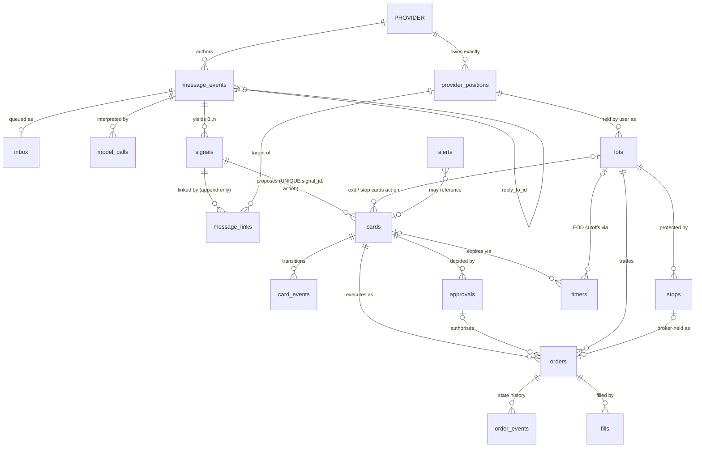
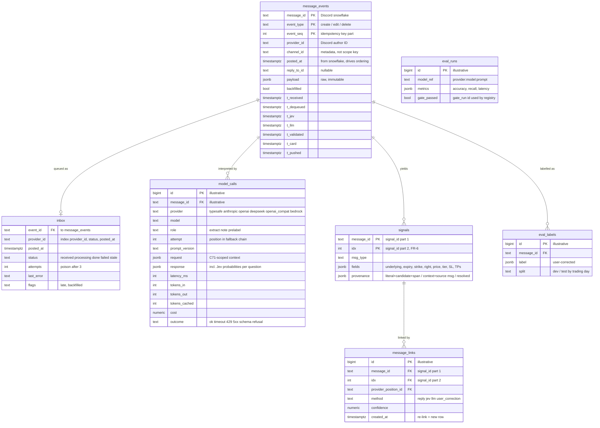
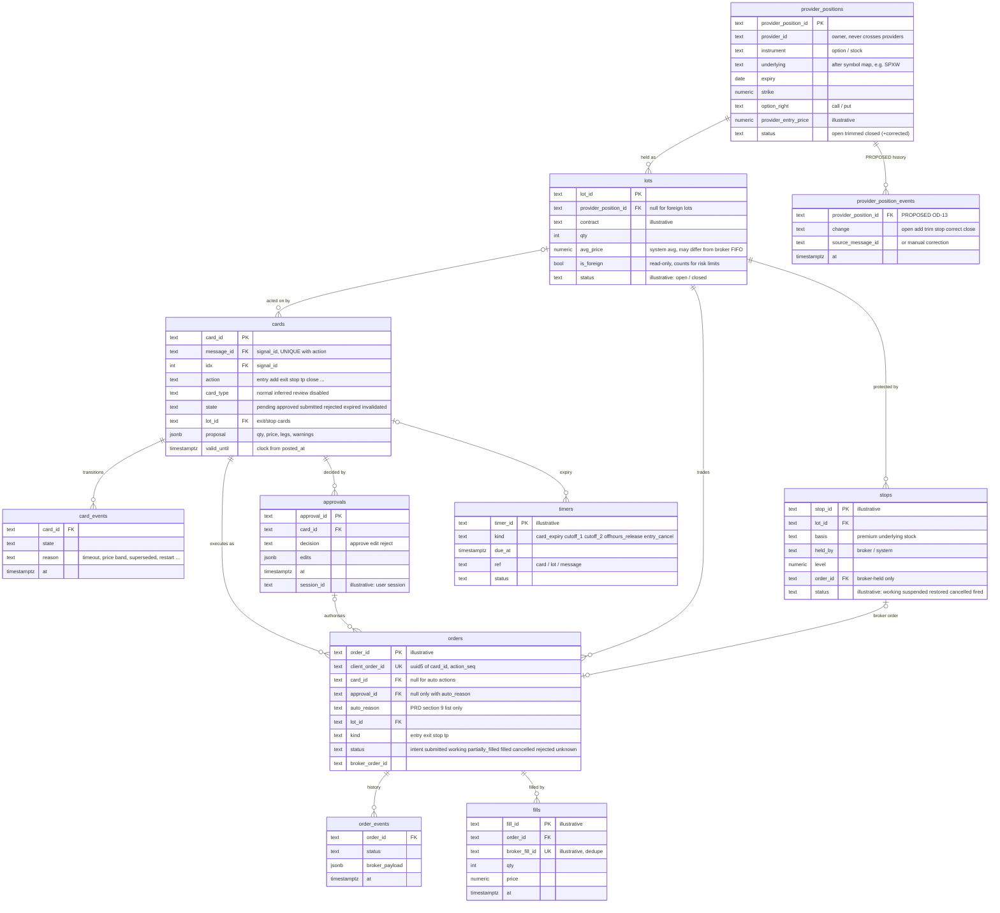
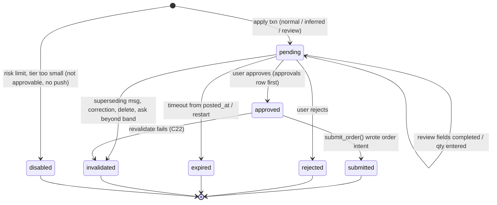
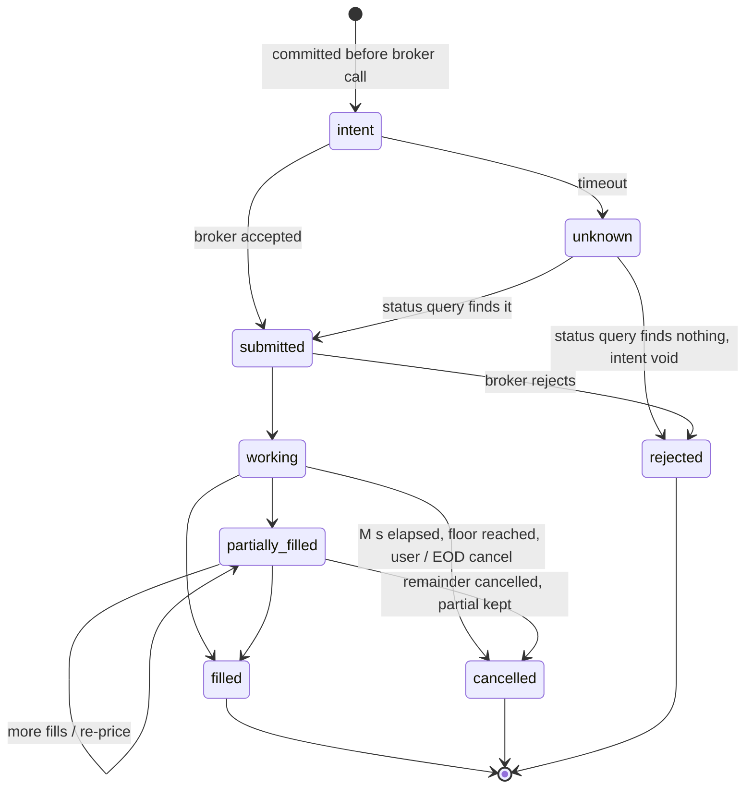
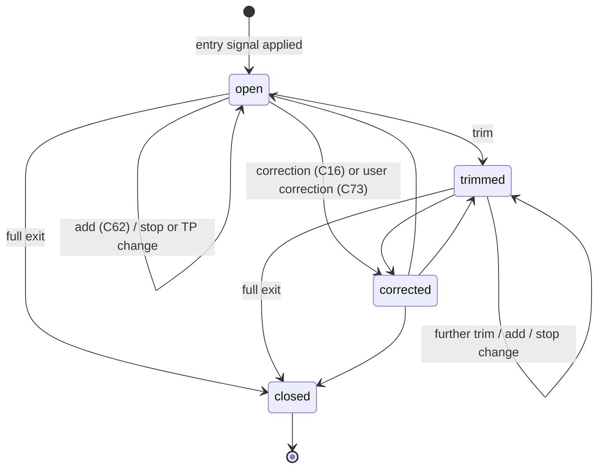
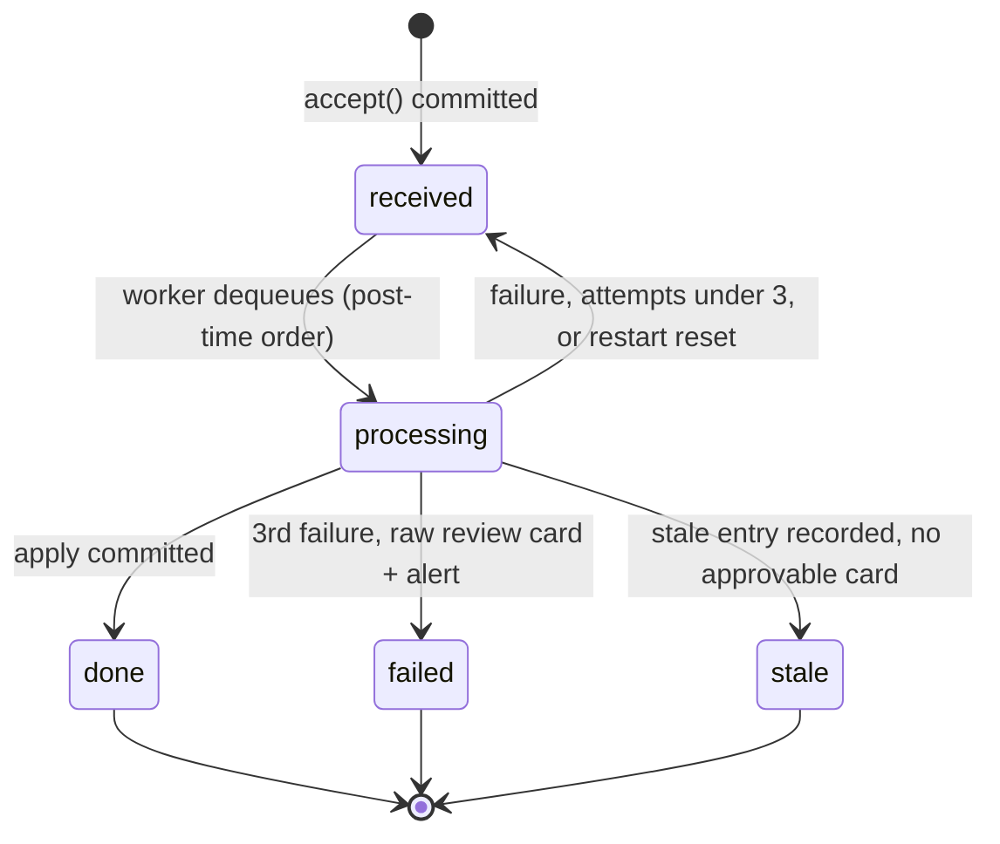

# 7. Data Model & Entity Relationships

[← Sequences](06-sequence-diagrams.md) · [Index](README.md) · Next: [Deployment →](08-deployment.md)

PostgreSQL 16 holds all system state (TRD §8). Tables fall into three classes:

| Class | Rule | Tables |
|---|---|---|
| **Immutable audit / event data** | App role has `INSERT, SELECT` only. Corrections are new rows. 7-year retention (C63). | `message_events`, `model_calls`, `signals`, `message_links`, `card_events`, `approvals`, `order_events`, `fills`, `alerts`, `config_changes`, `manual_corrections`, `logins`, `eval_labels`, `eval_runs` |
| **Current state** | Mutable, row-locked, derived from events + broker. | `inbox`, `provider_positions`, `lots`, `cards`, `orders`, `stops`, `timers`, `config`, `dispatcher_heartbeat` |
| **LangGraph-managed** | Orchestration only; not audit; checkpoints pruned after 30 days. | checkpoint tables (`AsyncPostgresSaver`), store tables (`PostgresStore`: provider profiles) |

**Column fidelity:** columns named in TRD §8 are shown as-is. Columns marked `"illustrative"` are the minimum needed to draw a relationship the PRD/TRD describe but whose column name is not specified; final names are an implementation detail. Entities marked **PROPOSED** do not exist in the TRD (see OD-13).

## 7.1 Relationship overview

- **`PROVIDER`** is a *logical* entity: `provider_id` = Discord author ID carried on every row; mute list and channel list live in `config` (FR-2, C57). No dedicated `providers` table is specified.
- **`provider_positions ||--o{ lots`**: C24 gives one lot per (provider position, user); "re-entry after full exit creates a new lot" (C62). Whether that re-entry is also a new provider position is implied by PRD §6 ("entry through exit") — the cardinality is drawn permissively.
- **Foreign lots** (positions not opened by the system) have no provider position (C47).

---

## 7.2 Ingestion & interpretation entities

---

## 7.3 Trading state & trading audit entities

### Immutable vs current state — why it is split this way
- **Audit rows record what was known and decided at the time** (a message, a model answer, a link, an approval, a fill). They are the evidence for AC-2 ("no order without an approval") and the replay source for `evalkit`. Because they are never updated, a re-link after a correction is a second `message_links` row, and a card transition is a `card_events` row.
- **Current-state rows are the working set** the pipeline locks and updates. Every change to them is caused by (and traceable to) an audit row: a `signals` + `message_links` insert moves a provider position; a `fills` insert moves a lot; an `approvals` insert moves a card.
- **Uniqueness does the idempotency work:** `message_events` PK (duplicate delivery), `cards` UNIQUE `(signal_id, action)` (re-processing after crash), `orders.client_order_id` UNIQUE (resubmission), broker fill id (duplicate fill events).
- **History gap (OD-13):** PRD §14 requires provider positions "and their history", and stops/lots history is needed for audit. The TRD's audit tables capture the *causes* but not a row-per-change of `provider_positions`, `lots`, `stops`. The PROPOSED `provider_position_events` (and equivalents for `lots`, `stops`) closes that gap; the alternative is deriving history by replaying `message_links` + `fills` + `manual_corrections`.

### Durability classes (C93)
| RPO ≈ 0 (synchronous commit to standby) | RPO ≤ 5 min (PITR) |
|---|---|
| `approvals`, `orders`, `order_events`, `fills`, `lots`, `provider_positions`, `message_links`, `signals`, `cards` | `model_calls`, `alerts`, `logins`, eval tables, checkpoints |

`message_events`/`inbox` are protected by *durable-before-200* plus Message API redelivery/backfill, so even a PITR rollback can be refilled by the gap detector (OD-1).

---

## 7.4 State machines

### Card

### Order

The TRD lists `unknown` as a terminal-looking state; resolving it through the status query is the FR-22 rule ("query before any retry").

### Provider position

### Inbox event

