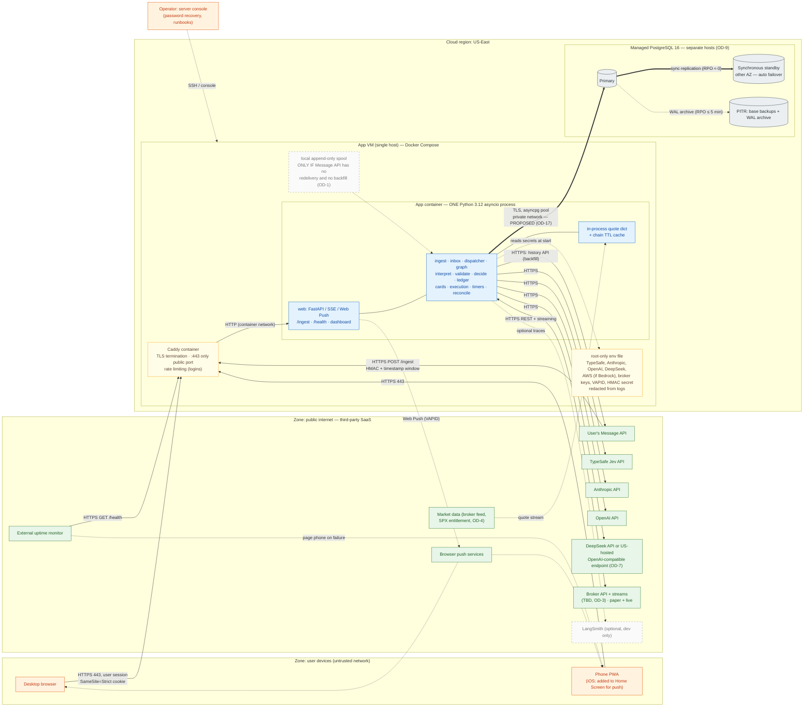
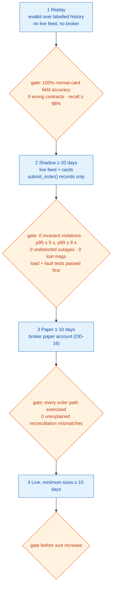
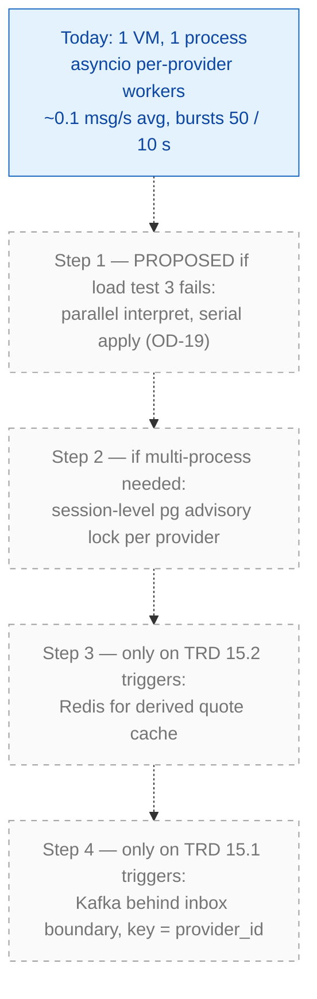

# 8. Deployment Architecture

[← Data model](07-data-model.md) · [Index](README.md) · Next: [Failure & recovery →](09-failure-recovery.md)

Source: TRD §3 (hosting row), §9, §10; PRD §13, §18. **One US-East VM running Docker Compose (app + Caddy), managed HA PostgreSQL in the same region with PITR, an external uptime monitor.** No Kubernetes, Kafka, Redis or vector DB.

## 8.1 Deployment topology and network boundaries

### What the diagram represents
Physical placement, trust zones and every network dependency. Outbound calls go to SaaS over HTTPS; the only inbound port is 443 on Caddy, carrying three kinds of traffic: the Message API webhook (HMAC-authenticated), the dashboard (email + password, allowlisted users), and the uptime probe.

### Component responsibilities
| Element | Responsibility | Notes |
|---|---|---|
| **Caddy** | TLS, reverse proxy, login rate limiting | Only public listener. |
| **App container** | Every module in one asyncio process | Simplifies ordering (per-provider workers are in-process) and removes network hops from the p95 budget. |
| **Env file** | All API keys and secrets | Root-only; never in code or logs (PRD §13). |
| **Managed Postgres** | All state; HA with automatic failover; PITR | **Must not share a host or disk with the app** (PRD §18, C93). |
| **External uptime monitor** | Probes `/health` (fails if dispatcher heartbeat > 15 s old) | Pages the phone — the only mitigation for system-held stops during an outage. |
| **Push services** | Deliver Web Push to desktop and phone | Best-effort; dashboard latency is the SLO, push is not (PRD §12). |

### Network / security boundaries
1. **Public → Caddy (443):** HMAC on `/ingest`; email + password auth for allowlisted users (no self-registration), short device-bound server-side sessions, password step-up for manual entry and flatten, append-only audit log.
2. **App → SaaS:** only provider-side text and provider context leave the system (FR-8); enforced by the Jev state builder's types and the LLM scope-guard middleware.
3. **App → Postgres:** a separate failure domain. Network path is not specified in the TRD (OD-17); private networking + TLS is the proposed default.
4. **Operator:** server console only — the sole password-recovery path (PRD §13).

### Important dependencies and their deployment implications
| Dependency | If slow/down | Mitigation |
|---|---|---|
| Message API | No new signals | Feed-health alert; backfill on reconnect; catch-up mode |
| Jev | Every message on slow path | Latency rises; nothing lost |
| LLM vendors | Slow path fails | ≥ 2 independent vendors, circuit breakers, raw review card |
| Broker | No orders / fills | Status query by client order ID; broker-held stops continue |
| Market data | No validation, no system-held stops | See [09 §9.7](09-failure-recovery.md) (OD-12) |
| Postgres | Trading halts | HA failover ≤ 5 min RTO; webhook 503 → redelivery |

---

## 8.2 Environments and go-live stages

PRD §17 defines a staged go-live. The runtime topology is the same in every stage; only `submit_order()`'s mode and the broker account change.

Each `(provider, model, prompt)` in the LLM chain must pass the replay gate on its own; config validation rejects live chain entries without a passing `gate_run` and chains with fewer than two independent vendors (TRD §4.8).

---

## 8.3 Scaling path (only on measured triggers)

The explicit prohibition in TRD §12: if only the single-provider slow-path burst test fails, apply Step 1; **do not** add Kafka or Redis for it.
