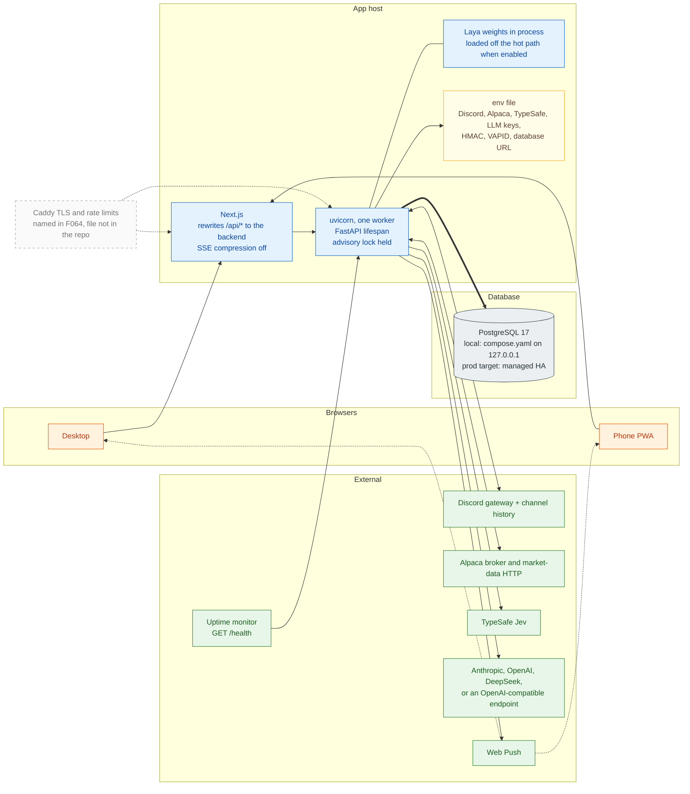

# 8. Deployment Architecture

[← Data model](07-data-model.md) · [Index](README.md) · Next: [Failure & recovery →](09-failure-recovery.md)

What the repository runs, and the production layout named in `docs/implementation/F064-deployment-runbooks.md`. The F064 images and Caddy file are not in the tree yet.

## 8.1 Processes and dependencies

### What actually starts

| Piece | Where it comes from |
|---|---|
| **PostgreSQL 17** | `compose.yaml`. One container, database `trading`, bound to `127.0.0.1`. Init scripts in `infra/postgres/init` create the owner and app roles. |
| **Backend** | `uv run fastapi dev` or uvicorn. `background_enabled` starts the listener, dispatcher, timers, consumer, reconciler, push, and gap loop. |
| **Frontend** | Next.js App Router. Browser calls same-origin `/api/v1/*`. `BACKEND_ORIGIN` defaults to `http://127.0.0.1:8000`. |
| **Single instance** | `hold_instance_lock` takes a session advisory lock when background work is on. A second process raises `SecondInstance` and does not trade. |
| **Health** | `GET /health` fails when the dispatcher heartbeat is stale and background work is on. `GET /api/v1/health/details` is the signed-in view. Heartbeat rows are written every 5 s. |

### Production target (F064)

One VM, Docker Compose for the backend image, the frontend image, and Caddy. Managed PostgreSQL in the same region, with failover and PITR, not a Postgres container on the app host. `uvicorn --workers 1` and `replicas: 1`. Secrets in a root-only env file. An external monitor pages the phone from `/health`. Those deploy files are still to be added; the process boundaries above are what the code assumes.

### Network boundaries

1. **Browser → Next.js → FastAPI.** Session cookie, `SameSite` strict, allowlisted emails, no self-registration. Users are created from the console (`app.auth.cli`). Step-up is required for manual entry and flatten. `origin_check` rejects a cross-origin dashboard.
2. **`POST /ingest`.** HMAC-SHA256 over `timestamp.body`, headers `X-Timestamp` and `X-Signature`, skew ±300 s. No session. Mounted at `/ingest`, not under `/api/v1`.
3. **Discord.** Outbound gateway using `DISCORD_TOKEN`. The listener drops channels that are not in `RuntimeConfig.channels` before insert.
4. **Alpaca and model vendors.** Outbound HTTPS. Paper and live must match `broker_kind` to the endpoint or the process refuses to start. Shadow never opens a broker order call.
5. **Models.** Requests carry provider text and the narrowed lane book. The scope guard blocks a request that contains portfolio fields.

### Desk routes

`/` desk home, `/feed`, `/cards/[cardId]`, `/positions`, `/lots/[id]`, `/orders`, `/manual/entry`, `/config`, `/discord`, `/alerts`, `/health`, `/users`, `/audit`, `/labels`, `/reports/trading`, `/login`, `/change-password`.

Live updates are one `EventSource` on `GET /api/v1/events`. The client also refetches on an interval (feed and cards about 8 s, health 15 s, Discord status 10 s) so a dropped SSE stream still converges.

### In-process background tasks

Started from `lifespan` when `background_enabled` is set:

| Task | Role |
|---|---|
| `config-listener` | `NOTIFY` on config changes, reloads `RuntimeConfig` |
| `bus` | `LISTEN` on `cards`, `alerts`, `flags`, `orders`, `fills`, `positions`, `lots`, `feed` |
| `reconcile` | periodic broker compare |
| `heartbeat` | `dispatcher_heartbeat` upsert |
| `feed-health` | silence and catch-up flags |
| `timers` | due deadlines |
| `broker-events` | Alpaca stream plus the simulator |
| `underlying-stops` | poll snapshots, fire system-held stops |
| `push` | Web Push from the same bus |
| `gap-detector` | every 60 s in regular hours |
| `discord-listener` | gateway, 30 s heartbeat |
| `llm-spend` | daily spend check |
| `checkpoint-prune` | daily checkpoint cleanup |

Laya's weights load on a background call when `laya.enabled` is set. Tests skip that load.
