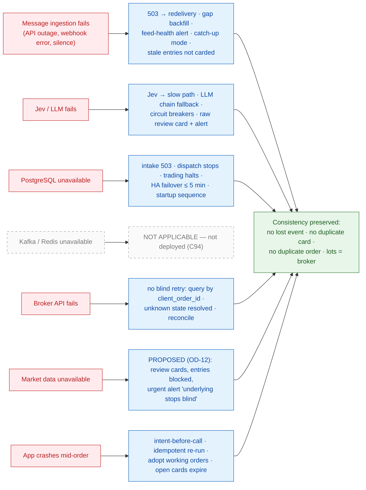
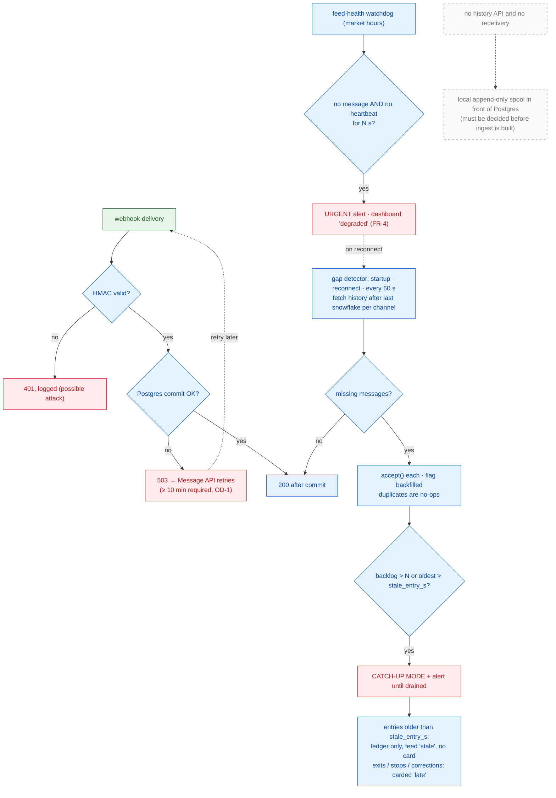
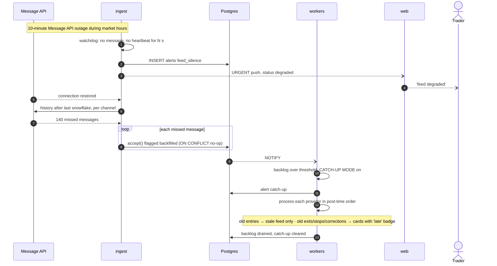
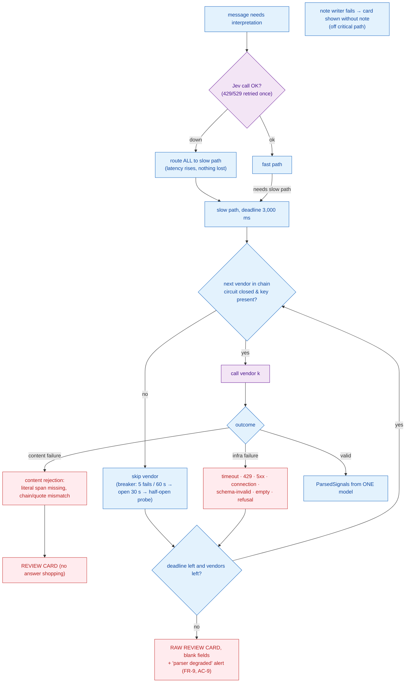
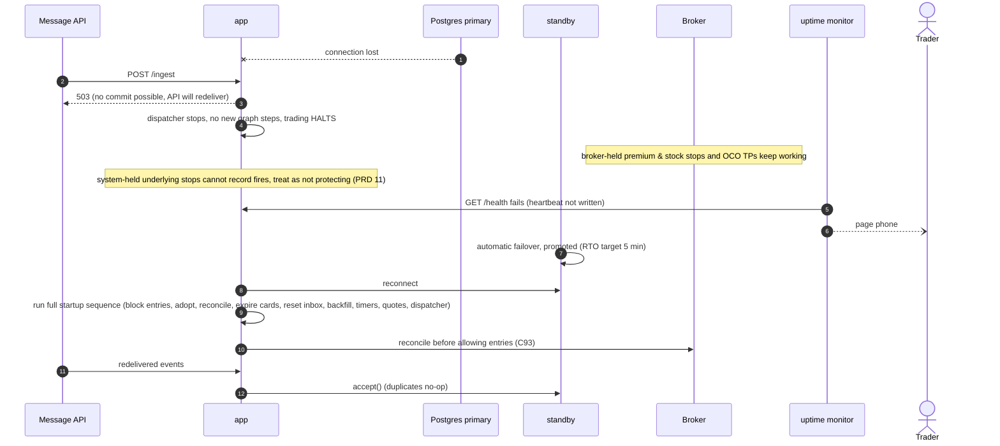
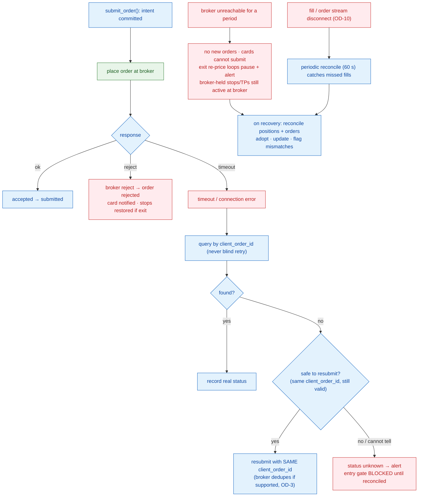
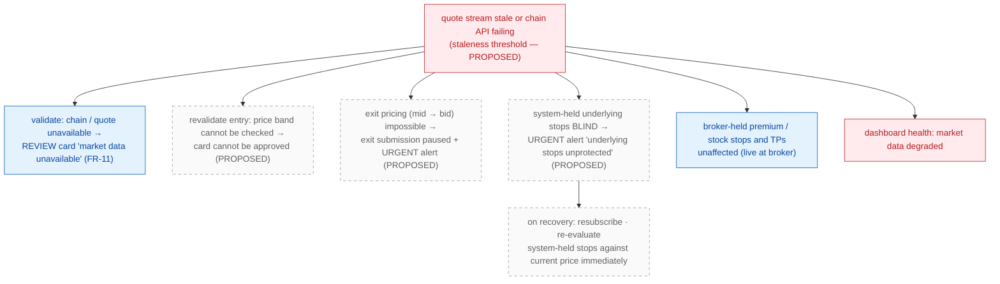
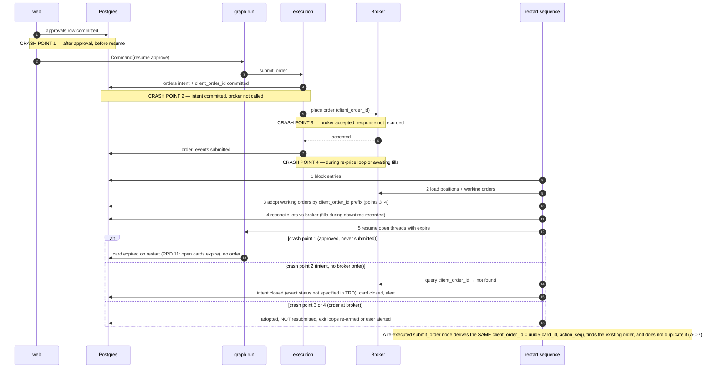

# 9. Failure & Recovery Architecture

[← Deployment](08-deployment.md) · [Index](README.md) · Next: [Architecture summary →](10-architecture-summary.md)

Guiding rules (PRD G5, §11; TRD §9):
1. **Never lose a signal silently.** Every message event is durable before it is acknowledged, and every failure leaves a visible record (card or alert).
2. **Never act on stale or unverified state.** When state is uncertain, the system blocks *entries*, not *exits*, and expires open approvals.
3. **The broker is the source of truth for holdings;** Postgres is the source of truth for decisions. Reconciliation reconnects them after any failure.
4. **Every side effect is idempotent:** event PK, card UNIQUE `(signal_id, action)`, deterministic `client_order_id`.

## 9.1 Failure-domain map

---

## 9.2 Message ingestion failure

**Consistency:** AC-21 — every message posted during the outage is redelivered or backfilled, none lost or duplicated. **Failure point:** if the Message API offers neither redelivery nor history, a Postgres outage or app outage loses messages; the greyed spool is then mandatory (OD-1).

---

## 9.3 LLM / model failure

**Consistency:** model calls have no side effects, so repeating them after a crash is safe. A missing API key disables that vendor at startup with an alert. Every attempt is recorded in `model_calls`.

---

## 9.4 PostgreSQL unavailable

**PITR restore (worse case):** data after the restore point may be lost for RPO-5-min tables. Orders placed after that point are recovered by reconciliation, which **adopts broker orders by `client_order_id` prefix** even if their intent rows were lost (TRD §9); missed messages are refilled by the gap detector. Trading data (approvals, intents, fills, ledger) is on the synchronous path so its RPO is ≈ 0.

**Why halting is correct:** there is no state to trade against, and a queue in front of Postgres (Kafka) would create exactly the dangerous mode TRD §15.1 lists: offsets ahead of a restored database, so trims/stops never re-process.

---

## 9.5 Kafka / Redis unavailable — not applicable

Neither is deployed (PRD C94, TRD §15). Their would-be failure modes were a reason for that decision:

| Would-be component | Failure mode avoided |
|---|---|
| Kafka | consumer lag → acting on stale signals; dead-lettered exit → lot never sold; offset reset → duplicate cards; PG restore behind offsets; retention expiry during outage |
| Redis | lost ~1 s of writes on failover; stale cached provider book → mis-linked follow-ups; dual-write races; a third source of truth for reconciliation |

If either is adopted on a measured trigger, it holds only rebuildable data (Redis) or sits behind the `inbox` boundary with offsets committed after `apply` (Kafka); its outage must then degrade to Postgres/broker with no correctness loss.

---

## 9.6 Broker API failure

The TRD requires "query before any retry" but does not define when a not-found order may be resubmitted; the "safe to resubmit" branch reuses the same `client_order_id` so the worst case is a broker-side duplicate rejection, never a second order. Exact semantics depend on the chosen broker's client-ID dedupe (OD-3).

---

## 9.7 Market data unavailable — **PROPOSED policy (OD-12)**

PRD/TRD only specify that a failed identity check yields a review card (FR-11) and that the SPX index entitlement is required for system-held stops (C49). The following policy is **proposed** and must be confirmed.

---

## 9.8 Application crash during an order

Crash points on the order path and why each is safe:

**Crash point 1 note:** PRD §11 says approval cards open at crash time expire. Whether an *approved-but-not-yet-submitted* card should expire or resume submission after restart is not explicitly stated; the diagram follows the stricter reading (expire, user re-acts) because prices will have moved. Flagged for confirmation alongside OD-14.

**Crash mid-message (before approval):** the event is re-processed from `load_context`; model calls repeat (no side effects); `apply` is one transaction; card uniqueness prevents a second card.

---

## 9.9 Consistency guarantees summary

| Failure | Data at risk | Guarantee | Mechanism | Test |
|---|---|---|---|---|
| Duplicate webhook | message | exactly-once receipt | PK `(message_id, event_type, event_seq)` | TRD §12 "duplicate delivery" |
| Crash during processing | card | no duplicate card | apply txn + UNIQUE `(signal_id, action)` | load test 5 (kill -9 each node) |
| Crash during order | order | no duplicate order | intent-before-call, deterministic `client_order_id`, adopt | AC-7 |
| Broker timeout | order | no blind retry | status query by client ID | FR-22 |
| Poison message | provider queue | no halt, no silent drop | 3 attempts → raw review card | AC-20 |
| LLM outage | signal | no loss | chain → raw review card | AC-9 |
| Message API outage | messages | no loss | redelivery / backfill, catch-up | AC-21 |
| Postgres failover | approvals / intents / fills / ledger | RPO ≈ 0, RTO ≤ 5 min | sync standby, startup sequence, reconcile | AC-23, load test 6 |
| Lot / broker drift | holdings | detected, entries blocked | reconcile startup + 60 s + post-fill | paper gate |
| App down | system-held stops | **not protected** (accepted risk) | uptime monitor pages phone | PRD §21 |
