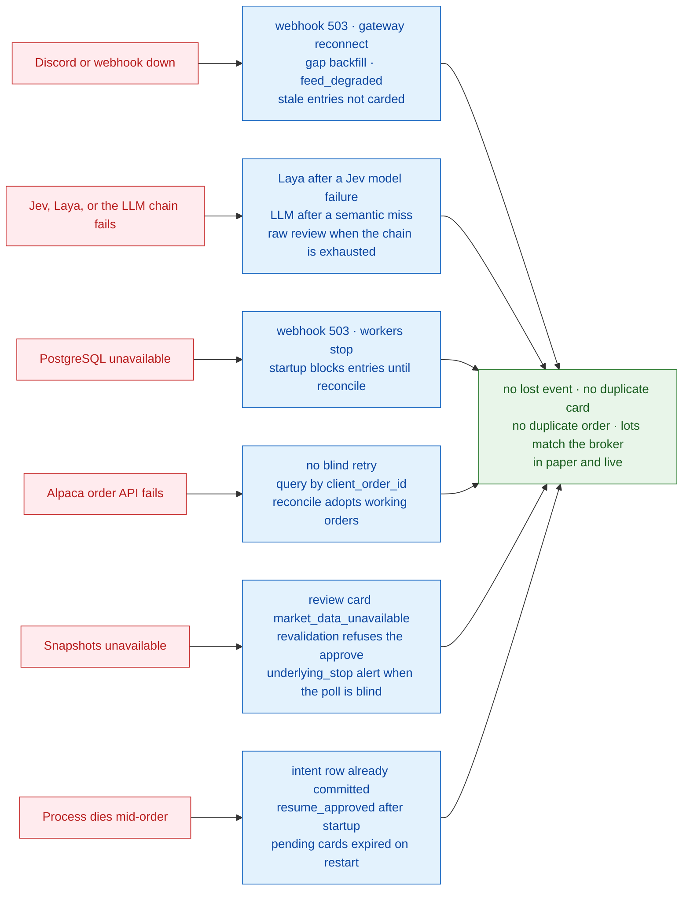
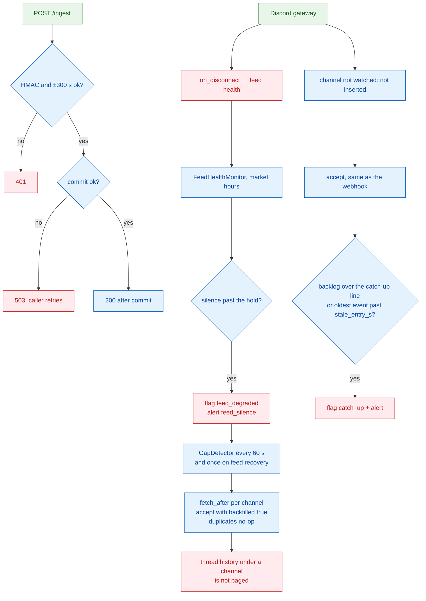
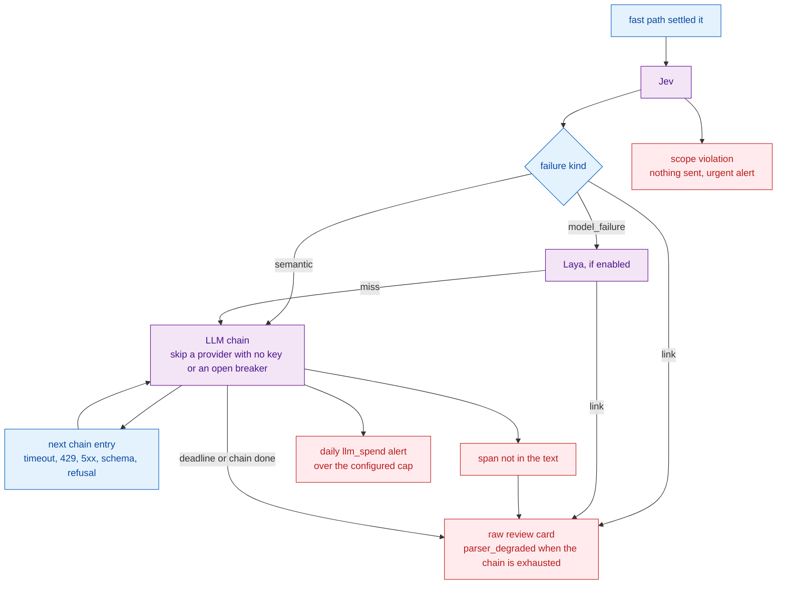
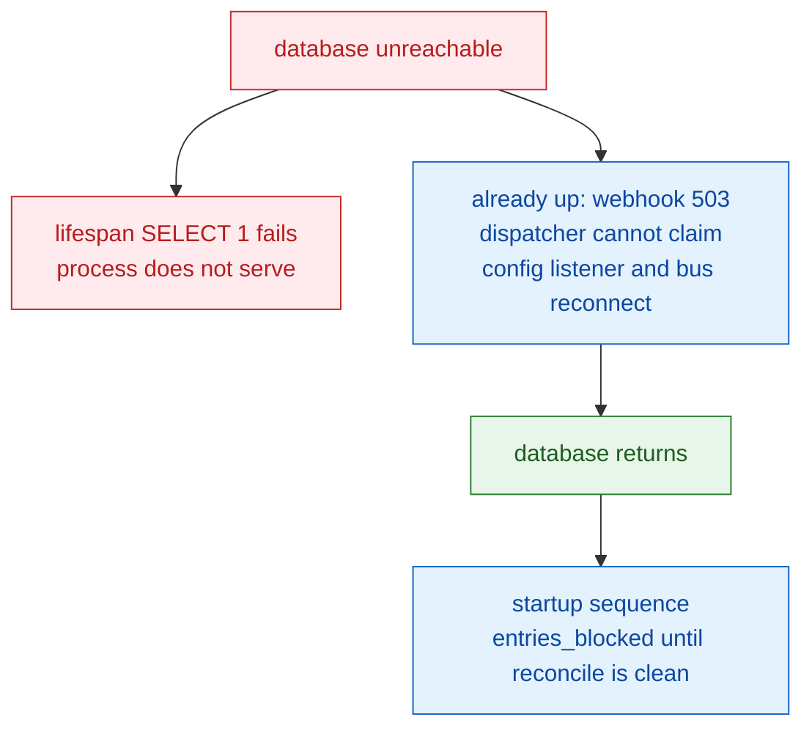
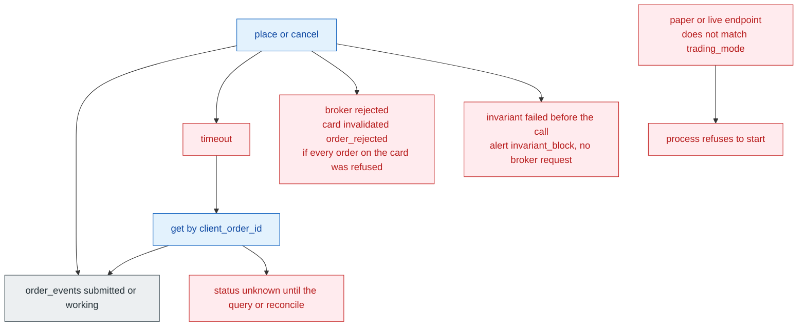
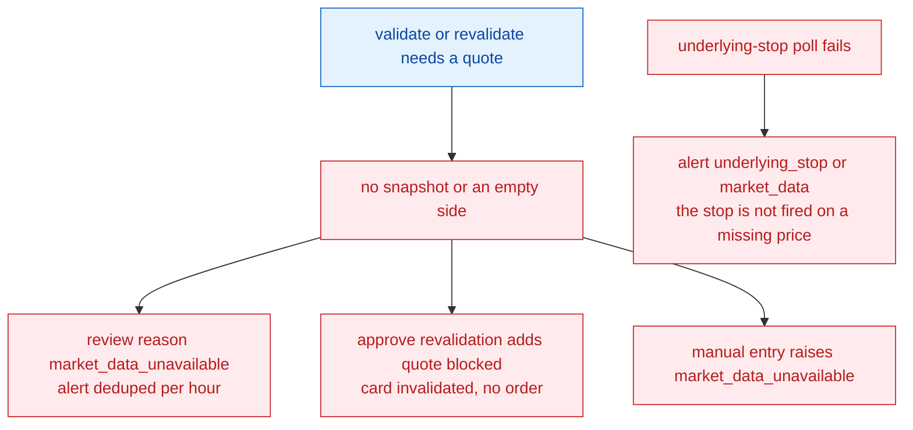
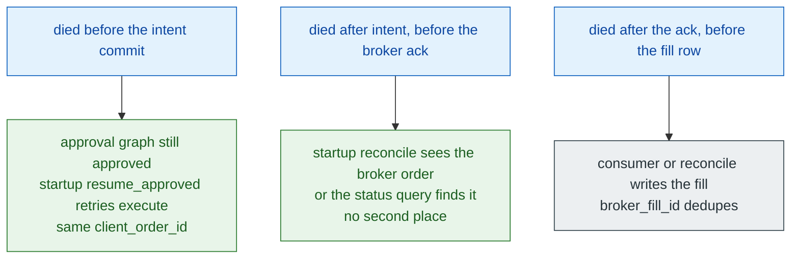

# 9. Failure and Recovery

[← Deployment](08-deployment.md) · [Index](README.md) · Next: [Architecture summary →](10-architecture-summary.md)

Three rules the code follows:

1. A message is durable before it is acknowledged, and a failed run leaves a card or an alert.
2. When state is uncertain, new entries stop. Exits still run. Open approvals from before a restart are expired.
3. In paper and live, Alpaca is the source of truth for holdings. Postgres is the source of truth for decisions. Shadow has no broker account to compare.

Idempotency keys: event primary key, `cards.dedupe_key`, unique `(signal_id, action)`, unique `client_order_id`, unique `broker_fill_id`.

## 9.1 Failure map

Kafka and Redis are not in the process, so they are not failure domains.

## 9.2 Ingestion

The listener's own heartbeat is every 30 s. `POST /ingest/heartbeat` is the same liveness mark for an external Message API.

There is no local spool. If both the gateway and Postgres are down, messages wait in Discord and the gap detector reads history after the database is back. That history call does not page messages that live only inside threads.

Catch-up is a flag and an alert. The lane still processes in `posted_at` order. Entries older than `stale_entry_s` are stored as inbox `stale` and do not become approvable cards.

## 9.3 Models

A content failure does not shop for another model. A vendor that is named in config and has no API key is skipped at startup with a `provider_disabled` warning. Laya `busy` and `queue_timeout` are `model_calls.outcome` values; the message then follows the same fallback as any other Laya miss.

`interpret_outcome` on the inbox row records which of these endings happened, with the trace in `interpret_reasons`.

## 9.4 PostgreSQL

The local compose file is a single PostgreSQL 17. Failover and PITR are the managed-database target in F064, not a second container in this repo. The app's recovery path is the startup sequence in [06.8](06-sequence-diagrams.md), which blocks entries until lots match the broker.

`BookChanged` during `apply` means the lane book moved after planning. The run fails, the attempt counts, and the worker retries against the new book. It does not commit a stale plan.

## 9.5 Broker

`check_mode` runs at startup and on every submit. Shadow selects `SimulatedBroker` and does not call Alpaca. A quote-less simulated order stays working, the same as a resting order with no market.

The consumer subscribes to both the Alpaca event source and the simulator, so a mode switch does not require a second process. Fills for the mode that is not selected simply do not arrive.

## 9.6 Market data

A zero bid or ask from IEX or the indicative feed is treated as "no quote on that side", not as a price of zero. Scale checks that need a quote to choose between `1.40` and `140` become a review instead of a guess.

System-held stops do not fire while the process is down or the snapshot poll is blind. Broker-held stops stay at Alpaca and do not need this process.

## 9.7 Crash during an order

Pending cards that were never approved are expired with reason `restart` during startup, and their approval threads are resumed with `expire`. Approved cards are not expired. Their execute step runs again after entries are allowed.

`ExitPolicy.adopt` reattaches open exit orders so re-pricing continues. Due timers are fired in the same startup, including a cutoff that elapsed while the process was down.

## 9.8 Consistency summary

| Guarantee | How |
|---|---|
| No lost event once accepted | Primary key, commit before `200`, gateway reconnect plus `GapDetector` |
| No duplicate card | `dedupe_key` and unique `(signal_id, action)` |
| No duplicate order | `client_order_id` checked before the broker call |
| No duplicate fill | unique `broker_fill_id`, forward-only order status |
| Lane order | one asyncio lock per `(channel_id, provider_id)`, claim by `posted_at` |
| One trader process | Postgres advisory lock for the lifetime of the process |
| Entries blocked while books disagree | `entries_blocked` from startup, failover, or `reconcile_mismatch` |
| Exits still possible while entries are blocked | `submit_order` checks the flag for `OrderKind.ENTRY` |
| Audit of an approval | `approvals` plus `card_events`, written before resume |
| Model cannot invent a digit | literal-span check on every interpreter, including fast |
| Model cannot resolve an ambiguous link | `resolve_link` keeps the hint as evidence |
