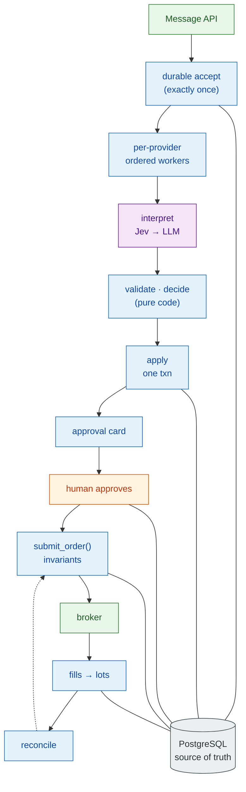

# 10. Architecture Summary

[← Failure & recovery](09-failure-recovery.md) · [Index](README.md)

## 10.1 One-page view

## 10.2 Summary by topic

### Overall architecture style
A **modular monolith**: one Python asyncio process containing a **deterministic event-processing pipeline** with a **durable human-in-the-loop pause**, backed by one highly-available PostgreSQL. It is explicitly *not* an autonomous trading agent (PRD §4): models interpret language; code decides; a human authorises. Orchestration uses LangGraph (per-message `StateGraph`, `interrupt()` for approval); everything outside the graph (ingest, market data, execution loops, timers, reconciliation, web) is plain async code.

### Main components
`ingest` → `inbox` → `dispatcher` → `graph` (`load_context`, `find_candidates`, `jev_interpret`, `route`, `llm_extract`, `assemble_signal`, `validate`, `decide`, `apply`, `notify`, `await_approval`, `revalidate`, `submit_order`) → `execution` → `broker`; plus `cards`, `ledger`, `timers`, `reconcile`, `marketdata`, `llm` registry, `web`, `evalkit`. See [02](02-component-architecture.md).

### Source of truth
- **PostgreSQL** is the only source of truth for system state and the only message queue (C94): message events, signals, links, provider ledger, lots, cards, approvals, order intents, fills, audit.
- **The broker** is the source of truth for actual holdings and working orders (PRD §11). Reconciliation keeps the two aligned and blocks entries on mismatch.
- LangGraph checkpoints hold *where a run paused*, never business truth (TRD §1.4).

### Data flow
Message → HMAC check → `accept()` (commit, then `200`) → NOTIFY → provider worker (post-time order, staleness check) → provider-scoped context → candidates → Jev (fast) or LLM (slow) → assembled signal with provenance → validation against live chain/quote → pure decision → **one transaction** writing signals, links, provider ledger, card → push → pause → approval row → resume → revalidate → invariants → order intent → broker → fills → lot update → reconciliation. See [03](03-end-to-end-data-flow.md).

### Context / signal correlation strategy
Three-step ladder, strictly within one provider (C71, AC-18):
1. `reply_to_id` whose parent is linked to the same provider's position (deterministic);
2. the provider's own book + Jev `links_to` above `T_link`;
3. otherwise a review card listing candidates.

Links are append-only rows with method and confidence. `signal_id` and `provider_position_id` are interpretation outputs, never transport keys. Two providers on the same contract → two provider positions → two lots. See [04](04-context-correlation.md).

### How ordering is maintained
- **Per provider, by Discord snowflake post time** (FR-1a, C88), not by arrival order.
- One worker per provider holds a **provider slot** from `load_context` through `apply`/`notify`, then releases it **before** the approval wait, so a pending approval never blocks that provider's next message.
- Late arrivals are applied, flagged `late`, and trigger re-linking of affected follow-ups into **review cards**, never automatic changes (FR-1b, C89).
- Validity clocks start at `posted_at` (C90).

### How concurrency is handled
| Concern | Mechanism |
|---|---|
| Same provider | serial worker (asyncio); future multi-process: session-level Postgres advisory lock per provider |
| Different providers | parallel workers |
| Ledger rows | `SELECT … FOR UPDATE` inside `apply` |
| Lots on fill | lot row lock, independent of provider slot |
| Model vendors | global semaphore for Jev and one per LLM vendor; 429 backoff inside the semaphore counts as queue wait |
| Card races (approve vs expire vs supersede) | card state machine: exactly one transition out of `pending`; late resumes are no-ops |
| Duplicate work after crash | UNIQUE constraints + deterministic `client_order_id` |

### How reliability and recovery work
Durable-before-acknowledge at every boundary; idempotent effects; HA Postgres with synchronous standby for trading data (RPO ≈ 0, RTO ≤ 5 min) and PITR for the rest; an 11-step startup sequence (block entries → load broker → adopt orders → reconcile → expire open cards → reset inbox → backfill → timers → quotes → dispatcher → unblock); periodic reconciliation; poison-message isolation; feed-health, heartbeat and uptime monitoring. Broker-held stops protect positions during outages; system-held underlying stops do not (accepted risk). See [09](09-failure-recovery.md).

### Where LLMs (models) are used
| Model | Role | Bounded by |
|---|---|---|
| **TypeSafe Jev** | Fast path: classify message type, assign roles to code-found numbers, pick ticker/right/expiry/tier/fraction, link to provider position, exit intent | Chooses only among code-provided candidates; calibrated probabilities; thresholds route; confidence only downgrades |
| **LLM chain** (Anthropic → OpenAI → DeepSeek, OD-7) | Slow path: missing candidates, context-implied fields, multi-signal messages | Shared 3 s deadline; ≤ 2 read-only tools; schema + literal-span verification; scope guard; no answer shopping; one model per message |
| **LLM note writer** | Advisory plain-language note per card | Async, labelled "advisory", cannot change fields; note guard hides unvalidated numbers (OD-6) |
| **LLM pre-labeler** | Offline labeling for evaluation (C64) | User corrects every label |

Models never receive the user's lots, balances or P&L (FR-8), never write to ledgers or the long-term store, and have no write tools.

### Where deterministic code is used
Everything else: candidate finding, routing thresholds, literal-span verification, validation (symbol map, optionable list, chain/quote identity, scale normalisation, adjacent strike, calendar dates), sizing (tiers, fractions, TP legs), risk limits, card tiers, ledgers, approval validity, FR-20 invariants, order construction and pricing, re-pricing, system-held stops, stop restore, end-of-day close, reconciliation, staleness, sequencing, backfill. `decide` is a pure function so every live decision is replayable and every PRD scenario is a unit test.

### How human approval fits into the system
- Every entry, add, exit, trim, stop/TP change, bracket, manual entry and flatten needs an approval (PRD §9). The only automatic actions are the pre-approved ones: broker/system stop or TP firing after approval, exit re-pricing within an approved intent, EOD close at cutoff 2, and stop restore after an unfilled exit — each recorded with `auto_reason`.
- Approval is a LangGraph `interrupt()`; the approval record is written to the `approvals` table **before** resuming, so AC-2 is auditable from domain tables alone.
- Cards expire rather than act when unanswered (C18); entry cards also expire on price-band breach or supersession (C22). Review cards require the user to complete fields first; disabled cards explain why they are blocked.
- Manual operations use password auth (step-up for manual entry and flatten) and pass the **same** `submit_order()` checks (C42).

### How the architecture can scale
The design point is ~0.1 msg/s average with bursts of 50 messages/10 s; latency is dominated by model calls, not infrastructure. Scaling steps are ordered and **trigger-gated**:
1. **Single-provider slow-path bursts** (the identified risk): *parallel interpret, serial apply* — interpret a provider's queued messages concurrently, apply strictly in snowflake order, re-interpret if an earlier message changes the book (OD-19). No new infrastructure.
2. **More processes:** provider slot becomes a session-level Postgres advisory lock; `LISTEN/NOTIFY` still drives workers.
3. **Redis** only for derived, rebuildable data, only on TRD §15.2 triggers.
4. **Kafka** only behind the `inbox` boundary (key = `provider_id`, offset committed after `apply`), only on TRD §15.1 triggers.
5. **Multi-user** is a PRD non-goal; if ever needed, isolation comes from `user_id` on every row + row-level security, interpreting each message once and fanning out per user.

## 10.3 Principal risks carried by this architecture

| Risk | Where it shows up | Mitigation in design |
|---|---|---|
| Message API cannot redeliver or backfill | [09 §9.2](09-failure-recovery.md) | Blocking spike; local spool if needed (OD-1) |
| Single-provider slow-path burst breaches p95 | [04 §4.1](04-context-correlation.md) | Load test 3 → OD-19 |
| App VM outage leaves system-held stops blind | [08](08-deployment.md) | Uptime monitor pages phone; prefer broker-held stops |
| Provider-ledger error propagates to follow-ups | [04 §4.3](04-context-correlation.md) | Review cards, user corrections, eval data |
| 50–150 approval cards/day | [06 §6.6](06-sequence-diagrams.md) | One-tap phone approval, push |
| Unspecified behaviours (OD-10 – OD-14, OD-18) | marked in diagrams | Decide before phase 3/4 build |

See the full [open architectural decisions register](README.md#3-open-architectural-decisions-register).
