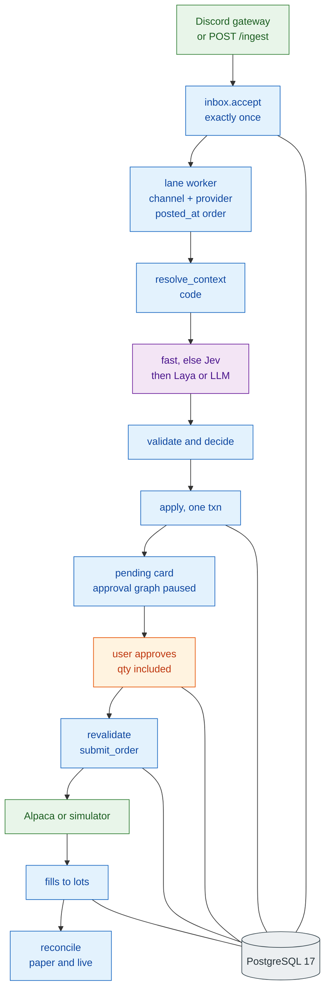

# 10. Architecture Summary

[← Failure and recovery](09-failure-recovery.md) · [Index](README.md)

## 10.1 One-page view

## 10.2 By topic

### Style

A modular monolith: one Python asyncio process, one Next.js desk, one PostgreSQL 17 database. The message graph is a `StateGraph` that ends at `notify`. Human approval is a second graph per card, paused with `interrupt()`. Ingest, market data, execution loops, timers, reconciliation, and the API are plain async code around those graphs.

### Modules

`discord_source` and `ingest` → `inbox` → `dispatcher` → message graph (`load_context`, `resolve_context`, `find_candidates`, `fast_interpret`, `jev_interpret`, `laya_interpret`, `llm_extract`, `decide_apply`, `raw_review`, `notify`) → approval graph (`await_approval`, `revalidate`, `execute`) → `execution` → Alpaca or `SimulatedBroker`.

Beside that path: `cards`, `ledger`, `validate`, `decide`, `pipeline`, `timers`, `reconcile`, `marketdata`, `llm`, `notify`, `auth`, `alerts`, `manual`, `runtime_config`, `reports`, `evalkit`, `observability`.

### Source of truth

- **PostgreSQL** stores messages, signals, links, the provider book and its events, lots and lot events, cards, approvals, order intents, fills, flags, and sessions.
- **Alpaca** is the source of truth for holdings and working orders in paper and live. Reconciliation blocks entries on a mismatch.
- **Shadow** fills inside `SimulatedBroker` from the quote feed. Reconciliation is skipped.
- **LangGraph checkpoints** store where an approval thread paused. Domain truth stays in the domain tables. Message runs checkpoint once, at the end.

### Data flow

Gateway or HMAC webhook → `accept` (commit, then ack) → `NOTIFY` → lane worker → lane context → code resolver → fast rules or Jev, then Laya or the LLM → span check → validate against a snapshot → `decide` → one transaction → SSE and push → approval thread paused → user decision row → resume → revalidate → intent row → broker or simulator → consumer → lot → reconcile.

### Correlation

Inside one lane, in order: reply chain (depth 3), thread, stated contract, else the single open position. A contradiction with the text makes the result ambiguous. A model hint is stored as evidence and does not create the link. Ambiguous and empty results are review cards. `watch` and `conditional` are book rows without cards. See [04](04-context-correlation.md).

### Ordering

- Per lane, by `posted_at`, then message id.
- The lane lock covers the message graph only. It is released at `notify`, before anyone approves.
- A late event is applied, flagged `late`, and follow-ups are rechecked into review cards.
- `valid_until` is computed from `posted_at`.

### Concurrency

| Concern | Mechanism |
|---|---|
| Same lane | one `asyncio.Lock`, one worker |
| Other lanes | other workers, same process |
| Second process | Postgres advisory lock, startup fails |
| Provider book | `lock_open_book`; `BookChanged` retries the attempt |
| Lots on a fill | lot row lock, no lane lock |
| Jev and each LLM vendor | semaphores and circuit breakers in the LLM and Jev clients |
| Laya | in-process queue; `busy` and `queue_timeout` fall through |
| Approve vs expire vs supersede | one legal transition out of `pending` |
| Duplicate work | unique keys and deterministic `client_order_id` |

Parallel interpret with serial apply is not implemented. A slow model call holds that lane and no other.

### Recovery

Commit before ack. Idempotent effects. Startup blocks entries, reconciles, expires pending cards, backfills, fires due timers, starts the dispatcher, then releases the block if the books match. See [09](09-failure-recovery.md).

Broker-held stops survive a process outage. System-held underlying stops do not, and a blind snapshot poll does not fire them.

### Where models are used

| Model | Role | Bound by |
|---|---|---|
| Fast rules | Whole-message patterns for the obvious cases | No model call. Spans still checked |
| Jev | Classify, assign roles, pick among candidates | Code candidates only. Thresholds downgrade |
| Laya | Local fallback after a Jev model failure | Not used for semantic or link doubts |
| LLM chain | Semantic extract and the advisory note | Configured order of `anthropic`, `openai`, `deepseek`, `openai_compat`. Shared deadline. Scope guard. No answer shopping |
| Prelabel | Offline labels in evalkit | A person corrects the label |

### Where code decides

Routing, the resolver, span checks, validation, card tier, limits, brackets, the blank quantity, risk, validity, order invariants, pricing, re-pricing, stops, end-of-day close, reconciliation, staleness, and sequencing. `decide()` is pure. Entry, add, trim, and exit cards leave `qty` for the user. A close card sells the lot.

### Human approval

Every entry, add, exit, trim, stop, take-profit, manual entry, and flatten needs an approval. Automatic orders carry `auto_reason`: exit re-price, underlying stop, end-of-day close at cutoff 2, stop restore.

The approval row is written before the graph resumes. Cards expire on their timer or on process restart. A review card cannot be approved until the missing fields are filled. Disabled cards explain the block.

Manual operations insert a card and approve it through the same executor. Password step-up is required for manual entry and flatten.

### Shape of the deployment

One uvicorn worker and one Next.js server. Local Postgres is the compose file. The production target is a managed PostgreSQL 17 with the app on one VM. A second backend is refused. Kafka and Redis are not used.

## 10.3 Risks the code still carries

| Risk | Where it shows | What the code does |
|---|---|---|
| Discord history misses thread-only messages | [09.2](09-failure-recovery.md) | Channel history is paged. Thread messages under a channel are not |
| One lane's model call delays that lane's next message | [04.1](04-context-correlation.md) | Other lanes keep running. This lane stays serial through `notify` |
| Process down, system-held stops silent | [08](08-deployment.md) | `/health` plus the uptime monitor. Broker-held stops still rest at Alpaca |
| A wrong provider-book update teaches the next message | [04.4](04-context-correlation.md) | Review cards, user corrections, eval labels |
| Snapshot poll lags the underlying | [02.4](02-component-architecture.md) | Default poll is 5 s. A missing quote does not fire the stop |
| Single database host in local compose | [08](08-deployment.md) | Production HA is the F064 target, not this compose file |
