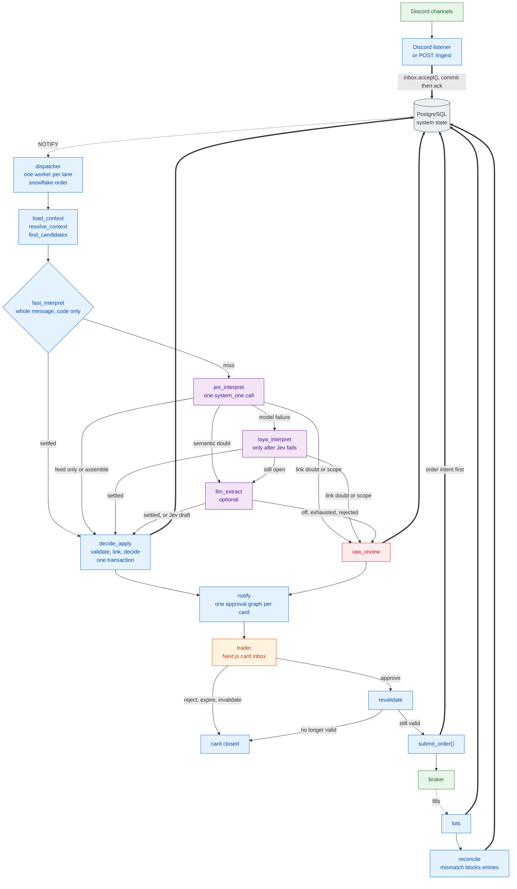

# 11. As-built architecture

[← Index](README.md) · Next: [Decision →](12-decision.md)

The same pipeline as [01](01-high-level-architecture.md)–[10](10-architecture-summary.md), on one chart: lane isolation, the deterministic fast path, Jev with a Laya fallback, and a decision engine that never chooses a quantity.

## 11.1 One-page view

Models interpret. `decide()` decides prices, stops, and the card type. A person approves. The only automatic orders are the ones that approval already authorised: a broker or system stop, a take-profit, exit re-pricing inside an approved intent, the end-of-day close, and stop restore.

PostgreSQL is the source of truth for messages, signals, the provider book, cards, approvals, and order intents. In paper and live, Alpaca is the source of truth for holdings and working orders. Shadow fills come from `SimulatedBroker` and reconciliation is skipped. LangGraph checkpoints record where an approval thread paused. They do not hold business state.

A lane is `(channel_id, provider_id)`. The worker holds that lane from `load_context` through `notify`, then releases it. The approval wait is a second graph, so a pending card does not block the lane's next message. Different lanes run in parallel.

`decide_apply` is one node on purpose: validation, linking, and `decide()` finish before the transaction, and the decided cards are written in that same transaction. A literal span that does not match the message text becomes a raw review card instead.
