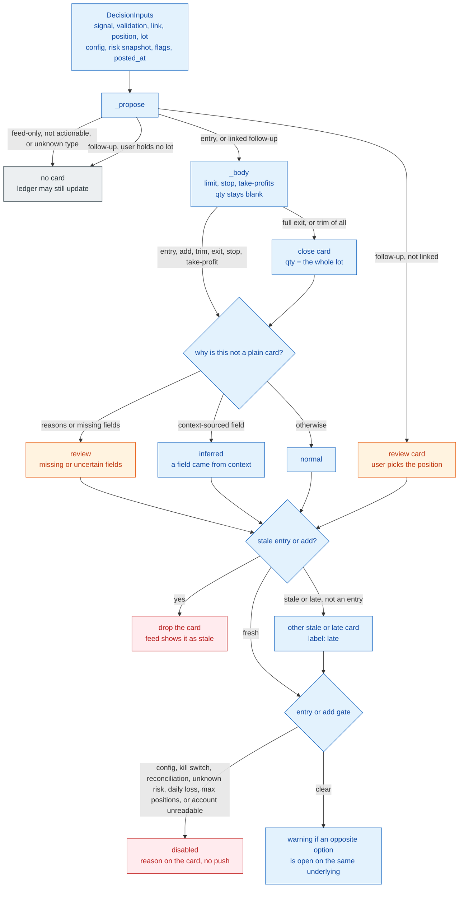
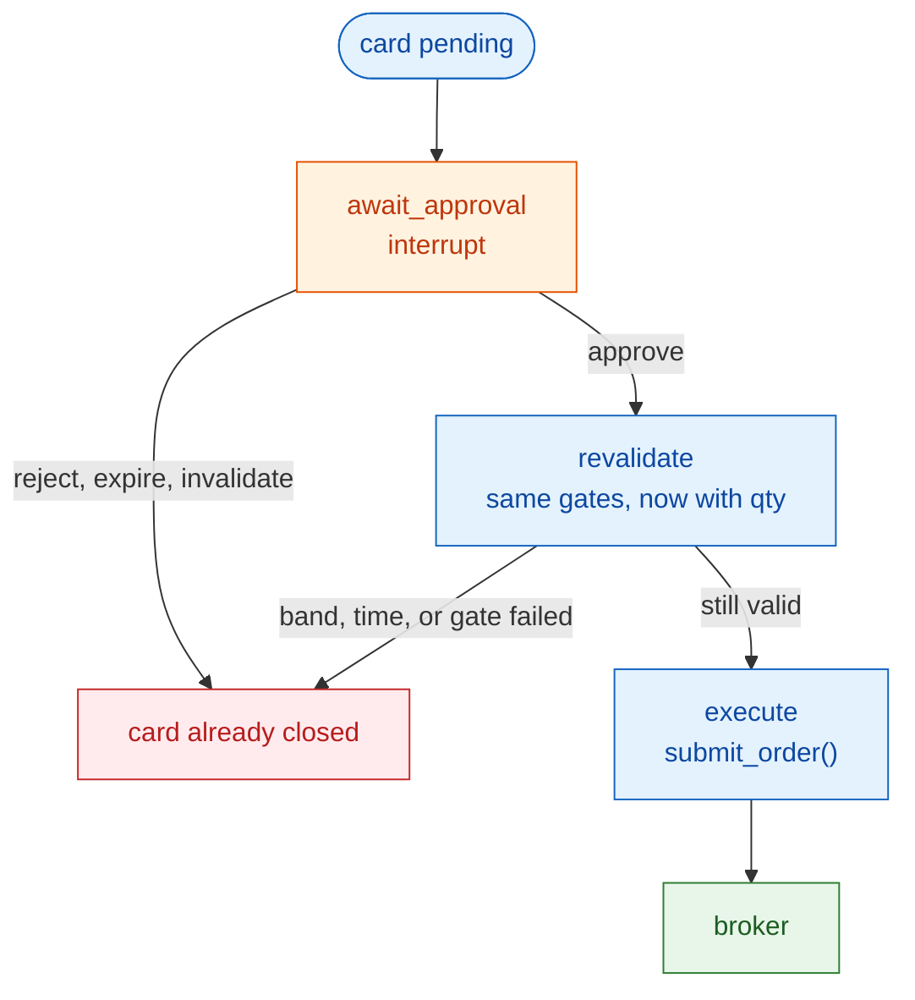

# 12. Decision

[← As-built architecture](11-as-built-architecture.md) · [Index](README.md) · Next: [Layers →](13-layers.md)

`decide()` in [backend/app/decide/engine.py](../../backend/app/decide/engine.py) is a pure function. The same inputs always produce the same cards. It does not read the database, call a model, or choose a quantity. The planner in [backend/app/pipeline/plan.py](../../backend/app/pipeline/plan.py) gathers the inputs; `apply` writes the result.

## 12.1 From a parsed signal to a card

An opening message (`entry`, `stock_entry`) is an entry card. It is an add only when it is already linked to a live position that is not a watch or conditional setup. Follow-ups map to add, trim, close, exit, stop, or take-profit. A trim whose fraction is `all` is a close.

Quantity is blank on every buy and sell card. The user types it. A close card is the exception: it sells the lot the user already holds. `decide()` refuses to return if it set a quantity on anything else.

Entry gates run again at approval, after the user has entered a quantity. That second pass is where max exposure and buying power can disable the card. At creation time those two need a quantity, so they do not fire yet. The kill switch and the reconciliation block disable entries and adds only. Exit and stop cards are still created.

## 12.2 Approval

One approval graph per card, thread `card:<card_id>`. The approval row is written before the graph resumes.

