# 13. Layers

[← Decision](12-decision.md) · [Index](README.md) · Next: [Jev →](14-jev.md)

Six layers. Each one hands the next a named object. A queue, a cache, or a model does not choose which provider position a message belongs to. That choice is code, in the correlation layer, before any model is asked.

```mermaid
flowchart TB
    classDef code fill:#e3f2fd,stroke:#1565c0,color:#0d47a1
    classDef model fill:#f3e5f5,stroke:#6a1b9a,color:#4a148c
    classDef human fill:#fff3e0,stroke:#e65100,color:#bf360c
    classDef ext fill:#e8f5e9,stroke:#2e7d32,color:#1b5e20
    classDef store fill:#eceff1,stroke:#37474f,color:#263238
    classDef fail fill:#ffebee,stroke:#c62828,color:#b71c1c

    subgraph transport ["1 · Transport"]
        direction LR
        SRC["Discord listener<br/>or POST /ingest"]:::ext --> ACC["inbox.accept()<br/>exactly once"]:::code
        ACC --> BOX[("message_events<br/>lane = channel, provider")]:::store
        BOX -.-> DISP["lane worker<br/>snowflake post time"]:::code
    end

    subgraph correlation ["2 · Correlation"]
        direction LR
        RES["resolve_context<br/>reply, then thread,<br/>then stated contract,<br/>then sole candidate"]:::code --> LINK["resolve_link<br/>code verdict"]:::code
    end

    subgraph interpretation ["3 · Interpretation"]
        direction LR
        FAST["fast_interpret"]:::code -->|"miss"| JEV["jev_interpret"]:::model
        JEV -->|"model failure"| LAYA["laya_interpret"]:::model
        JEV -->|"semantic doubt"| LLM["llm_extract"]:::model
        LAYA -->|"still open"| LLM
    end

    subgraph decision ["4 · Decision"]
        direction LR
        VAL["validate<br/>chain, quote, scale"]:::code --> DEC["decide()<br/>pure, no I/O"]:::code
    end

    subgraph state ["5 · State"]
        direction LR
        APPLY["apply<br/>one transaction"]:::code ==> ROWS[("signals · links<br/>provider book · card")]:::store
    end

    subgraph approval ["6 · Approval and execution"]
        direction LR
        HUMAN["trader"]:::human --> REVAL["revalidate"]:::code
        REVAL --> EXEC["submit_order()"]:::code
        EXEC --> BRK["broker"]:::ext
        BRK -.-> FILL["fills → lots"]:::code
        FILL --> RECON["reconcile"]:::fail
    end

    DISP -->|"envelope"| RES
    LINK -->|"candidates + resolution"| FAST
    FAST -->|"settled ParsedSignals"| VAL
    JEV -->|"settled ParsedSignals"| VAL
    LLM -->|"settled ParsedSignals"| VAL
    DEC -->|"ProposedAction"| APPLY
    ROWS -->|"pending card"| HUMAN
```

**Transport** gets every event in once and in order. It knows the lane. It does not know the position. Edits and deletes enter the same inbox.

**Correlation** runs before interpretation. The order is reply chain, then thread, then a contract stated in the text, then the single live position left in the lane. A model's `links_to` is stored as a proposal. It never becomes the link. If the code cannot pick one position, the card asks the user.

**Interpretation** reads provider text and the provider's own book. It does not receive the user's lots, balances, or P&L. A fast-path hit never calls a model. Jev is the primary model. Laya runs only when Jev produced no usable answer. The LLM runs only on a semantic doubt, and only when one is configured. A link doubt stops after Jev and becomes a raw review card. A scope violation never calls a model. Both are still written in one state transaction. The only write on this layer is a `model_calls` audit row.

**Decision** prices the card and chooses its type. See [12](12-decision.md).

**State** commits the signal, the link, the provider-ledger change, and the card together. A crash before that commit leaves the inbox event to be retried. A crash after it does not create a second card.

**Approval and execution** is the only path to the broker. `submit_order()` commits the order intent before the broker call. Reconciliation compares lots and working orders with the broker and blocks new entries on a mismatch.
