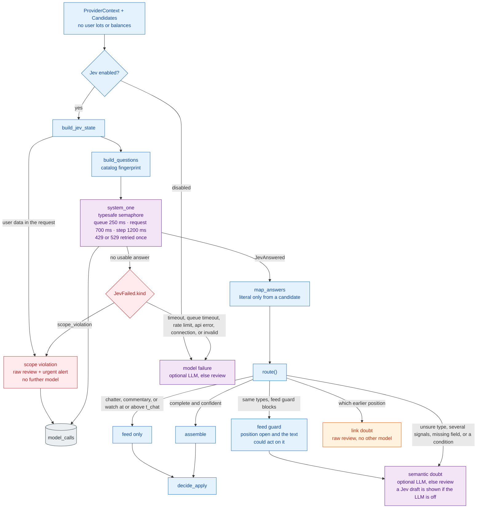

# 14. Jev

[← Layers](13-layers.md) · [Index](README.md)

Jev is the primary interpreter. One TypeSafe `system_one` call answers a fixed question catalog over candidates the code already found. Jev chooses among those candidates. It does not invent a number, pick a quantity, or write a link.

The model is pinned (`jev-1.13.0`). The question-set version is a hash of the catalog, stored on the audit row with the model that was requested and the model that answered.

## 14.1 Call, map, route

A failure is a `JevFailed` value. It does not raise, and it does not poison the inbox event.

`map_answers` keeps a field only when Jev picked a code-found candidate. The stored value is that candidate's exact span. Two numbers claiming one role, a required field left unstated, or a confidence under `t_field` are slow reasons, not a settled signal. Doubts about which earlier position is meant are review reasons. Those never go to the LLM.

`route()` is pure. The message graph sends each kind to a different place:

| Kind | Examples | Next |
|---|---|---|
| Settled | feed only at or above `t_chat`; assemble | `decide_apply` |
| `link` | re-entry among several positions | raw review |
| `semantic` | unsure type, several signals, missing field, a worded condition, feed guard | optional LLM, else a person. If the LLM is off and Jev left a draft, the card shows that draft |
| `model_failure` | off, timeout, queue timeout, rate limit, API error, connection, invalid answer | optional LLM, else review |
| scope violation | the request contained user-portfolio data | raw review and an urgent alert. Nothing is sent |

The feed guard refuses a feed-only verdict when the lane holds a position or today's setup and the text has an action word, a leaving phrase, a provider term, a fraction, or a price. Confidence does not override that. Over-blocking costs a review card. Under-blocking can drop an exit.
