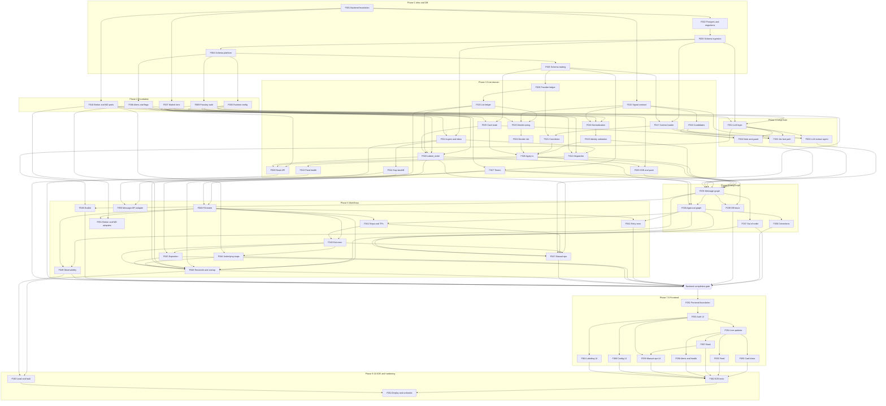

# Implementation Roadmap — Discord Signal Copy-Trading Assistant

**Sources of truth:** [`docs/prd.md`](../prd.md) v0.3 (requirements), [`docs/trd.md`](../trd.md) v0.5 (architecture), [`database-schema.md`](database-schema.md) (authoritative schema), [`backend/coding-practices.md`](../../backend/coding-practices.md) (engineering contract), [`docs/diagrams/`](../diagrams/README.md) (diagrams + open-decision register OD-1…OD-19).
**How to use:** implement features **strictly in ID order** (F001 → verify → F002 → verify …). Each `Fxxx-*.md` is self-contained: scope, files, API contract, tests, acceptance criteria, numbered steps. Do not start a feature until every feature in its *Depends on* list is done and verified. If something is missing or contradicts PRD/TRD: stop, record it under *Open decisions* here, and ask — never guess.

---

## 1. Architecture overview

A deterministic pipeline with models in narrow roles (PRD §4, TRD §1). **Models interpret, code decides, the human approves.**

```
Message API ─webhook─▶ ingest ─▶ inbox (Postgres) ─NOTIFY─▶ dispatcher (one worker per provider, post-time order)
                                                                 │ provider slot held
    ┌────────────────────── message graph (LangGraph, thread msg:<id>:<seq>) ──────────────────────┐
    │ load_context → find_candidates → jev_interpret → route ─┬→ assemble_signal                     │
    │                                                          └→ llm_extract (LangChain agent) ─┘    │
    │ → validate (code) → decide (pure code) → apply (ONE Postgres tx) → notify (SSE + Web Push)     │
    └──────────────────────────────────────────── slot released ────────────────────────────────────┘
                                   │ one approval graph per card (thread card:<card_id>)
                                   ▼
          await_approval (interrupt) → revalidate (C22) → submit_order() (FR-20 invariants) → broker
                                   execution loops (plain async): fills → lots, re-pricing, stops, EOD, reconcile
Next.js dashboard ◀── JSON API + SSE (FastAPI) ── passkey sessions, step-up for manual entry / flatten
```

- **Authoritative state:** PostgreSQL domain tables + broker reconciliation. LangGraph checkpoints hold only "where a run paused".
- **Transport / correlation / state are separate layers** (TRD §1.7): inbox + sequencer; reply-to → provider book → model `links_to` → review; Postgres transactions.
- **No Kafka, no Redis** (C94, TRD §15). In-process caches only behind accessors.
- **Every order goes through `submit_order()`** (TRD §1.5). No graph node or model calls the broker directly.

### 1.1 Backend layout (domain modules per TRD §2.2; layers inside a module only where they earn it)
```
compose.yaml                     local Postgres 17 (F002)
.env.example                     all env vars, no secrets
infra/postgres/init/             role + test-DB bootstrap SQL (F002)
backend/
  pyproject.toml  uv.lock  alembic.ini
  migrations/                    Alembic (env.py async, versions/)
  app/
    main.py                      FastAPI app factory + lifespan (starts background services)
    config.py                    Settings (env / secrets only)          db.py  (engine, sessions, transaction())
    logging.py                   structured JSON logs + redaction       db_models.py (imports every models.py for Alembic)
    api/                         deps.py, errors.py, schemas/base.py (CamelModel), routes/<area>.py
    runtime_config/              RuntimeConfig (tiers, limits, thresholds, LLM registry …) + audit
    markettime.py                XNYS calendar, ET clock, snowflake time, relative dates
    system/                      system_flags, heartbeat
    alerts/                      alert creation / ack
    auth/                        passkeys, sessions, step-up, enrolment CLI
    inbox/ ingest/ dispatcher/   transport boundary, webhook, sequencing, feed health, gap backfill
    interpret/                   signal contract, spans, candidates, context, jev/, llm_extract/, note, route
    llm/                         model registry, capability table, fallback chain, breaker, usage/cost
    validate/                    normalization, identity checks, missing-underlying suggestion
    ledger/                      provider positions, lots, correlation
    decide/                      pure decision engine
    cards/                       card state machine, validity, repo
    pipeline/apply.py            the apply transaction
    timers/                      persisted deadlines + scheduler
    execution/                   submit_order, invariants, pricing, entry/exit/brackets, fills, underlying stops, expiration
    broker/ marketdata/ messageapi/   ports (Protocols) + fakes + real adapters
    reconcile/                   reconciliation + startup sequence
    notify/                      SSE bus, Web Push
    manual/                      manual ops, kill switch, provider corrections
    evalkit/                     labels, replay, gate metrics
    observability/               stage timings, health metrics
    graph/                       message_graph.py, approval_graph.py, checkpointer.py
  tests/  unit/ integration/ api/ graph/ scenarios/ load/  (conftest.py per level)
frontend/                        Next.js 16 App Router (existing): app/, features/, components/, lib/
```
File rule for every module: `models.py` = SQLModel tables only; `repo.py` = queries and locking, no business decisions; `domain.py` (or named pure modules) = rules, no I/O; `service.py` = use case orchestration, owns transactions. Omit any of these a module does not need.

### 1.2 API conventions
- JSON API under `/api/v1`, session-cookie auth (`require_session`), except `POST /ingest*` (HMAC) and `GET /health` (public liveness).
- Response schemas extend `CamelModel` (Pydantic `alias_generator=to_camel`, `populate_by_name`, `serialize_by_alias`) → camelCase JSON matching the existing frontend types. **Discord IDs are serialized as strings.**
- Errors: `{"message": str, "code": str}` (matches `frontend/lib/api/client.ts`). Codes: `not_found` 404, `conflict` 409, `invalid` 422, `unauthorized` 401, `step_up_required` 403, `forbidden` 403 (Origin check), `rate_limited` 429, `unavailable` 503.
- OpenAPI is the contract; the frontend generates types from it (F052).

### 1.3 Endpoint catalog
| Method | Path | Feature |
|---|---|---|
| GET | `/health` | F001 (liveness), F049 (heartbeat age) |
| POST | `/ingest`, `/ingest/heartbeat` | F011, F013 |
| GET/PUT | `/api/v1/config` | F006 |
| POST | `/api/v1/auth/{register,login,step-up}/{options,verify}`, `/api/v1/auth/logout`; GET `/api/v1/auth/session` | F009 |
| GET | `/api/v1/events` (SSE); GET `/api/v1/push/vapid-public-key`; POST/DELETE `/api/v1/push/subscriptions` | F029 |
| GET | `/api/v1/feed`, `/cards`, `/cards/{id}`, `/positions`, `/positions/{id}`, `/lots`, `/lots/{id}`, `/orders`, `/orders/{id}`, `/fills`, `/alerts`, `/health/details`; POST `/alerts/{id}/acknowledge` | F030 |
| POST | `/api/v1/cards/{id}/decision` | F036 |
| POST | `/api/v1/manual/exit`, `/manual/stops`, `/manual/entry`, `/kill-switch`, `/flatten`, `/links`, `/lots/{id}/adjust`; POST/PATCH `/api/v1/positions`; PUT `/api/v1/providers/{id}/profile` | F047 |
| GET/PUT | `/api/v1/labels/queue`, `/api/v1/labels/{eventKey}` | F048 |

### 1.4 Commands (documented in F001/F002; used by every feature's DoD)
```bash
docker compose up -d postgres            # from repo root
cd backend && uv sync
uv run alembic upgrade head
uv run python -m app.graph.checkpointer setup   # LangGraph tables, as owner (F035)
uv run pytest
uv run ruff check . && uv run ruff format --check . && uv run mypy app
uv run fastapi dev app/main.py
cd frontend && pnpm dev                  # after F052
```

---

## 2. Phases

| Phase | Features | Exit |
|---|---|---|
| 0 — Spikes (not code in this repo's app) | S1–S6 (§11) | Blocking OD answers recorded here |
| 1 — Infrastructure & database | F001–F005 | `docker compose up`, migrations to head, schema constraint tests green |
| 2 — Backend foundation | F006–F010 | config, time, flags/alerts, auth, broker/market-data ports with fakes |
| 3 — Core deterministic domain | F011–F030 | full message → card path with **stub interpretation**, `submit_order()` in shadow mode, read API, SSE |
| 4 — LangChain | F031–F034 | LLM layer + extraction agent + Jev fast path + note, all behind the one `ParsedSignals` contract |
| 5 — LangGraph | F035–F039 | message graph + per-card approval graph; FR-1b, corrections, off-hours |
| 6 — Complete backend workflows | F040–F051 | execution loops, reconciliation, manual ops, evalkit, observability, real adapters (when unblocked) |
| **Gate** | Backend Completion Checklist (§7) | all boxes ticked |
| 7 — Next.js frontend | F052–F061 | every PRD FR-25 view against the real API |
| 8 — Frontend ↔ backend integration | inside F052–F061 (no mocks left) | mock `app/api/v1/*` deleted |
| 9 — End-to-end testing | F062–F063 | E2E + load/fault suites green |
| 10 — Hardening & go-live | F064 | deployment, runbooks, stage gates (PRD §17) |

**Order justification (deviations from the default sequence):**
- `submit_order()` core (F028) sits in Phase 3, before LangChain: it is deterministic, needed by the approval graph (F036), and testable with the fake broker.
- **LLM slow path (F032) before Jev (F033)** (conflict X6): the LLM-only interpreter is the TRD §15.6 fallback and works regardless of the OD-8 Jev bench; Jev then plugs into `route` as the fast path. Jev remains the primary interpreter at go-live if the bench passes.
- Real external adapters (F050, F051) are last in Phase 6 because they are **blocked** on spikes; everything before them runs on fakes behind the same ports.

---

## 3. Feature list

| ID | Feature | Depends on | Key requirements |
|---|---|---|---|
| [F001](F001-backend-foundation.md) | Backend foundation | — | TRD §3, coding-practices |
| [F002](F002-local-postgres-and-migrations.md) | Local PostgreSQL & migrations | F001 | PRD §18, TRD §9 |
| [F003](F003-schema-ingestion-interpretation.md) | Schema: ingestion & interpretation | F002 | FR-1, FR-6/7, PRD §14 |
| [F004](F004-schema-platform.md) | Schema: platform (alerts, config, auth, eval) | F003 | PRD §13, §14 |
| [F005](F005-schema-trading-state.md) | Schema: trading state & audit | F004 | FR-16, FR-20, AC-2 |
| [F006](F006-runtime-config.md) | Runtime config & audit | F004 | PRD §18, C69 |
| [F007](F007-market-time-calendar.md) | Market time & exchange calendar | F001 | FR-15, PRD §12 Time |
| [F008](F008-alerts-and-system-flags.md) | Alerts & system flags | F004 | FR-26, TRD §9 |
| [F009](F009-passkey-auth.md) | Passkey auth & sessions | F004 | PRD §13, AC-10 |
| [F010](F010-broker-marketdata-ports.md) | Broker & market-data ports + fakes | F001 | TRD §2.2, §7 |
| [F011](F011-ingest-webhook-inbox.md) | Ingest webhook & inbox | F003, F007 | FR-1, FR-1d, FR-3 |
| [F012](F012-per-provider-dispatcher.md) | Per-provider dispatcher | F011, F008, F006 | FR-1a, FR-1c, FR-1e, FR-2 |
| [F013](F013-feed-health-catch-up.md) | Feed health & catch-up mode | F012 | FR-4, FR-1c, AC-8 |
| [F014](F014-gap-detection-backfill.md) | Gap detection & backfill | F011 | FR-1d, AC-21 |
| [F015](F015-signal-contract-literal-spans.md) | Signal contract & literal-span verification | F001 | FR-6, FR-7, AC-11 |
| [F016](F016-candidate-finders.md) | Candidate finders | F015 | TRD §4.1, FR-12 |
| [F017](F017-provider-context-loader.md) | Provider context loader | F003, F005 | C71, FR-8 |
| [F018](F018-normalization.md) | Normalization: symbol map, dates, price scale | F007, F010, F015 | FR-12, FR-15, FR-15a |
| [F019](F019-contract-identity-validation.md) | Contract identity validation & missing underlying | F018 | FR-11, FR-13, FR-14, C84, C86 |
| [F020](F020-provider-position-ledger.md) | Provider position ledger | F005 | FR-16, C72 |
| [F021](F021-signal-correlation.md) | Signal correlation resolver | F017, F020 | FR-3, 7.3, AC-18 |
| [F022](F022-user-lot-ledger.md) | User lot ledger | F020 | FR-16, C24, C47, C62 |
| [F023](F023-decide-sizing-exits.md) | Decide: sizing, tiers, exits, TP legs | F022, F015, F006 | FR-17, C15, C51, C82, C83 |
| [F024](F024-decide-risk-warnings.md) | Decide: risk limits, staleness, warnings | F023 | FR-18, FR-19, FR-1c |
| [F025](F025-card-state-validity.md) | Card state machine & validity | F005, F007 | 7.2, C22, C18 |
| [F026](F026-apply-transaction.md) | `apply` transaction | F019, F021, F024, F025 | TRD §2.1, §9 |
| [F027](F027-persisted-timers.md) | Persisted timers | F005, F007 | 7.2, 7.6, 7.7 |
| [F028](F028-submit-order-core.md) | `submit_order()` core & invariants | F008, F010, F022, F025 | FR-20, FR-22, AC-2, AC-3 |
| [F029](F029-live-events-sse-push.md) | Live events: SSE & Web Push | F009, F026 | FR-25, FR-26 |
| [F030](F030-dashboard-read-api.md) | Dashboard read API v1 | F009, F026, F028 | FR-25 |
| [F031](F031-llm-provider-layer.md) | LLM provider layer | F003, F006, F008 | FR-9, C45, TRD §4.8 |
| [F032](F032-llm-extraction-agent.md) | LLM extraction agent (slow path) | F031, F015, F017 | FR-6–9, TRD §4.6, §5.5 |
| [F033](F033-jev-fast-path-routing.md) | Jev fast path & routing | F016, F017, F031 | FR-5, FR-10, TRD §4 |
| [F034](F034-advisory-note-guard.md) | Advisory note & note guard | F016, F025, F031 | C80, AC-13 |
| [F035](F035-message-graph.md) | Message graph | F012, F019, F026, F029, F032, F033, F034 | TRD §2.1, §5 |
| [F036](F036-approval-graph-decision-api.md) | Approval graph per card & decision API | F035, F027, F028 | G3, §9, AC-2, AC-4 |
| [F037](F037-out-of-order-relinking.md) | Out-of-order arrival & re-linking | F035 | FR-1b |
| [F038](F038-corrections-edits-deletes.md) | Corrections, edits & deletes | F036 | 7.5, AC-5 |
| [F039](F039-off-hours-hold.md) | Off-hours hold & release | F027, F035 | 7.7, C59 |
| [F040](F040-order-status-fill-intake.md) | Order status & fill intake | F028, F022 | FR-16, OD-10 |
| [F041](F041-entry-execution.md) | Entry execution | F036, F040 | 7.1, FR-21, C22 |
| [F042](F042-stops-tps-brackets.md) | Stops, take-profits & brackets | F036, F040 | 7.4, FR-23, AC-16 |
| [F043](F043-exit-execution-repricing.md) | Exit execution, re-pricing, stop restore | F040, F042 | 7.3, C25, FR-20(3) |
| [F044](F044-underlying-stops.md) | System-held underlying stops | F043, F010 | C49 |
| [F045](F045-expiration-management.md) | Expiration management | F043, F027 | 7.6, FR-24, AC-6 |
| [F046](F046-reconciliation-startup.md) | Reconciliation & startup sequence | F008, F014, F027, F036, F040, F043, F044, F045 | §11, AC-7, AC-23 |
| [F047](F047-manual-ops-kill-switch.md) | Manual ops, kill switch, provider corrections | F009, F028, F036, F037, F042, F043 | 7.9, FR-27, C73 |
| [F048](F048-evalkit.md) | Evaluation kit | F035, F031 | §17, C64, C67 |
| [F049](F049-observability.md) | Observability & health metrics | F035, F040 | PRD §16, TRD §11 |
| [F050](F050-message-api-adapter.md) | Real Message API adapter (**blocked**) | F011, F014 | §15, OD-1/2 |
| [F051](F051-broker-marketdata-adapters.md) | Real broker & market-data adapters (**blocked**) | F010, F040 | §15, OD-3/4/16 |
| [F052](F052-frontend-foundation.md) | Frontend foundation & contract | Backend gate | FR-25 |
| [F053](F053-frontend-auth.md) | Passkey login & step-up UI | F052 | PRD §13 |
| [F054](F054-frontend-live-updates-push.md) | Live updates & push (PWA) | F053 | FR-26, C21 |
| [F055](F055-frontend-card-inbox.md) | Card inbox & approval | F054 | G3, 7.1–7.5 |
| [F056](F056-frontend-message-feed.md) | Message feed | F054 | FR-10, FR-1c |
| [F057](F057-frontend-book.md) | Book: positions, lots, orders, fills | F054 | FR-25 |
| [F058](F058-frontend-alerts-health.md) | Alerts & system health | F054 | FR-4, PRD §16 |
| [F059](F059-frontend-manual-ops.md) | Manual ops & kill switch UI | F057, F053 | 7.9 |
| [F060](F060-frontend-config.md) | Config screen | F053 | PRD §18 |
| [F061](F061-frontend-labeling.md) | Labeling screen | F053 | C64 |
| [F062](F062-e2e-tests.md) | End-to-end tests | F055–F061 | AC-18, AC-15, AC-6 |
| [F063](F063-load-fault-tests.md) | Load & fault test suite | F046, F049 | AC-22, AC-23, §17 |
| [F064](F064-deployment-runbooks.md) | Deployment, runbooks & stage gates | F062, F063 | §17, §18, AC-12 |

---

## 4. Dependency graph



F050/F051 are not on the gate path: they are blocked on external decisions and may land any time after their dependencies. They are required before the **paper** stage (PRD §17), not before the frontend.

---

## 5. Implementation order
Strict numeric order F001 → F064. Allowed parallelism (only if two agents work at once): F007/F010/F015 after F001; F013/F014 after F011/F012; F031–F034 once Phase 3 is done; F056–F058 after F054. Never start a feature whose dependency is not verified.

**Feature cycle (every feature):** read the feature doc + referenced PRD/TRD clauses → re-verify any framework API it uses against official docs → implement steps in order → run the doc's tests → `uv run pytest && uv run ruff check . && uv run ruff format --check . && uv run mypy app` (frontend: `pnpm lint && pnpm tsc --noEmit && pnpm test`) → tick the Definition of Done → update `database-schema.md` / this README if anything changed.

---

## 6. Milestones

| Milestone | Reached after | Demonstrable result |
|---|---|---|
| **M1 Database** | F005 | `docker compose up -d postgres && uv run alembic upgrade head`; constraint tests prove AC-2 check, no-cross-provider FK, idempotency keys |
| **M2 Deterministic backend** | F030 | Webhook → inbox → dispatcher → (stub interpretation from fixtures) → validate → decide → apply → card visible via `GET /api/v1/cards` + SSE; `submit_order()` records shadow orders; AC-18 sequencing passes with stub |
| **M3 AI** | F034 | Real messages → `ParsedSignals` via Jev or LLM chain; fallback, scope guard, literal spans, note guard tested; `model_calls` has cost |
| **M4 Orchestrated backend** | F039 | Full message graph + approval graph; approve/reject/expire/invalidate/restart resumes; AC-4, AC-5, AC-19, AC-20 green |
| **M5 Backend complete** | F049 (+gate) | Execution loops, reconciliation, manual ops, evalkit replay, health metrics; AC-3, AC-6, AC-7 green on fakes |
| **M6 Frontend** | F061 | All FR-25 views on the real API; mocks deleted |
| **M7 Tested** | F063 | E2E + load/fault suites; AC-22/23 measured |
| **M8 Go-live ready** | F064 (+F050/F051) | Deployed; replay → shadow → paper → live gates (PRD §17) |

---

## 7. Backend Completion Checklist (gate before F052)
- [x] Database: all tables in `database-schema.md` exist via Alembic migrations; `alembic upgrade head` and `downgrade -1/upgrade` work on an empty DB; runtime role grants verified by test.
- [x] Local Docker environment: `docker compose up -d postgres` + documented commands work on a clean checkout.
- [ ] Repositories: every table has only the queries features need; no business decisions in `repo.py`.
- [ ] Domain rules: `decide`, invariants, validity, pricing, sizing are pure and unit/property tested (hypothesis for no-short/no-oversell).
- [ ] Services own transactions T1–T8 (`database-schema.md` §7); no transaction spans a model/broker call.
- [ ] API contracts: every endpoint in §1.3 exists, typed request/response models, error mapping, OpenAPI exported (`uv run python -m app.api.export_openapi > openapi.json`) and committed.
- [ ] LangChain: LLM registry, fallback chain, middleware guardrails, structured output, `model_calls` with cost — tests from TRD §12 "LLM provider tests" green.
- [ ] Jev fast path wired; routing thresholds configurable; OD-8 bench result recorded (go or LLM-only).
- [ ] LangGraph: message graph + approval graph with `AsyncPostgresSaver`; interrupt/resume tests for every resume value; crash-mid-node tests.
- [ ] Validation + error handling: no silent drops (FR-1e), raw review cards, alerts for every degraded state.
- [ ] Authentication: passkey-only, step-up, rate limiting, `logins` audit, no password path (AC-10).
- [ ] Observability: stage timings, `/health` heartbeat, health metrics endpoint.
- [ ] Scenario tests from TRD §12 tables (real-trade patterns, sequencing/context) all green.
- [ ] AC coverage (§9): every backend-provable AC has a passing test.
- [ ] `uv run pytest`, ruff, mypy clean; no `TODO` without an OD reference.

---

## 8. Definition of Done (global — each feature doc adds its own)
- Requirements in the doc's *Acceptance criteria* are met and proven by tests listed in the doc.
- Tests run against real PostgreSQL (never SQLite) where the DB is involved.
- `ruff check`, `ruff format --check`, `mypy app` clean (frontend: eslint, `tsc --noEmit`, tests).
- Migrations included for any schema change, and `database-schema.md` updated in the same change.
- No secret, raw prompt with user data, or API key in logs; correlation IDs (`message_id`, `signal_id`, `provider_id`, `card_id`, `client_order_id`) on log lines.
- No new dependency without a documented reason; versions resolved from official sources at implementation time.
- Doc's *Files to create/modify* list matches the diff (update the doc if reality differs, with the reason).

---

## 9. Acceptance-criteria coverage

| AC | Proven in |
|---|---|
| AC-1 normal card ≤ 5 s p95 | F049 (measurement), F063 (load), shadow stage |
| AC-2 no order without approval | F005 (CHECK), F028 (audit query), F036, F064 (stage audit) |
| AC-3 FR-20 invariants | F028, F043, F047 |
| AC-4 entry card invalidation | F025, F036, F041 |
| AC-5 edit before/after trade | F038 |
| AC-6 end of day | F045, F062 |
| AC-7 kill mid-order, no duplicate | F028, F036, F046, F063 |
| AC-8 feed silence | F013 |
| AC-9 LLM outage fallback | F031, F032, F035 |
| AC-10 no password; step-up | F009, F047, F053 |
| AC-11 literal spans | F015, F032, F033 |
| AC-12 stage gates | F048, F064 |
| AC-13 note cannot change card | F034 |
| AC-14 missing underlying → review | F019, F023 |
| AC-15 trim half on 1-lot | F023, F055, F062 |
| AC-16 TP legs | F023, F042 |
| AC-17 SPX → SPXW | F018, F019 |
| AC-18 multi-provider isolation | F012, F017, F021, F035, F062 |
| AC-19 stale entry / late exit | F012, F024, F035 |
| AC-20 poison message | F012, F035 |
| AC-21 outage backfill | F014, F050, F063 |
| AC-22 load bursts | F063 |
| AC-23 DB failover | F046, F063, F064 |

---

## 10. Decisions

### 10.1 Resolved (confirmed by user, 2026-09-28)
| ID | Decision | Effect |
|---|---|---|
| OD-5 | Provider-position scope = **per author** (`provider_id`); `channel_id` metadata only | F017, F020, F021 |
| R-DB | **SQLModel + SQLAlchemy 2 async + Alembic + psycopg 3** (amends TRD §3 asyncpg + numbered SQL). psycopg 3 is also LangGraph's Postgres driver → one driver | F001–F005 |
| R-PG | **PostgreSQL 17** locally and in managed prod (amends TRD §3's 16) | F002, F064 |
| OD-11 | **Approval graph per card** (thread `card:<card_id>`); the message graph ends at `apply → notify` (amends TRD §2.1/§5.1 shape; keeps LangGraph interrupt + checkpointer) | F035, F036 |
| OD-28 | (2026-09-29) **Shadow mode simulates fills**: `SimulatedBroker` fills marketable orders at the live quote so lots, exits and stops are exercised; it never calls a broker | F028 |
| R-INTERP | (2026-09-29) Until the model interpreters land (F035), production has **no interpreter**: every message becomes a raw review card + `parser_degraded` alert; the fixture interpreter is dev/test only | F026 |
| OD-29 | (2026-09-29) Off-hours held messages: validity/staleness clock starts at the **9:30 ET release**, not the post time (amends C90 for held messages only) | F039 |
| OD-30 | (2026-09-29) A bracket's stop and TP legs share one `oco_group_id`; the FR-20 invariant counts a group as max(stop qty, Σ TP qty). System-managed linkage (TP fill → stop resized, stop fill → TPs cancelled) is within the bracket approval. Real adapter (F051) should use native OCO to close the simultaneous-fill race | F028, F042, F051 |
| OD-20 | (2026-09-29) Exit re-price floor = `exit_floor_pct` below the mid at exit start, never below one tick | F006, F043 |

### 10.1a Context-only decision-log entries
C1 (single user, own money — no `user_id` columns), C2 (Discord, multiple channels), C6 (= C14, approval for every order action — F036), C7 (no prediction), C10 (options; revised by C55 stocks), C3 (trusted providers), C9 (grouping per provider/company — realised as per-provider sequencing, C88), C27 (loss rule dropped), C68/C70 (non-goals: prediction, spreads, short selling, extended hours, multi-user, images) produce no feature. Any feature that would touch a non-goal must stop and ask.

### 10.2 Conflicts found (PRD/TRD vs repo/each other) — proposed smallest resolution
| # | Conflict | Impact | Proposed resolution |
|---|---|---|---|
| X1 | TRD §3 web = FastAPI + Jinja + HTMX + SSE; repo already has a Next.js 16 App Router frontend and the request mandates Next.js | Two UI stacks otherwise | Next.js frontend + FastAPI JSON API. Same-origin through Next `rewrites` so passkey cookies stay `SameSite=Strict` and WebAuthn RP ID = dashboard origin. **TRD §3 needs amendment.** |
| X2 | TRD Python 3.12 vs repo `.python-version` 3.13 | none functionally | Python 3.13 |
| X3 | TRD §6 card states lack `disabled`; diagram 07 and frontend have it | API/UI mismatch | `disabled` is a terminal card state (+ `card_type='disabled'`), as in diagram 07. Fix TRD §6 text. |
| X4 | `frontend/features/cards/decision.ts` + mock `_store.ts` re-implement approval rules | duplicated business rules | Deleted in F052; backend is sole owner. |
| X5 | TRD §8 lacks tables for passkeys, sessions, enrolment tokens, push subscriptions, system flags, alert acks, row history | features cannot persist required state | Added as "derived necessity" tables in `database-schema.md` §4–§5, each citing the forcing PRD/TRD clause. |
| X6 | TRD "Jev primary" vs building LLM path first | order only | LLM path first (fallback design, OD-8 independent); Jev primary at go-live if bench passes. |
| X7 | TRD §8 puts stage timestamps on `message_events` (append-only table) | append-only violated | `stage_timings` audit rows instead. |

### 10.3 Open (must not be silently decided)
| ID | Question | Blocks | Plan default until decided |
|---|---|---|---|
| OD-1 | Message API delivery: redelivery ≥ 10 min or history API; webhook vs websocket | F050 (real adapter); F011 payload mapping is provisional | Webhook + history API port with fake |
| OD-2 | Message API fields: edit/delete events, heartbeat, snowflakes, stable author IDs, edit sequence | F050, F038 (edit path), F013 (heartbeat) | Provisional envelope in F011 |
| OD-3 | Broker + account type (PDT) | F051, go-live | Fake broker; `pdt_day_trade_limit` absent from config until decided |
| OD-4 | Market-data source incl. real-time SPX index | F051 | Fake market data |
| OD-6 | Note guard accept? (TRD recommends) | F034 guard step | Guard implemented behind `note_guard_enabled` config (default **true** per TRD recommendation) — **confirm** |
| OD-7 | LLM vendors and chain order; DeepSeek first-party vs US-hosted | F031 config, go-live | Registry supports all; chain empty until configured |
| OD-8 | Jev go/no-go (≤ 300 ms p95) | go-live path | Both paths built |
| OD-9 | Managed Postgres provider, RPO≈0 mechanism | F064 | — |
| OD-10 | Fill intake: broker stream vs polling | F040 | One `BrokerEvents` port; fake pushes events; real adapter chooses |
| OD-12 | Behaviour when market data unavailable | F019, F041 | Validation failure → review card + `market_data` alert; entries not approvable (never guess) — **confirm** |
| OD-13 | History of current-state rows | F005 | `*_events` tables (proposed, included) — **confirm** |
| OD-14 | Who fires supersession | F025/F026 | Cards module inside `apply` tx; resumes approval graph after commit — **confirm** |
| OD-15 | `stale_entry_s` and catch-up N | F012, F013 | Config values; `stale_entry_s=30` (PRD default); catch-up N has **no default** → must be set |
| OD-16 | Paper stage if broker has no paper account | F064 | — |
| OD-18 | Card behaviour for `add` with no user lot, `tp_hit_notice`, `conditional` | F023 | `add` w/o lot → ledger + feed only (mirrors 7.3 step 2); `tp_hit_notice` → ledger + feed; `conditional` → feed with label (C30) — **confirm** |
| OD-19 | Parallel-interpret upgrade | F063 result | Not built unless load test 3 fails |
| PRD (d) | LLM cost ceiling | F049 alert threshold | Config `llm_monthly_budget_usd` required, no default |
| PRD (e) | Initial config values | F006 | Money values (tiers, limits, X/N/M, floor) have **no defaults**; entries produce disabled cards "config incomplete" until set |
| PRD (f) | Order-history export | tuning only | — |
| C-EVSEQ | Edit `event_seq` source | F011 | Provisional: edit timestamp in ms; replaced when OD-2 answered |
| OD-17 | Network path app VM ↔ managed Postgres | F064 | Private network (diagram 08 proposal) |
| OD-21 | Cutoff 1/2 representation | F006, F045 | Minutes before session close (handles half days) |
| OD-22 | `Ndte` = calendar days or trading sessions; weekday name on that weekday | F007, F018 | Trading sessions; "friday" on Friday = today |
| OD-23 | Meaning of "device-bound" sessions (PRD §13) | F009 | Session bound to credential + User-Agent hash; UA change revokes |
| OD-24 | Sequencing/validity time for edit & delete events | F011, F038 | Event time (edit/delete timestamp), not original post time |
| OD-25 | Price tick source for limit rounding | F010, F023 | `MarketData.tick_size()` from the data source; unknown → review |
| OD-26 | How "X% commons" is extracted (no Appendix A role for position %) | F023, F033 | Not actionable until a Jev role/LLM field is agreed; card = review |
| OD-27 | Kill switch scope: "pauses new cards and entries" | F024, F047 | Entry/add cards disabled; exit/stop cards still created |
| OD-31 | Flatten scope vs foreign positions | F047 | Tracked lots only; foreign excluded (C47 read-only) |
| OD-32 | Price used to trigger underlying stops | F044 | Last trade price |

---

## 11. Risks and blockers

| # | Spike / risk | Blocking | Mitigation in plan |
|---|---|---|---|
| S1 | Message API spike (OD-1/2): payload, delivery, backfill, heartbeat | F050, real ingest | Everything built on `Envelope` + fakes; provisional mapping isolated in `ingest/adapter.py` |
| S2 | Broker + account (OD-3/16) | F051, paper stage | `BrokerClient` Protocol + fake; shadow mode |
| S3 | Market data + SPX entitlement (OD-4) | F051, F044 live | `MarketData` Protocol + fake |
| S4 | Jev bench (OD-8) | Jev go-live | LLM-only path works alone |
| S5 | LLM bench (OD-7) | chain config | Registry gate rule rejects unbenched models |
| S6 | Managed Postgres (OD-9) | F064 | Local PG 17 identical major version |
| R1 | Single-provider slow-path bursts breach p95 | AC-22 | F063 test 3 → OD-19 upgrade |
| R2 | LangChain/LangGraph API churn | all AI features | Step 0 verification table; re-verify per feature |
| R3 | SSE through Next.js `rewrites` may buffer in some deployments | live updates | F054 verifies; fallback: dashboard calls API origin directly under same site (`api.` subdomain) — recorded if needed |
| R4 | System-held underlying stops dead while process down (C49) | — | External uptime monitor (F064) |
| R5 | Long-lived approval interrupts (exit cards live until provider exits) grow checkpoint tables | ops | 30-day prune job (F049); domain tables are the audit |

---

## 12. Technology verification (checked 2026-09-28 against official sources — re-verify when implementing)

| Tech | Version seen | Facts the plan relies on | Source |
|---|---|---|---|
| FastAPI | 0.141.1 | Built-in SSE: `from fastapi.sse import EventSourceResponse, ServerSentEvent` (≥ 0.135), auto 15 s keep-alive ping, `X-Accel-Buffering: no`; lifespan; `Annotated` dependencies | fastapi.tiangolo.com/tutorial/server-sent-events, release notes |
| Pydantic / pydantic-settings | 2.13.5 / 2.15.0 | `model_validate`, `model_dump`, `ConfigDict(alias_generator=to_camel, populate_by_name=True, serialize_by_alias=True)`; `BaseSettings` | docs.pydantic.dev |
| SQLModel / SQLAlchemy | 0.0.47 / 2.0.x | SQLModel tables on SQLAlchemy 2 async (`AsyncSession`, `create_async_engine("postgresql+psycopg://…")`); `sa_column` for jsonb/arrays; `__table_args__` for composite keys/CHECKs | sqlmodel.tiangolo.com, docs.sqlalchemy.org |
| Alembic | 1.20.0 | async `env.py` template (`alembic init -t async`) | alembic docs |
| psycopg | 3.3.6 | `psycopg[binary,pool]`; also required by `langgraph-checkpoint-postgres` | psycopg.org |
| PostgreSQL | 17 | `LISTEN/NOTIFY` delivered on commit; advisory locks; `ON CONFLICT DO NOTHING`; `gen_random_uuid()` built in | postgresql.org/docs/17 |
| LangChain | 1.4.2 | `create_agent(model, tools, response_format, middleware)`; `from langchain.agents.structured_output import ToolStrategy, ProviderStrategy`; result in `structured_response`; **`ToolStrategy(handle_errors=…)` defaults to retrying — set `handle_errors=False`** so schema failure counts as a failed attempt (TRD §4.8 rule 2); middleware decorators `before_model`, `after_model`, `after_agent`, `wrap_model_call`, `dynamic_prompt`, `hook_config(can_jump_to=["end"])`; built-ins `ToolCallLimitMiddleware`, `ModelCallLimitMiddleware` (resolves TRD §5.5 [VERIFY]) from `langchain.agents.middleware`; `init_chat_model("provider:model")` | docs.langchain.com/oss/python/langchain |
| langchain-anthropic / -openai / -deepseek | 1.7.4 / 1.6.6 / 1.1.1 | provider packages for `init_chat_model` | PyPI |
| LangGraph | 1.2.12 | `from langgraph.types import interrupt, Command`; node re-runs from its start on resume (side effects before `interrupt` must be idempotent); `thread_id` in config; `from langgraph.checkpoint.postgres.aio import AsyncPostgresSaver` + `setup()`; `from langgraph.store.postgres.aio import AsyncPostgresStore` | docs.langchain.com/oss/python/langgraph (interrupts, add-memory) |
| langgraph-checkpoint-postgres | 3.1.2 | psycopg 3 based | PyPI |
| typesafe-sdk (Jev) | 0.7.2 | `AsyncTypeSafeClient().system_one(state=…, questions={id: Choice/Score/Noul})`; `response.choices[id].choice` etc.; `TypeSafeAPIError(status, request_id)`; `max_retries`, `timeout` configurable; model via constructor param. **Probability/confidence field names not in the docs page — verify in S4** | docs.typesafe.ai/sdk/python |
| webauthn (py_webauthn) | 3.0.1 | registration/authentication options + verification | PyPI |
| pywebpush | 2.5.0 | VAPID Web Push | PyPI |
| exchange-calendars | 4.13.2 | `XNYS` sessions, half days | PyPI |
| pytest / pytest-asyncio / hypothesis | 9.1.1 / 1.4.0 / 6.168.3 | async tests, property tests | PyPI |
| uv | current | `uv add`, `uv add --dev`, `uv sync`, `uv run`, `uv lock` | docs.astral.sh/uv |
| Next.js | 16.3.6 (installed) | App Router; **`middleware` renamed `proxy.ts` in 16**; `rewrites` in `next.config.ts` for external destinations; read `frontend/node_modules/next/dist/docs/` before coding (frontend/AGENTS.md) | bundled docs |
| openapi-typescript / Playwright / @simplewebauthn/browser | 7.13.0 / 1.63.0 / 14.0.0 | contract types, E2E, passkey browser helpers | npm |
