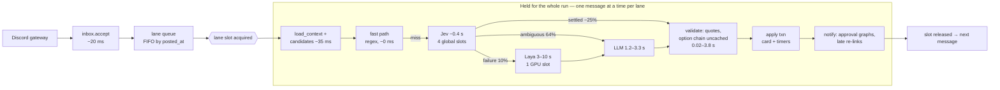

# Signal pipeline bottleneck report — 2026-10-12

Why do Discord signals turn into review cards, and why can't the system take a message to an
approvable card in under one second when traffic is high? This report answers from three sources.

| Source | What it gives |
|---|---|
| Live `trading` DB | `model_calls`, `stage_timings`, `inbox` for about 4,700 interpreted messages, including today's backfill flood |
| `trading_measure` DB | 510 human-labelled real messages (the label set reviewed 2026-10-08), used to check how well Jev's confidence matches reality |
| Current code | `backend/app/**`, read against `docs/prd.md`, `docs/trd.md` and `docs/diagrams/` |

Every number below has a query or a document reference in the appendix.

---

## 1. TL;DR

**The bottleneck is not raw model speed. It is how often a model is confident enough to settle a
message, combined with a pipeline that handles every unsettled message serially, inside a lock.**

- **Jev is fast but rarely decisive.** One call takes about 0.4 s (p50 390 ms, p99 708 ms). But
  Jev settles only about 25% of messages: 11% feed-only, 10% assembled, 4% fast path. It answers
  "ambiguous" on **64%**. On the labelled set, it is confident (≥ 0.9) on **only 26% of real
  trade signals**.
- **Most messages therefore take the slow path, which costs seconds, not milliseconds.**
  - LLM: DeepSeek p50 1.2 s, p90 2.5 s.
  - Laya, the local model: p50 2.8 s, up to 10 s, with a single GPU slot.
  - Since the LLM chain was configured, **75% of live messages** go to the slow path.
- **That time is spent while the lane lock is held** (one lane = one author in one channel).
  Jev, Laya, LLM, option-chain fetches and quote loops all run before the lane's next message can
  start. Live dequeue-to-card time is **p50 3.9 s, p90 5.5 s**.
- **Bursts hit a fixed ceiling.**
  - Jev runs through a 4-slot limiter, which tops out at about 8 calls/s (~500/min). Above that,
    calls give up after waiting 250 ms (`jev_queue_timeout`). They fall to Laya, which has one
    slot and answers `BUSY`, and then to review.
  - Backfill and catch-up share the lanes with live messages and have no lower priority.
  - Entries older than 30 s are dropped as stale, but only after paying for the full pipeline.

**Summary: sub-second is achievable today for about a quarter of messages. Getting most of the
rest under a second needs the code to settle more messages before any model is asked, and needs
the slow work moved out of the serial lane. A faster model on its own will not get there.**

### Five numbers

| | Value | Source |
|---|---|---|
| Messages Jev settles (feed-only + assembled + fast) | ~25% | `inbox.interpret_reasons`, n≈4,700 |
| Real trade signals Jev is ≥ 0.9 confident on | 26% (176 labelled) | `trading_measure` |
| Live messages to the slow path since the LLM was on | 75% (37/49) | `inbox`, after 14:00 UTC |
| Live dequeue → card | p50 3.9 s, p90 5.5 s | `stage_timings` |
| Jev throughput ceiling | ~8 calls/s (4 slots × ~0.4 s) | `model_calls` per minute, `llm/limiter.py:10` |

---

## 2. Targets vs reality

The TRD §2.3 stage budget (fast path ~1 s, slow path ~4 s, end-to-end p95 ≤ 5 s / p99 ≤ 8 s) is
measured against live, non-backfilled messages:

| Stage | TRD budget | Measured (live) | Verdict |
|---|---|---|---|
| Ingest + inbox commit | 20 ms | post → received p50 236 ms (Discord gateway included) | OK |
| Queue wait | p95 ≤ 1 s | p50 21 ms, p90 39 ms (live); **p90 206 s in the backfill flood** | OK live, fails in bursts |
| Context + candidates | 130 ms | p50 34 ms | OK |
| Jev call | ≤ 300 ms [VERIFY] | p50 390–433 ms, p90 572–709 ms; **no bench has met 300 ms** (F076: 0/510) | Over budget |
| LLM chain | ≤ 3,000 ms | DeepSeek p50 1.2 s, p90 2.5 s per call; graph stage 1.4–3.3 s | At the limit |
| Laya (fallback) | n/a | ok p50 2.8 s, p90 4.8 s, timeout 10 s; 305 `BUSY` | Unusable for latency |
| Validate + decide + apply | 550 ms | validate p50 21 ms, **p90 951 ms, max 3.8 s** (entries: quote + chain) | Tail over budget |
| **Total, fast path** | ~1 s | dequeue → card ~0.5 s when Jev settles | OK, but only ~25% of messages |
| **Total, slow path** | ~4 s | dequeue → card p50 3.9 s, p90 5.5 s, worst seen 6.1 s | Borderline; fails if a lane has a backlog |

The traffic itself is light. Live messages peaked at **9 per minute** in one lane against a
design burst of 50 in 10 s (PRD §12). The system is within SLO at today's live rate because live
traffic is sparse, not because the pipeline is fast. One busy author during a market move, or any
backfill or catch-up, pushes a lane past the 30 s staleness cutoff.

---

## 3. How a message flows, and where time goes



Two facts from the code drive everything else:

1. **One lane, one message at a time, and the slot covers network I/O**
   (`dispatcher/service.py:63,214-224`). Diagram 10 says so directly: "parallel interpret with
   serial apply is not implemented. A slow model call holds that lane and no other." The TRD's own
   §2.3 example notes the third message in a slow-path burst waits about 8 s.
2. **Staleness and card validity are measured from the post time** (`dispatcher/classify.py:23`,
   `decide/engine.py:218-222`). Every second a message waits in its lane comes off the user's
   decision window. After `stale_entry_s` = 30 s an entry is dropped.

---

## 4. Bottleneck 1 — Jev confidence (the root cause)

### 4.1 What the router asks of Jev

`interpret/route.py:36-60` settles a message only if all of these hold:

- the msg_type confidence clears `t_type` (0.8) for trade types, or `t_chat` (0.9) for feed types;
- `signal_count` is not "multiple";
- **every** field answer the mapper uses clears `t_field` (0.8), including every `role_nN` for every
  number in the text (`jev/mapping.py:186-187,246-251`);
- no feed guard, condition, correction or missing-required-field reason applies.

One Jev request holds about 20 questions: 15 fixed, plus one per number found, plus `links_to`
(`jev/questions.py:73-74,144-149`). The message must clear every gate on every question. Even if
each answer were 95% likely to clear its gate on its own, all 20 together clear only about 36% of
the time (0.95²⁰). This weakest-link design is why "ambiguous" dominates.

### 4.2 What Jev actually says

Routing over about 4,700 interpreted messages (live plus backfill):

| Route | Share |
|---|---|
| `slow_path` / Jev ambiguous | **64%** |
| `slow_path` / Jev model failure (timeout, queue_timeout) | 10% |
| `feed_only` (Jev success) | 11% |
| `assemble` (Jev success) | 10% |
| `fast` (regex, no model) | 4% |

Top reasons a message was not settled:

| Reason | Count |
|---|---|
| `msg_type: below t_type` | 1,053 |
| `instrument: confidence < t_field` | 545 |
| `msg_type: below t_chat` | 538 |
| `jev_queue_timeout` | 400 |
| `role_nN: confidence < t_field` | 367 |
| `exit_fraction: confidence < t_field` | 284 |
| feed_guard (all variants) | ~400 |
| `right` / `strike` required but not stated | ~240 |
| `jev_timeout` | 73 |
| `signal_count: multiple` | 63 |

### 4.3 Is the threshold too strict, or is Jev unsure?

Mostly Jev is unsure, and it is right to be. Jev's msg_type answer was compared with the human
label on the 510 labelled messages:

| Jev msg_type confidence | Messages | Correct |
|---|---|---|
| < 0.60 | 178 (35%) | 38% |
| 0.60–0.80 | 99 (19%) | 54% |
| 0.80–0.90 | 48 (9%) | 65% |
| 0.90–0.95 | 38 (7%) | 74% |
| ≥ 0.95 | 147 (29%) | 92.5% |

- **Confidence tracks accuracy well**, so the gates are doing their job. Lowering `t_type` to
  0.6 would let through messages Jev labels wrongly about half the time.
- **More than half of all messages fall below 0.8.** No threshold setting gives both speed and
  safety. The model's capacity on this provider's writing style is the limit.
- **Real trade signals are harder than chatter.** On the 176 actionable messages, Jev is ≥ 0.9 on
  only **26%** and both confident and correct on **24%**. Earlier reviews agree:
  - `jev-hardening-2026-10.md`: precision 1.0, recall 14.9%, review rate 73%.
  - `jev-performance-2026-09-30.md`: confidence ≥ 0.9 is right 88% of the time.
- **Most mistakes are between non-actionable neighbours:** commentary_pnl→chatter 35,
  watch→chatter 26, commentary_pnl→tp_set 14, commentary_pnl→tp_hit_notice 9. The 18-class
  taxonomy spends Jev's confidence on distinctions that never become an order.

### 4.4 Inputs that make Jev's job harder

- **Ticker candidates are mostly ordinary words.** In a recent request the ticker candidates were
  `s, while, can, t, even, catch, trade, right, Money, your, done, range`. That averages 3.5 per
  message (p90 8), and each one is an option Jev must reject. Numbers reach **65** candidates on a
  single message, and each adds a `role_nN` question that must clear 0.8.
- **Requests are large.** A Jev request averages **5.4k input tokens** (5.9k characters of state).
  That is larger than the message text needs.
- **The fast path is regex over the whole message** (`interpret/fast.py:88-98`). Any newline, any
  extra word, an entry with no price, the "Entry / SL / TP1" layout, or "1350/con" is a miss. It
  settles 4%.

---

## 5. Bottleneck 2 — the slow path is seconds long and runs inside the lane

| Fallback | When | Latency | Concurrency | Accuracy |
|---|---|---|---|---|
| LLM `extract` (DeepSeek → gpt-5-nano) | Jev semantic doubt; after Laya | p50 1.2 s, p90 2.5 s per call; stage 1.4–3.3 s; deadline now 8 s | limiter of 4 per provider, **shared with the NoteWriter** (`main.py:146,380`) | rescued 14 of 37 live slow-path messages today |
| Laya (local MLX) | only after a Jev model failure | ok p50 2.8 s, p90 4.8 s, timeout 10 s | **`Semaphore(1)`**, `BUSY` if taken (`laya/client.py:75-76,143-151`) | 27% msg_type accuracy (`laya-evaluation-2026-09-30.md`) |

- The LLM agent may make up to 2 tool calls per attempt (`llm_extract/agent.py:34`), and those
  tools fetch market data, so one "attempt" can be several round trips.
- Laya is the wrong fallback for latency. It is slower than the LLM and less accurate than Jev, and
  it holds the lane for up to 10 s. Under load it answers `BUSY`, which hands the message to the
  LLM after a wasted step.
- Before the LLM chain was configured this morning, every message with no draft ended as a raw
  review card (`message_graph.py:418-432`). That is why every card showed only "Dismiss".

---

## 6. Bottleneck 3 — burst capacity

### 6.1 Jev limiter ceiling

- Jev runs through a process-wide limiter with **4 slots** (`llm/limiter.py:10-24`), sized at boot.
- With about 0.4 s per call, that caps out near **8 calls/s**. Measured peak minutes: 526, 484,
  465, 433 calls/min, with 97, 18, 70 and 79 queue timeouts respectively.
- A call waits at most `queue_timeout_ms` = 250 ms for a slot, then counts as a model failure and
  goes to Laya (`jev/client.py:292-295`).
- The single retry (only on 429/529) needs 1,050 ms of a 1,200 ms budget. It can only happen if
  the first attempt failed within about 150 ms, so it almost never runs (`jev/client.py:274-276`).
- Even at low traffic, **11 of about 100 live calls hit the 700 ms timeout**. The vendor's tail
  (p99 708 ms, earlier max 7.8 s) sits right on the cutoff.

### 6.2 Lanes are strictly serial; backfill and catch-up are not deprioritised

- **No priority for old messages.** Backfilled events go into the same `inbox` lanes, ordered by
  `posted_at`, so older history always runs first (`ingest/gaps.py:100`,
  `inbox/repo.py:109-135`).
- **The `catch_up` flag only reports.** It changes no processing (`feed_health.py`;
  `catch_up_backlog_n` defaults to None).
- **Stale entries still pay full price.** They run interpretation, validation and risk, and are
  dropped only at the end (`decide/risk.py:21-22`).
- **Late events cost extra inside the slot.** They trigger `relink.recheck_after_late`, which
  re-runs interpretation for later follow-ups (`ledger/relink.py:73-99`). Backfill produces
  exactly these events.
- **A `BookChanged` conflict re-runs everything.** It is not retried in place: it re-runs the
  whole graph and counts toward the poison limit (`pipeline/apply.py:113-115`).
- **Startup backfill runs before the Discord listener logs in.** It waits 10 s per channel, fails,
  and the backlog lands all at once on the 60 s periodic run (`main.py:390-432`).

### 6.3 Pools

- DB pool is 10 (+10 overflow) and the checkpoint pool is 5 (`config.py:25`,
  `graph/checkpointer.py:29`).
- Approval graph starts are serial per card, with `durability="sync"`, inside the lane slot
  (`cards/approval_service.py:186-206`).
- These are fine today and will cap lane parallelism as providers grow.

---

## 7. Bottleneck 4 — market data on the critical path

- **The option chain is not cached.** Every option entry pulls the full expiry snapshot, 1,000
  rows per page, with a 10 s httpx timeout per page and no stage budget
  (`validate/service.py:128`, `marketdata/alpaca.py:28,70-89`).
- **The risk snapshot fetches one quote per open lot, one after another**
  (`decide/risk_snapshot.py:59-67`). It does not depend on validation but runs after it.
- **Measured effect:** validation p50 21 ms, but p90 951 ms and a worst live case of **3.8 s**
  ("Two dumb lottos… AMD 0dte 595": Jev 0.4 s, LLM 1.8 s, validate 3.8 s, total 6.1 s).

---

## 8. Contributing issues

- **Stage timing gaps.** There is no start mark for Jev or Laya, and the raw-review path records
  no `card` stage (`pipeline/apply.py:425`), so review-card latency is invisible in
  `stage_timings`.
- **Many small commits.** Each `_stage()` call and each `model_calls` attempt is its own
  transaction: about 4–6 extra commits per message.
- **Config drift between documents.** The TRD says `t_field` 0.8 / `t_chat` 0.9. The diagrams say
  Laya runs only on model failure; the TRD's ASCII graph says it runs on Jev being unsure. The
  README says Laya is off by default; the PRD says it is the default fallback.
  `docs/reviews/jev-hardening-2026-10.md` is the current truth for Jev.

---

## 9. Incident timeline — 2026-10-12

| UTC | Event |
|---|---|
| 13:34 | Two channels added (`797685616401580042`, `1079801072945737768`). The gap detector has no stored message for them, so it pages `after=None`: **full history from 2021**, about 15k events. |
| 13:35–13:43 | Jev runs at its ceiling: 433–526 calls/min, 18–97 queue timeouts per minute. These go to Laya (1 slot, 305 `BUSY`). With no LLM configured, they become raw review. |
| 13:35 | A live "162.5c at .90 my fill" queues behind the flood and hits `jev_queue_timeout`, ending as a raw review card. |
| by 13:45 | About 2,300 cards. 1,066 are pending raw-review cards with no `valid_until`, Dismiss only, pending forever. 12.5k events are still queued. |
| afternoon | Fixed: a fresh channel now starts at `now − 8 h`; a stale raw review produces no card; unreadable cards get Reject + Approve (manual entry). Cleanup marked 12,956 queued events stale and expired 1,434 cards. The LLM chain was configured (DeepSeek → gpt-5-nano). |
| 14:00–18:00 | Live: 75% slow path, LLM rescued 14 of 37, dequeue → card p50 3.9 s. |

---

## 10. Ranked fixes

Ordered by expected impact on "under 1 s for most messages", then by effort. None of these is
built.

| # | Fix | Attacks | Expected impact | Effort |
|---|---|---|---|---|
| 1 | **Gate only the fields the msg_type needs.** Today every `role_nN` and side question must clear `t_field` even when the decision never reads it. Gate msg_type, then only the required fields for that type (`REQUIRED`, `mapping.py:54-59`). | §4.1 weakest-link | Large cut in "ambiguous" with the same safety: the gated answers are the ones that become an order | S–M |
| 2 | **Clean the candidates before Jev.** Ticker candidates from a known-symbol list (the optionable list is already cached 24 h in `validate/service.py`) plus `$TICK` / all-caps patterns; drop number candidates inside URLs, mentions and dates; cap the `role_nN` count. | §4.4 | Fewer and easier questions, smaller requests (5.4k tokens), fewer `role`/`instrument` doubts | S |
| 3 | **Widen the deterministic fast path.** Line-wise parsing (the "Entry / SL / TP1" layout), entries without a price, `N/con`, percent-trim phrases, provider lexicon terms. Settle feed-only for messages with no ticker/strike/price candidates and no action words. | §4.4, §4.2 | Fast path from 4% toward 20–30%; ~0 ms and no model | M |
| 4 | **Parallel interpret, serial apply (OD-19 / R1).** Run context through interpretation outside the lane slot (bounded per lane); take the slot only for plan + apply in `posted_at` order, with the existing `BookChanged` check. | §3, §6.2 | Lane latency no longer adds up: a burst of 5 slow-path messages costs ~3 s, not ~15 s | M–L |
| 5 | **Treat backlog differently.** Classify staleness before interpretation (stale entry/add means no Jev or LLM); run backfill and catch-up in a low-priority lane behind live messages; batch late re-links after the lane drains; start the listener before the startup backfill. | §6.2 | Floods like today's can no longer starve live messages or burn model capacity | S–M |
| 6 | **Take market data off the critical path.** Cache the option chain per (underlying, expiry) for 30–60 s; fetch risk-snapshot quotes in parallel and alongside validation; give validation a per-stage budget (e.g. 800 ms, then a review card saying data is late). | §7 | Removes the 1–4 s validation tail on entries | S |
| 7 | **Tune Jev capacity.** Raise the `typesafe` limiter to match the vendor's actual rate limit (ask TypeSafe; TRD §7.4 [VERIFY]); move the `timeout_ms` cutoff off the p99 (700 → 900 ms) or hedge with a second request at p95; make the limiter size adjustable at runtime. | §6.1 | Ends burst queue timeouts and the ~10% timeout rate | S |
| 8 | **Drop Laya from the live path, or limit it to off-hours.** Measured 27% accurate, 3–10 s, one slot. Send model failures straight to the LLM. | §5 | Removes up to 10 s of lane blocking and the `BUSY` churn | S |
| 9 | **Make the LLM path one shot.** Direct structured extraction with no tool loop (pass the context the tools would fetch); a dedicated limiter separate from the NoteWriter; a small fast model first with a stricter deadline (~1.5 s). | §5 | Slow path from 1.4–3.3 s toward ~1 s | M |
| 10 | **Collapse the taxonomy for gating.** Gate on actionable vs feed-only first, and let commentary_pnl / chatter / watch / tp_hit_notice share one feed-only bucket for the confidence check. | §4.3 | Recovers most non-actionable doubt (the top confusion pairs) | S–M |
| 11 | **Fill observability gaps.** Start marks for Jev/Laya/LLM, a `card` stage on raw review, and one `stage_timings` write per message. | §8 | Lets each fix be measured | S |

**Suggested order:** first 2 + 1 + 5 + 6 + 7 (all small or medium, and they attack the root
cause and the burst failure mode), then 3, then 4 if load test 3 still fails (the trigger
OD-19 already sets).

Re-measure after each step with the F082 replay on the labelled corpus. Watch:

- review rate (73% baseline);
- wrong links / false feed-only (must stay 0);
- dequeue → card p50/p90 on live messages.

---

## Appendix A — queries

All against `trading` unless marked `trading_measure`. Run with
`docker exec trading-agent-postgres-1 psql -U postgres -d <db> -c "..."`.

```sql
-- model latency by outcome
select provider, model, role, outcome, count(*),
  percentile_cont(0.5) within group (order by latency_ms) p50,
  percentile_cont(0.9) within group (order by latency_ms) p90,
  percentile_cont(0.99) within group (order by latency_ms) p99
from model_calls where eval_run_id is null group by 1,2,3,4 order by 5 desc;

-- Jev calls per minute and queue timeouts (throughput ceiling)
select date_trunc('minute', started_at) mn, count(*) calls,
  count(*) filter (where outcome='queue_timeout') qto
from model_calls where provider='typesafe' group by 1 order by 2 desc limit 6;

-- route mix
select interpret_reasons->>'route', interpret_reasons->>'jev', interpret_reasons->>'llm', count(*)
from inbox where interpret_reasons is not null group by 1,2,3 order by 4 desc;

-- top doubt reasons
select regexp_replace(r, '[0-9.]+', 'N', 'g') reason, count(*)
from inbox, jsonb_array_elements_text(interpret_reasons->'reasons') r
where interpret_reasons ? 'reasons' group by 1 order by 2 desc limit 25;

-- live stage timings (dequeue -> card), see section 2
-- (stage_timings joined to message_events where not backfilled; deltas between stage rows)

-- trading_measure: msg_type accuracy by Jev confidence
with lab as (select distinct on (message_id) message_id, label->'signals'->0->>'msg_type' truth
             from eval_labels order by message_id, labeled_at desc),
jev as (select distinct on (message_id) message_id, response->'msg_type'->>'choice' guess,
          (response->'msg_type'->>'confidence')::numeric conf
        from model_calls where provider='typesafe' and outcome='ok' and response ? 'msg_type'
        order by message_id, id desc)
select case when conf>=0.95 then '>=0.95' when conf>=0.9 then '0.90-0.95'
            when conf>=0.8 then '0.80-0.90' when conf>=0.6 then '0.60-0.80' else '<0.60' end,
       count(*), round(100.0*avg((guess=truth)::int),1)
from lab join jev using (message_id) group by 1 order by 1;
```

## Appendix B — references

- `docs/trd.md` §2.3 (stage budget, load), §2.4 (lanes), §4.4 (thresholds), §4.8 (LLM deadlines), §7.4 (Jev vendor unknowns)
- `docs/prd.md` §12 (SLO, traffic), §21 R1
- `docs/diagrams/10-architecture-summary.md` (no parallel interpret), `13-layers.md`, `14-jev.md`
- `docs/reviews/jev-hardening-2026-10.md`, `jev-performance-2026-09-30.md`, `laya-evaluation-2026-09-30.md`, `load-2026-10-03.md`
- `docs/implementation/F076-concurrency-replay-scenario.md`, `F078-interpretation-outcomes.md`, `F074-laya-latency.md`
